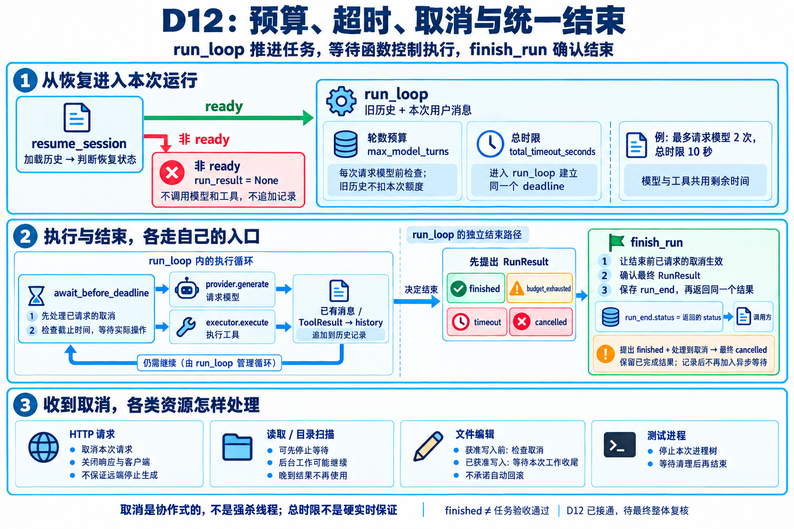

# Pi 学习与 Python 实现

通过阅读 Pi 的官方资料和源码，理解单 agent 的执行循环、工具调用、会话管理和上下文管理，再使用 Python 完成一个简化的 Mini-Pi，并加入 reviewer 子 agent。

学习路线和当前进度见 [Pi 阅读与 Python 实现路线](local-learning/pi-learning-roadmap.md)。其中包含 30 个步骤、每步的动作与验收标准，以及学习记录和第一版交付清单。

当前主线已完成 D01–D14（14/30），M1 单 Agent 可用首版通过：真实qwen3.8-flash在隔离副本完成折扣修复，固定测试及独立复验5项全通过；Python3.14.5全量400项中398通过、2项Windows符号链接权限跳过。详情见[D14验收摘要](local-learning/d14-acceptance-summary.md)。有指导复盘完成，不宣称任意项目可自动修复；上下文压缩、reviewer及v0.1完整交付尚未完成。

## 本地验证 D05

在项目根目录执行，当前已使用 Python 3.14.5 验证，代码仅依赖标准库：

```sh
python -X utf8 -m unittest tests.test_read_file -v
python -X utf8 -m examples.d05_read_file
```

示例生成临时文件，实际调用读取工具，将三种结果保存到本地 `local-learning/evidence/d05-read-file-results.json`。原始结果保持 Git 忽略；它不是模型调用或折扣修复的成功证据。

## 本地验证 D06

在项目根目录执行：

```sh
python -X utf8 -m unittest tests.test_loop tests.test_read_file -v
python -X utf8 -m examples.d06_loop
```

已验证 5 项循环测试和 5 项读取工具测试，共 10 项通过。示例使用预设的模型响应，实际运行核心循环并读取临时文件；第二次请求包含用户消息、assistant 调用请求和匹配的工具结果，最终历史为 4 条。运行状态为 `finished`，`task_passed=None`，未验证折扣修复。

执行轨迹保存在本地 `local-learning/evidence/d06-loop-trace.json`，测试输出保存在 `local-learning/evidence/d06-test-results.txt`，两者保持 Git 忽略。核心循环由用户根据给出的代码分段手敲，最后按用户授权由助手修正缩进和参数名；模拟模型、测试和示例由助手准备。后续协作遵循 [学习协作规则](AGENTS.md)。

若 Windows 中的 `python` 指向未能启动解释器的 `WindowsApps` 入口，可在 PowerShell 中直接调用实际安装的 Python。当前设备已验证以下命令：

```powershell
& 'C:\Users\hyf\AppData\Local\Python\pythoncore-3.14-64\python.exe' -X utf8 -m examples.d06_loop
```

该路径只适用于当前设备；其他设备需使用自己的解释器路径。

## 本地验证 D07

D07 的核心转换函数在 `mini_pi/qwen_provider.py`，真实模型适配器在 `mini_pi/qwen_client.py`。核心逻辑由用户根据助手给出的代码分段手敲；HTTP、配置、记录、测试与示例由助手准备，个别错误按用户明确授权修正。

在项目根目录运行离线测试，不请求模型服务：

```sh
python -X utf8 -m unittest tests.test_qwen_provider tests.test_qwen_transport tests.test_loop tests.test_read_file -v
```

35 项通过：D07 转换 17 项、发送与适配器 8 项、D06 循环 5 项、D05 读取工具 5 项。网络入口在测试中模拟，测试中的 usage 是样例数据，真实 usage 另见下方运行摘要。

真实示例读取临时文件，使用文件中的随机标记检查最终回答是否接收了读取结果。密钥通过 `DASHSCOPE_API_KEY` 读取；可用 `DASHSCOPE_BASE_URL` 和 `QWEN_MODEL` 修改接口与模型，默认采用百炼北京地域的 OpenAI 兼容接口及 `qwen3.8-flash`。

先在本地配置环境变量。PowerShell 可使用隐藏输入，变量只在当前窗口及其子进程中生效：

```powershell
$taskSecret = Read-Host "输入 API Key" -AsSecureString
$env:DASHSCOPE_API_KEY = [System.Net.NetworkCredential]::new("", $taskSecret).Password
$taskSecret.Dispose()
Remove-Variable taskSecret
```

只检查本地配置，不验证服务权限或发送请求：

```sh
python -X utf8 -m examples.d07_qwen --check-config
```

下面的命令实际调用服务并消耗额度。示例配置最多 4 次请求、每次 `max_completion_tokens=1024`、HTTP 超时 30 秒，不自动重试：

```sh
python -X utf8 -m examples.d07_qwen --live
```

Windows 当前设备若遇到 `python` 入口问题，使用前面记录的真实解释器路径，并保留 `-X utf8 -m examples.d07_qwen` 和对应模式参数。必须在项目根目录运行，不能在 `mini_pi` 子目录运行模块命令。

2026-10-12 实际验证：服务返回模型 `qwen3.8-flash`，共 3 次请求、2 次文件读取，耗时约 12.10 秒。供应商 usage 合计输入 1,314、输出 232、总计 1,546 tokens；调用 ID 配对及工具结果回传均通过，最终解释包含文件中的随机标记。正常结束时 `task_passed=None`；D07 接入验收结论由记录和人工解释核对得出，不自动修改该字段。

原始轨迹和测试输出保持 Git 忽略，保存在 `local-learning/evidence/`。示例会打印本次唯一的轨迹路径；源码和学习记录不保存密钥。自动检查不证明折扣修复正确，也不证明完整的取消、会话与预算控制已经实现。

接口格式对照 [百炼 Chat API](https://help.aliyun.com/zh/model-studio/qwen-api-via-openai-chat-completions/) 与 [Function Calling 文档](https://help.aliyun.com/zh/model-studio/qwen-function-calling)。

## 本地验证 D08

D08 在 `mini_pi/tools/edit_file.py`、`edit_policy.py` 和 `edit_executor.py` 中实现受约束的文件编辑；[学习记录](local-learning/pi-learning-roadmap.md#第八次学习记录) 和 [执行图](pic/day8-edit-flow.png) 展示从 `ToolCall` 到实际读写、差异反馈的过程。在项目根目录运行：

```sh
python -X utf8 -m unittest discover -s tests -p "test_edit_*.py"
python -X utf8 -m examples.d08_edit_trace
```

当前设备的 Windows `python` 入口如不能启动，使用上文记录的实际解释器路径。Windows 下 48 项测试有 46 项通过，2 项因 WinError 1314 无法创建符号链接而跳过；在 Ubuntu WSL 的同一份工作区代码上 48 项全部通过，包括两项真实符号链接越界拒绝。示例构造 `ToolCall` 并真实修改临时文件，结果含差异和原调用 ID；不调用模型服务，也不判断折扣业务测试通过。原始输出保留在本地忽略目录 `local-learning/evidence/`。

## 本地验证 D09

D09 新增 `ToolRouter`、`list_files` 和 `run_tests`，复用已有读取、编辑工具。测试命令由程序固定；结果区分测试失败、超时和启动失败，截断时给出完整日志位置。实现与用户/助手分工见[学习记录](local-learning/pi-learning-roadmap.md#第九次学习记录)，流程见[心智图](pic/day9-tools-flow.png)。

在项目根目录运行，不请求模型服务：

```sh
python -X utf8 -m unittest tests.test_run_tests tests.test_list_files tests.test_tool_router -v
python -X utf8 -m examples.d09_tools
```

13 项针对性测试通过。联调示例在 `local-learning/evidence/d09-<运行ID>/workspace/` 内创建演示项目，记录四工具的成功和失败结果，并实际测试折扣公式修改前失败、修改后通过；示例调用顺序预先安排，不能证明模型能自主修复。完整轨迹和测试输出保留在本地忽略目录，重复运行会生成新的证据目录。

## 本地验证 D10

`SessionStore` 在 `mini_pi/session_store.py` 中保存线性 JSONL；给 `run_loop` 传入可选的 `session_store` 后，初始消息、模型响应、工具结果和正常结束状态逐条追加。运行 ID 和时间戳位于记录外层，实际消息或结果位于 `data`。实现分工与验收边界见[第十次学习记录](local-learning/pi-learning-roadmap.md#第十次学习记录)，两条保存路径见[心智图](pic/day10-session-flow.png)。

在项目根目录运行，不请求模型服务：

```sh
python -X utf8 -m unittest tests.test_loop_session tests.test_session_store tests.test_loop -v
python -X utf8 -m examples.d10_session
```

11 项相关测试通过。示例使用模拟模型和实际读取工具，生成 `local-learning/evidence/d10-<运行ID>/session.jsonl` 与 `summary.json`，正常退出后可重新读取；原始记录保持 Git 忽略。示例含六条记录，最终 `history` 为四项；运行开始和结束事件不作为模型消息。D10 实现保存，不实现加载继续运行、未完成写操作核对或异常恢复。

## 本地验证 D11

`SessionStore.load` 还原统一对象，`find_pending_calls` 按运行 ID 和调用 ID 找出缺少配对结果的调用，`plan_recovery` 判断恢复状态；[resume_session](mini_pi/session_resume.py) 在进入循环前执行门禁。核心逻辑由用户分段手敲，容器、接口、测试和示例由助手准备，详见[第十一次学习记录](local-learning/pi-learning-roadmap.md#第十一次学习记录)。

```sh
python -X utf8 -m unittest tests.test_session_resume_gate tests.test_recovery_policy tests.test_session_recovery tests.test_session_restore tests.test_session_resume tests.test_loop_session tests.test_session_store tests.test_loop -v
python -X utf8 -m examples.d11_resume_demo
```

34 项相关测试通过，无跳过。示例在独立的 `local-learning/evidence/d11-resume-<运行ID>/` 中保存三场景的恢复前后记录：正常继续使用两个独立进程；读取或编辑中断通过真实执行后故意不保存结果来模拟。非 `ready` 时模型与工具零调用、没有新记录；编辑已实际发生但结果未落盘时停在 `needs_review`。示例使用模拟模型，不请求真实模型服务、不运行业务测试；进程结束与任务验收仍分别判断。

## 本地验证 D12（已完成：2026-10-16）

恢复学习先读 [Mini-Pi 学习对齐与 D12 整体复盘](local-learning/pi-mini-pi-learning-alignment.md)：对照完整行为图和正常/写前取消/写中取消轨迹。编辑晚写、HTTP 取消、工具启动前取消和目录扫描均已在受控边界修复并验证，恢复入口预算也已接通；路径解析等同步工作不在硬实时保证内，D12 保持进行中，待整体验收与理解复盘。

目前已验证模型轮数预算、模型与模拟异步工具的总时限和主动取消，以及真实固定测试进程的停止与清理。执行控制核心由用户分段手敲，模型与工具的取消分支按用户明确授权由助手插入；进程管理辅助层、测试和演示由助手准备。完整范围见[学习路线 D12](local-learning/pi-learning-roadmap.md#d12-实现预算-超时和取消)。

```sh
python -m pip install -r requirements.txt
python -X utf8 -m unittest tests.test_loop_budget tests.test_run_deadline tests.test_loop_timeout tests.test_loop_cancel tests.test_run_tests tests.test_process_cleanup -v
python -X utf8 -m unittest tests.test_thread_worker -v
python -X utf8 -m unittest tests.test_async_http_transport tests.test_qwen_cancel tests.test_qwen_transport tests.test_qwen_provider -v
python -X utf8 -m unittest tests.test_edit_cancel tests.test_edit_cancel_points tests.test_edit_write tests.test_edit_execute -v
python -X utf8 -m examples.d12_control_demo
```

第一组 D12 与测试工具共 30 项，加上线程与 Qwen 适配器的 32 项和 D11 的 34 项，合并的 96 项相关测试曾在 Windows 实际通过，无跳过。控制演示生成 `local-learning/evidence/d12-control-<运行ID>/`，保存三种停止状态、会话、进程 PID 与清理证据；使用模拟模型，不请求真实服务。预算演示命令只打印退出，不能据此声称业务测试通过。后续诊断确认 HTTP 取消仍依赖同步线程自然结束：0.05 秒预算约 0.305 秒才返回。旧测试证明了收尾，不足以证明按时间预算退出，HTTP 部分待整改，D12 保持进行中；详见路线中的 D12-01。阶段提交保存当前实现与已知缺口，不代表 D12 验收完成。

2026-10-15 编辑取消整改：用户手敲同步检查点与异步接线，助手准备共享标记、线程通知与收尾辅助层及测试，并按授权修正类名拼写。编辑相关 18 项、线程辅助 8 项、Qwen 相关 28 项，共 54 项实际通过，无跳过。写前取消阻止写入，受控分段写入中取消则完成本次文件工作后返回，超时同样通知并等待收尾；记录与真实文件、线程状态一并核对。本轮没有请求真实模型服务，HTTP 原缺口仍未修复；详细日志和范围见学习路线。只读工具的取消已补核固定 Pi 源码，其边界与写入不同，不能把编辑收尾要求当作所有工具的原始保证。

HTTP 取消已接通磁盘代码并验收：用户手敲 `_send` 的异步调用，函数名拼写按授权修正。11 项异步 HTTP、4 项真实 HTTPS 的 Qwen/循环流程、8 项发送回归及 17 项转换，共 40 项实际通过，无跳过。正常返回 finished、主动取消返回 cancelled、总时限到达返回 timeout；取消和超时场景都核对服务端实际断开、客户端/响应关闭、无重试与后续工具调用。日志见学习路线。本轮不再使用内存替换核心方法，测试仅使用公开本地合成证书与测试占位凭证，不访问模型服务。每请求独立客户端带来额外建连开销；初始化、系统 DNS、硬实时停止不在本轮已验证保证内，普通模型错误的统一终态仍待 D13。

工具启动前处理取消已修复：学习者在统一等待入口手敲 `await asyncio.sleep(0)`，使已请求的取消在调用 operation 前生效。原 3 条失败反例均通过，正常对照仍启动工具并回传结果；连同等待、循环、会话、编辑、读取及本地 HTTPS 相关回归共 49 项实际通过，无跳过，测试前后相关源文件哈希一致。助手按既有授权恢复编辑器类名拼写和缺失导入，旧内容回写来源未确定；本轮没有新增其他核心逻辑，具体证据见学习路线 D12-04。

目录扫描取消（D12-05）已由学习者手敲修复：collect_names 负责扫描与逐项目录判断，execute 将函数及目录参数交给 to_thread。此前 4 条失败反例全部通过，目录、启动前取消与等待入口共 19 项实际通过，0 失败、0 错误、0 跳过。扫描暂停时主流程可先返回 cancelled/timeout，晚到结果不进入历史、不启动下一工具；正常输出、排序及截断保持正确。路径解析仍同步，本轮不声称所有文件系统操作均已移出事件循环。恢复预算现已接入，见下条最新验收；D12 保持进行中，目录证据见学习路线 D12-05。

## 跨设备继续学习

远程仓库为 [bakeyliao-boop/Mini-Pi](https://github.com/bakeyliao-boop/Mini-Pi)。首次在其他设备使用时：

```sh
git clone https://github.com/bakeyliao-boop/Mini-Pi.git
cd Mini-Pi
```

在其他设备克隆本仓库后，打开阅读文件的“当前进度与下一步”。每次开始学习前执行 `git pull --ff-only`，结束后提交阅读文件与本次代码改动，再执行 `git push`。

遇到远程进度更新或冲突时，先核对两台设备的学习记录，再合并内容，保留双方实际完成的动作与证据。

阅读路线和学习进度随仓库同步。`local-learning/evidence/` 中的原始执行记录、模型输出，以及 `.env` 等凭证文件由 `.gitignore` 排除，仅保存在本地。

## 上游项目

- [Pi 源码](https://github.com/earendil-works/pi)
- [How Pi Works](https://pi.dev/docs/latest/how-pi-works)

本项目是围绕 Pi 的学习与 Python 简化实现，具体设计借鉴和实现边界会随学习记录更新。

恢复入口预算（D12-03）最新验收：学习者已将两个参数传给 run_loop，恢复预算和既有两入口相关 22 项测试全部通过，无跳过。旧历史不预扣本次额度，模型与工具共用 deadline，非 ready 零执行、零追加；D12 仍待整体验收与理解复盘。证据见学习路线。

D12 整体验收最新结论（2026-10-15）：尚未通过。当前原有 198 项中 196 通过、2 项因 Windows 符号链接权限跳过；另新增 2 条结束前取消反例均失败，发现 run_end 记录为 finished/budget_exhausted 而调用方收到取消异常的不一致。核心未在本轮修改，新增 D12-06，先统一结束判定与取消结算，再验收，不进入 D13。详情见学习路线最新记录。

D12-06 最新进展（2026-10-16）：用户授权后，助手补齐剩余模型超时、模型取消与工具超时三处接线；当前六条结束路径均调用 finish_run。73 项相关回归全部通过，无失败、错误或跳过，核心文件测试前后哈希一致。此前结束前取消的两条失败反例现均通过，D12 仍待最终整体复核与理解回顾，未提交或推送；证据见学习路线最新记录。

D12 最终技术复核（2026-10-16）：完整测试 207 项，205 通过、2 条旧 D08 符号链接用例因 Windows 权限跳过，无失败或错误；预算、总时限、取消三场景真实进程演示均通过，全部核心 Python 文件哈希保持一致。当前阶段技术验收通过既定受控范围，理解回顾待用户讨论，D12 仍进行中、未自动进入 D13；完整证据见学习路线最新记录。

D12 已完成归档（2026-10-16）：技术验收及用户本次理解回顾均已记录，当前进度 12/30，进入 D13-A。timeout 不能证明文件未改或没有重复修改；对于已经开始写入的本次编辑，它表示工作先收尾再报告超时。D13-A 先解决普通模型错误的统一结束状态，以及长度截断调用零执行、逐 ID 错误反馈和完整重试。本轮只更新记录与解释，未实现 D13 功能，未提交或推送。

### D12 学习图



[完整生成提示词](pic/day12-execution-control.prompt.txt)。图为接线完成时的学习快照；底部“待最终整体复核”是绘图时状态。最终复核及理解回顾已完成，当前先提交推送 D12，再开始 D13，最新验收边界和执行证据见学习路线。

## D13 统一入口与 CLI

在项目根目录运行；请使用已配置 `requirements.txt` 的 Python 3.14.5。默认 `mock` 不请求云模型、不执行实际任务验收：

```powershell
python -X utf8 -m mini_pi "检查当前项目" --session local-learning/evidence/cli-demo.jsonl --workdir .
python -X utf8 -m mini_pi "继续检查" --session local-learning/evidence/cli-demo.jsonl --workdir . --resume
python -X utf8 -m mini_pi --help
```

首条命令须使用不存在的会话文件；已有路径显式使用 `--resume`，且恢复门禁为 `ready` 才能继续。每次运行使用新的 `run_id`，旧历史不重复追加。`--allow-file` 可重复指定允许编辑的相对文件；默认空清单不允许编辑。`--test-command-json` 配置程序固定的测试命令数组，模型不能替换命令；默认是当前解释器执行 `-m unittest discover -s tests`。默认轮数上限为 4、总时限为 60 秒，可通过 `--max-model-turns` 和 `--total-timeout` 调整。

只有显式选择 `--provider qwen` 才使用真实模型，密钥仍由既有 `DASHSCOPE_API_KEY` 环境变量提供；该选择会产生真实模型请求，本次 D13 验收未运行付费任务。`ContextProvider` 每次请求使用历史深拷贝，默认保留全量消息，实际筛选/裁剪尚未实现。

终端输出 JSON，包含 `status`、绝对 `session_path`、`task_passed` 和 `error`；`task_passed: null` 表示尚无任务验收结论。退出码：正常结束 0、运行错误或明确验收失败 1、参数/配置/文件错误 2、预算耗尽 3、恢复受阻 4、超时 124、取消 130。中断请求 Agent 取消，等待资源和结束回调收尾后退出；重复 SIGINT 不跳过该等待。

本次验证覆盖模拟模型、真实受控文件/进程/本地请求及 Python SIGINT；未把模拟输出、进程退出 0 或 `finished` 当作真实自主修复验收。

## D14 单 Agent 验收

[验收范围、六轮真实轨迹、运行方式和证据边界](local-learning/d14-acceptance-summary.md)。默认准备和离线排演不调用云模型；显式live运行需要付费授权与进程级密钥配置。原始证据与凭证保持本地忽略。
