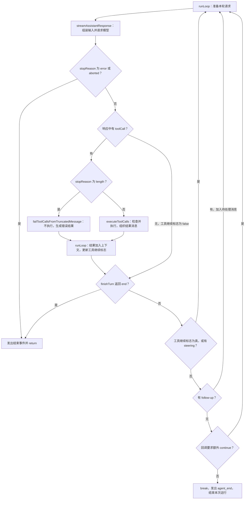
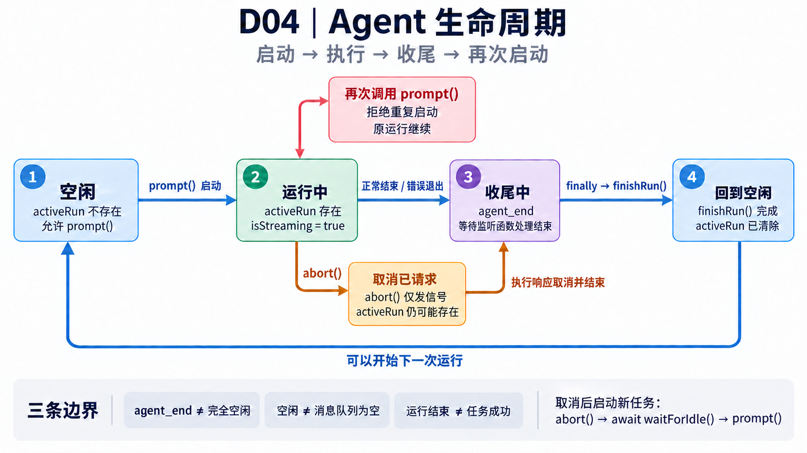
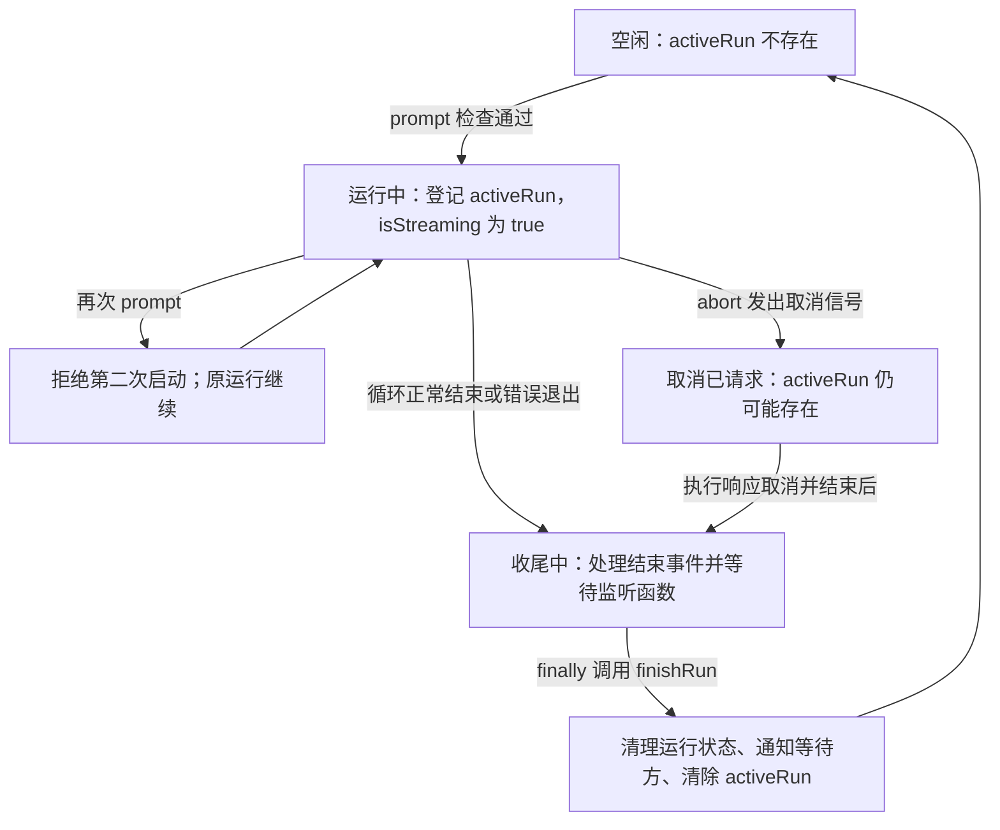
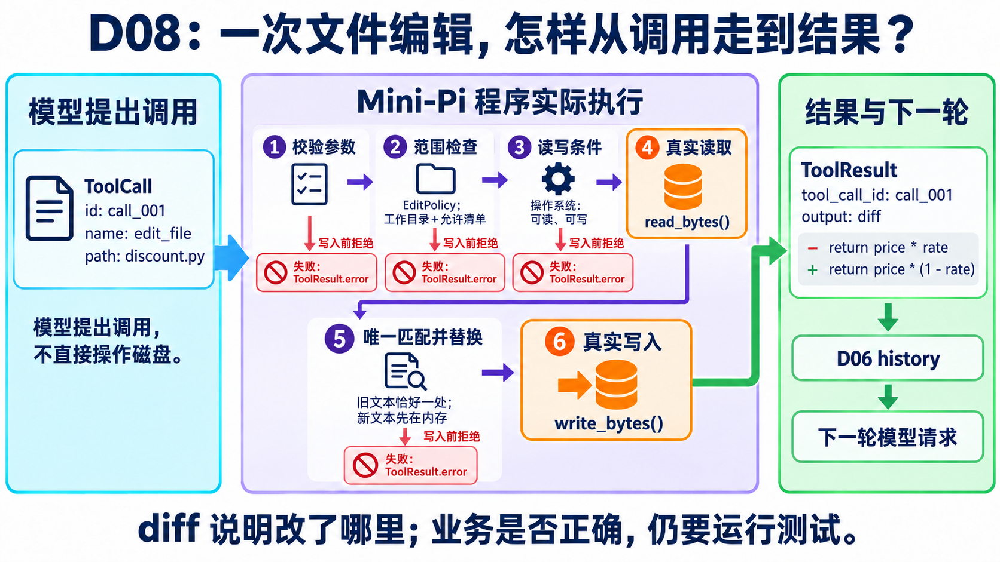
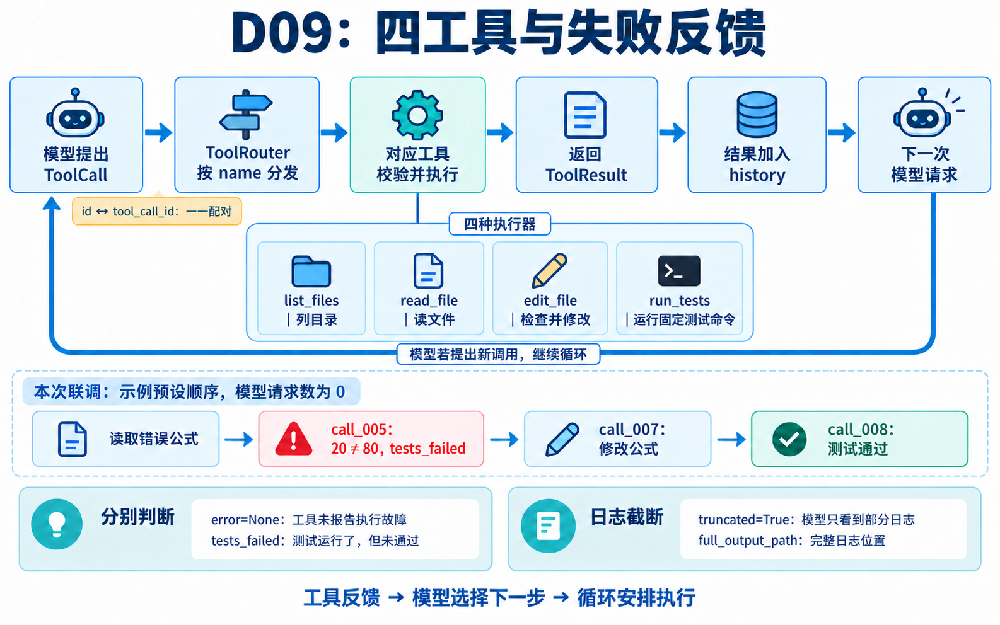
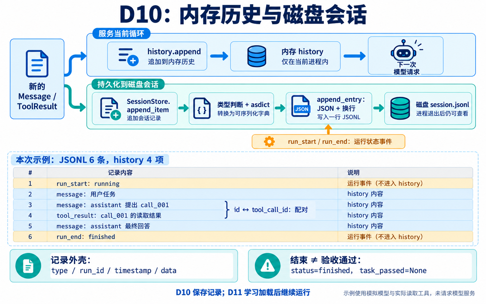
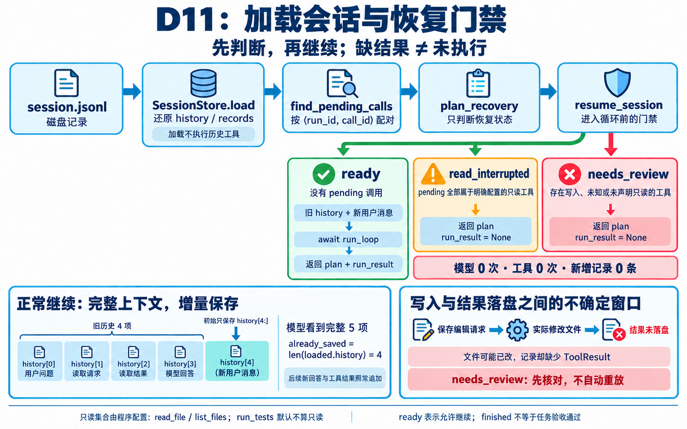

# Pi 阅读与 Python 实现路线

[当前进度](#当前进度与下一步) · [步骤总表](#步骤总表) · [第一周任务](#第一周-理解并实现单-agent-循环) · [交付清单](#里程碑与第一版交付清单) · [学习记录](#学习记录)

从一次具体任务出发：给 agent 一个有 bug 的 Python 小项目，让它读取代码、运行测试、修改文件，再确认测试结果。一个月后，完成 Mini-Pi v0.1，并能用源码、执行记录和实验数据解释自己的 agent 编排与 harness 设计。

本路线面向已有 AI 应用开发实习经验、了解 agent 和 harness 基础、主要使用 Python 的学习者。先理解并实现单 agent，再加入一个 reviewer 子 agent。每一步都写明现在该做什么、核对什么证据，以及这一步要解决什么问题。

## 当前进度与下一步

| 项目 | 当前记录 |
| --- | --- |
| 最后维护日期 | 2026-10-23 |
| 路线版本 | 初版 跨设备同步 |
| 学习开始日期 | 2026-10-08 |
| 已完成学习步骤 | 12 / 30 |
| 当前步骤 | D13-C 追加输入队列（待开始） |
| 当前状态 | D13-A 模型终态与反馈、D13-B 活动运行与空闲已完成；本次准备提交推送 |
| 远程仓库 | [bakeyliao-boop/Mini-Pi](https://github.com/bakeyliao-boop/Mini-Pi) |
| 下一步 | 提交已完成的 D13-A/B；下一章先核对 Pi 上游 main 及固定基线差异，再学习 steer/followUp 递送边界 |
| 当前阻塞 | D13-C/D 尚未实现；D13 整体未完成，计数保持 12/30。旧编辑缓冲回写来源未确定，本次提交只采用已复测内容 |
| Pi 源码版本 | `7f9e1198f2f7a8cf5ea18d5010ba081d4d60c333`；D08 对照 `edit.ts` |
| 模型接入 | 已接入百炼 `qwen3.8-flash`；真实读取与解释已验证，接口、模型 ID、耗时及 usage 见 D07 记录 |
| 第一版完成情况 | 四工具、基础循环、真实模型接入、JSONL 保存与加载、正常继续和中断恢复门禁已分别验证；模型自主修复和完整执行控制尚未完成 |

**D01–D12 已完成并推送；D13-A/B 已完成，D13-C 待开始；D13 整体仍进行中（12/30）。**D01–D04 完成有指导的阅读与推演，D05–D06 完成本地工具和模拟循环验证。D07 完成真实模型接入与读取反馈；D08 完成编辑和路径边界验证；D09 完成四工具联调及失败分类；D10 将初始消息、模型响应、工具结果和正常结束状态逐条写入 JSONL；D11 加载统一对象、正常继续并增量保存，对缺结果的调用返回明确恢复状态。34 项相关测试通过，三场景示例保留恢复前后记录。D11 使用模拟模型和真实文件工具，不据此声称已实现自动重放、模型自主修复或第一版完整交付。

开发分支为 `codex/mini-pi-v0.1`，D11 完成范围见[第十一次学习记录](#第十一次学习记录)。D13-A 已完成模型终态与反馈，D13-B 已完成活动运行、取消与空闲门禁，下一单元为 D13-C。手敲只聚焦当前学习目标的少量核心决策；时间戳、路径配置、测试和示例等由助手准备和解释，具体边界见 [AGENTS.md](../AGENTS.md)。

路线准备和此前调研不计入学习完成数。D01–D12 计为 12 / 30；D01–D04 是阅读与推演，D05 是本地工具验证，D06 是模拟循环验证，D07 是真实模型配合读取的循环验证，D08 是实际编辑与受限路径验证，D09 是四工具联调与演示用例修复，D10 是正常运行记录的持久化验证，D11 是加载、增量继续与显式恢复门禁验证。各阶段不能互相代替；不据此声称用户已独立实现全部代码。

## 怎样使用和维护这份路线

D01 到 D30 是任务顺序，不是固定的日历日期，也不限定一次会话完成。原先每周 10 至 12 小时、总计 40 至 50 小时只是初始估算；新增对齐、复盘和整改后不再用它约束进度。按完整行为划分能力单元，以理解和证据决定是否继续。D29 处理非阻塞遗留，影响当前阶段核心能力的缺陷应在对应门禁前修复；D30 用于交付第一版。

每次学习按下面的顺序进行：

1. 看“当前进度与下一步”，找到当前步骤。
2. 阅读本单元的整体行为图、Pi 对照和正常/失败场景，先解释各层如何相连，再分段手敲。
3. 对照行为契约验收，查看真实副作用、资源或下一次请求的输入；用反例确认错误实现会被发现。
4. 在“学习记录”中分别追加源码定位、理解边界、实现状态与验证证据，再更新总表。未通过的指标留在当前步骤。
5. 把下一次的第一个具体动作写回开头，避免重新找起点。

总表中的状态是进度依据，允许使用：`待开始`、`进行中`、`待验收`、`已完成`、`阻塞`。只有完成指标通过，并且记录了证据或可核对的说明，才标记为已完成。一个概念仍说不清楚时，把不理解的点写下来；代码能运行但验收没有通过时，标记为待验收。

后续在这个聊天里可以直接说：“D03 做完了，代码在……，运行结果是……，请更新阅读文件。”维护时核对你的说明或实际文件，把状态、完成日期、证据和下一步一起更新。提供的信息不足以确认完成时，保留待验收状态并写出还要核对什么。

如果在新的聊天中继续，先让助手读取本文件，再根据当前进度推进。没有定时维护任务；每次实际学习或继续讨论时更新。

当前恢复学习先读 [Mini-Pi 学习对齐与 D12 整体复盘](pi-mini-pi-learning-alignment.md)。其中包含团队交叉讨论、完整行为图、已复现的编辑晚写反例与下一步能力单元；先复盘再恢复新的手敲段落。

### 固定 Pi 核心组件与 Mini-Pi 能力对照（2026-10-15 只读审计）

学习基准仍是固定提交 `7f9e1198f2f7a8cf5ea18d5010ba081d4d60c333`，已核对本地上游 HEAD。下面以该提交的代码确定行为；[Pi 当前官方概览](https://pi.dev/docs/latest/how-pi-works)只补充组件关系，不替换固定版本的实现证据。

| 固定 Pi 入口 | 必须理解的行为 | Mini-Pi 当前与后续门禁 |
| --- | --- | --- |
| [Agent][S03] `agent.ts` | `activeRun` 拒绝重入；`abort` 发信号，`waitForIdle` 等运行及监听收尾；`steer` 和 `followUp` 在不同边界取出 | D04 已阅读，`mini_pi/agent.py` 尚不存在。D13 实现并测试，D14 阶段验收 |
| [循环][S02] `agent-loop.ts` | 请求模型、执行调用、配对结果再决定下一轮；模型错误/中止退出；输出截断的调用不执行但生成配对错误结果 | 现有循环已有基本工具反馈；`qwen_client.py` 对截断直接抛错，普通模型异常也缺少一致 `RunResult/run_end`。D13 补行为，D14 验收，D19 收入完整回归 |
| `packages/ai/src/api/openai-completions.ts`、[模型接口][S10] | 模型请求使用实际提供者，并将同一取消信号传给请求 SDK 与底层传输 | D07 已接 Qwen；D12-01 已切换异步 HTTP，并用磁盘代码验证连接关闭、取消与 timeout；同步初始化及系统 DNS 等不属于已证明可抢占的边界。运行总时限是 Mini-Pi 新增要求 |
| `packages/coding-agent/src/core/tools/bash.ts`、[工具调度][S02] | 工具接收调用 ID、参数和取消信号；已完成结果、执行故障与在途副作用要分清 | D05–D09 已覆盖四工具基本执行，D12 Windows 实测固定测试进程清理；D18 再做可替换的调用前 hook。当前只承诺串行子集 |
| [编辑工具][S07]的 I/O 边界 | 在写入前观察取消；已经开始的写入结算后才解除占用，不承诺回滚 | D12-02 已通过共享标记、写入许可检查与线程收尾修复，真实临时文件受控验证通过；不表示完整并发文件锁已实现 |
| `packages/coding-agent/src/core/tools/read.ts`、`ls.ts` 的只读取消 | abort 可先拒绝外层 Promise，在途只读 I/O 本身不保证已经结束；read 还用 aborted 标记阻止部分后续处理 | 本轮核对源码，未执行上游用例；不能把编辑的等待写入约束直接说成所有 Pi 工具的共同保证。若 Mini-Pi 要求只读线程也全部退出，须明确为新增要求，不能暗中变更验收 |
| [SessionManager][S06]、[AgentSession][S05] | 原始记录持久化；活动分支与压缩记录投影下一次模型上下文；记录写入时机保护工具调用和结果的关系 | D10–D11 已完成线性记录、加载和恢复门禁；树分支与压缩尚未实现。D15–D17 按既定路线实现请求上下文，D13 先保留可替换组装入口 |
| Mini-Pi 新增运行预算在既有入口中的集成 | 直接运行和恢复后的新 run 遵守调用方配置 | `resume_session` 已透传轮数/时限，22 项相关测试通过；旧历史不预扣本次预算，非 ready 保持零调用零追加 |

本次不重排 D01–D30：D15–D17 的上下文、D18 的 hook、D20–D21 的评测及 D22–D26 的 reviewer 均已有对应步骤。调整集中在 D13–D14 的遗漏门禁，并把 D19 的截断反馈视为复验而非首次实现。一个模型、串行工具和线性会话属于当前学习范围；这些裁剪不意味着 Pi 的完整并行调度或会话树已实现。D11 的 pending 写入恢复门禁是 Mini-Pi 的安全边界设计，不能直接称为 Pi 的同名能力。D12 的总时限也是 Mini-Pi 的工程要求，固定 Pi 的协作式 `abort` 不承诺硬截止时刻。

### 跨设备同步规则

本文件位于 `local-learning/pi-learning-roadmap.md`，阅读路线、学习记录和进度随项目进入版本控制。原来的整目录本地忽略规则已移除；`local-learning/evidence/` 中的模型原始输出、实验日志和运行证据继续由 `.gitignore` 排除。

在其他设备克隆仓库后，打开同一个阅读文件，即可查看进度。每次开始学习前执行 `git pull --ff-only`，结束后提交阅读文件与实际代码改动，再执行 `git push`。存在冲突时，核对两台设备的记录后合并，保留各自实际完成的动作。

在学习记录中填写证据的项目相对路径和关键结果。只有本地设备能访问的日志，补一段足够解释验收的结果摘要；不要把密钥写入进度或公开的说明。

下面的命令用于确认原始执行证据由 Git 忽略：

```sh
git check-ignore -v local-learning/evidence/example.jsonl
```

不要强制加入被忽略的证据或凭证文件。`.gitignore` 随仓库同步，新设备也会使用相同排除规则。

## 第一版要完成的行为

Mini-Pi v0.1 的演示任务是修复一个小型 Python 项目的 bug。任务开始时给出目标和工作目录，结束后能查看修改、测试结果和整个执行过程。

| 第一版能力 | 可以核对的结果 |
| --- | --- |
| 单 agent 循环 | 模型可以多次请求工具，工具结果进入下一轮请求，最后结束或达到预算 |
| 四个基础工具 | `list_files`、`read_file`、`edit_file`、`run_tests`，每个工具有参数定义和一致的结果格式 |
| 执行控制 | 参数错误、执行错误和超时有不同结果；轮数受限；取消后释放资源 |
| 会话记录 | 保存最终消息和工具结果；每次运行有 ID；正常退出后可以加载记录继续 |
| 中断边界 | 对没有记录完成结果的写操作标记为待核对，不统一自动重放 |
| 上下文管理 | 完整历史保留；模型请求可以使用摘要和近期内容；工具调用与结果保持配对 |
| 扩展入口 | 至少有一个工具调用前的 hook，能实际允许或阻止调用 |
| 简单多 agent | worker 修改代码，reviewer 使用独立消息上下文读取代码并返回意见，返工次数受限 |
| 独立验收 | 用固定测试判断是否修复成功，分别记录运行结束状态和任务验收结果 |
| 面试材料 | 架构图、可查看的执行记录、评测结果、设计取舍说明和可复现的演示 |

本月以一个模型服务、串行工具执行、JSONL 会话存储和一个 reviewer 为范围。轮数预算、执行约束和独立测试验收是个人项目的设计选择，在项目说明中写清楚与 Pi 的关系。

先从项目目录内的文件访问和固定测试命令做起。`run_tests` 用固定参数数组启动测试程序；这便于核对和控制行为，但不能把它称为完整沙箱。测试程序仍然会执行项目代码。

## 读 Pi 时需要带着的四个问题

### 模型怎样提出下一步

在折扣 bug 任务中，模型可能先读文件，再运行测试。它依据当前上下文返回工具调用，程序才负责执行、记录结果和开始下一次模型请求。单 agent 的编排首先体现在这个循环中。[How Pi Works][R01] 和 [Agent Core 文档][R04] 可以对照阅读。

### 工具失败以后怎样继续

如果模型请求替换的旧文本已不存在，工具需要说明匹配失败，让模型重新读取并修正。网络错误、工具参数错误和项目测试失败需要分开处理；项目测试失败本身可能是修复任务里的正常反馈。

Pi 的核心循环还处理一种特殊情况：模型输出达到长度上限时，工具参数可能被截断，即使参数能通过校验，也不能直接执行。阅读循环里的 `failToolCallsFromTruncatedMessage`，再看对应测试。[循环源码][S02]、[循环测试][S09]

### 保存历史与组装上下文有什么区别

一次修复可能产生大量测试日志。完整记录要保留过程，下一轮模型通常只需要相关日志、任务摘要和近期消息。Pi 的会话是追加保存的树，通过当前分支构建模型上下文；压缩加入摘要，原始记录仍保留。[会话格式][R05]、[压缩规则][R06]

在 Python 项目里，`SessionStore` 保存发生过什么，`ContextBuilder` 决定下一次模型需要看到什么。先做线性会话，理解后再考虑分支；v0.1 不要求复刻完整的会话树。

### 多 agent 怎样交接任务

官方 subagent 示例启动独立 Pi 进程，支持单次委派、并行任务和链式流程。父 agent 收到子 agent 的结果后继续处理。[Subagent 文档][R08]

独立上下文与文件隔离要分别考虑：示例允许子进程使用同一工作目录，所以文件写入仍可能冲突。[Subagent 源码][S08] 本月采用 worker 写入、reviewer 仅使用列文件和读文件工具的串行流程。Python 实现可以使用独立 Agent 实例和会话，不要求照搬示例的多进程启动方式。

## 阅读资料和源码导航

资料以 2026-10-08 的调研为起点。Pi 于 2026-10-01 发布 1.0，加入原生 MCP、延迟工具加载等能力；Pi Durable 同时作为实验性包发布。[Pi 1.0 发布说明][R09] 早期文章适合理解设计动机，安装方式、API 和功能状态以你固定的源码版本与对应文档为准。

以下 GitHub 源码和仓库内文档链接已固定到提交 `7f9e1198f2f7a8cf5ea18d5010ba081d4d60c333`，作为 D02 起的阅读基线。D01 阅读的是 2026-10-08 的在线 `docs/latest` 文档，未据此声称已阅读该提交的源码；遇到文档与基线差异，把实际文件位置和差异记在“版本与决策记录”中。

### 文档和作者文章

| 编号 | 资料 | 本路线的阅读目的 |
| --- | --- | --- |
| R01 | [How Pi Works][R01] | 理解一次任务的循环、上下文、会话和事件 |
| R02 | [Mario Zechner 的最小 coding agent 设计文章][R02] | 理解为什么强调控制上下文、统一模型接口和较小的核心 |
| R03 | [Armin Ronacher 对 Pi 的架构与扩展介绍][R03] | 理解小核心、扩展状态和会话之间的关系 |
| R04 | [Agent Core README][R04] | 核对消息转换、事件、生命周期和消息队列 |
| R05 | [Session File Format][R05] | 理解会话记录与模型上下文的区别 |
| R06 | [Compaction][R06] | 理解压缩边界、摘要和工具消息配对 |
| R07 | [Extensions][R07] | 理解工具调用前后如何介入执行 |
| R08 | [官方 Subagent Example][R08] | 理解委派、结果收集、失败和取消 |
| R09 | [Pi 1.0 发布说明][R09] | 区分早期文章与当前功能 |
| R10 | [Pi Durable 官方介绍][R10] | 进阶理解检查点、崩溃恢复和是否允许重放工具 |

R02 中优先读 `pi-ai and pi-agent-core`、`Minimal agent scaffold` 和 `Minimal toolset`。R03 中优先读扩展、会话和自定义消息部分。历史文章里关于 MCP 的功能描述不能直接当作当前结论。

### 源码入口

| 编号 | 入口 | 带着什么问题读 | Python 对应位置 |
| --- | --- | --- | --- |
| S01 | [agent/src/types.ts][S01] | 消息、工具、事件和状态分别装什么？ | `mini_pi/models.py` |
| S02 | [agent/src/agent-loop.ts][S02] | 何时请求模型、执行工具、继续或退出？ | `mini_pi/loop.py`、`mini_pi/executor.py` |
| S03 | [agent/src/agent.ts][S03] | 如何启动运行、取消和接收追加消息？ | `mini_pi/agent.py` |
| S04 | [coding-agent/src/core/sdk.ts][S04] | 各模块怎样组装成一个会话？ | `mini_pi/bootstrap.py` |
| S05 | [coding-agent/src/core/agent-session.ts][S05] | 怎样接入持久化、压缩、重试和请求准备？ | `mini_pi/harness.py` |
| S06 | [coding-agent/src/core/session-manager.ts][S06] | 怎样从保存的记录重建模型上下文？ | `mini_pi/session_store.py`、`mini_pi/context.py` |
| S07 | [coding-agent/src/core/tools/edit.ts][S07] | 编辑参数和匹配约束怎样变成实际操作？ | `mini_pi/tools/edit.py` |
| S08 | [subagent/index.ts][S08] | 怎样启动子任务、接收结果、传回失败？ | `mini_pi/delegation.py` |
| S09 | [agent/test/agent-loop.test.ts][S09] | 怎样构造可重复的模型响应，检验循环行为？ | `tests/test_loop.py` |
| S10 | [ai/src/types.ts][S10] | 统一消息和工具调用结构怎样与模型接口衔接？ | `mini_pi/provider.py` |

`agent-session.ts` 有数千行，按问题跳读即可。第一遍只追踪消息持久化和下一轮上下文，后面再读压缩和重试。涉及 TypeScript 时，优先理解 `interface`、联合类型、`Promise` 和 `async/await` 在这些文件中的作用。

## 步骤总表

总表记录实际进度，下面的详细步骤负责解释动作和验收。完成日期填写实际日期。

| 步骤 | 类型 | 本步目标 | 状态 | 完成日期 |
| --- | --- | --- | --- | --- |
| D01 | 阅读 | 画出一次任务的执行流程 | 已完成 | 2026-10-08 |
| D02 | 阅读与小练习 | 看懂消息和工具调用结构 | 已完成 | 2026-10-08 |
| D03 | 阅读与小练习 | 找到循环继续与退出的条件 | 已完成 | 2026-10-09 |
| D04 | 阅读 | 理解 Agent 生命周期和队列 | 已完成 | 2026-10-09 |
| D05 | 编码 | 建立消息与工具接口 | 已完成 | 2026-10-09 |
| D06 | 编码与测试 | 用模拟模型跑通循环 | 已完成 | 2026-10-12 |
| D07 | 编码与验收 | 接入真实模型并完成一次工具调用 | 已完成 | 2026-10-12 |
| D08 | 阅读与编码 | 实现受约束的文件编辑 | 已完成 | 2026-10-13 |
| D09 | 编码 | 完成四个工具及错误分类 | 已完成 | 2026-10-13 |
| D10 | 阅读与编码 | 保存执行事件和会话 | 已完成 | 2026-10-14 |
| D11 | 编码与测试 | 加载会话并明确恢复边界 | 已完成 | 2026-10-14 |
| D12 | 编码与测试 | 实现预算、超时和取消 | 已完成 | 2026-10-16 |
| D13 | 阅读与编码 | 补齐 Agent 生命周期、队列与模型反馈后组装 harness 和 CLI | 进行中（A/B已完成，C/D待开始）（D12 推送后） | — |
| D14 | 验收 | 验证单 agent 核心行为及真实修复任务 | 待开始 | — |
| D15 | 阅读 | 理解上下文压缩和消息配对 | 待开始 | — |
| D16 | 编码 | 分开完整历史与请求上下文 | 待开始 | — |
| D17 | 编码与测试 | 实现最小摘要压缩 | 待开始 | — |
| D18 | 阅读与编码 | 实现工具调用前的 hook | 待开始 | — |
| D19 | 测试 | 建立可重复的 harness 行为测试 | 待开始 | — |
| D20 | 评测准备 | 固定任务集与成功判定 | 待开始 | — |
| D21 | 评测 | 比较上下文策略并通过阶段验收 | 待开始 | — |
| D22 | 阅读 | 看懂 subagent 的委派流程 | 待开始 | — |
| D23 | 编码与测试 | 创建独立 reviewer 会话 | 待开始 | — |
| D24 | 编码 | 串联 worker 和 reviewer | 待开始 | — |
| D25 | 测试 | 验证子 agent 失败、超时与取消 | 待开始 | — |
| D26 | 评测 | 比较单 agent 与 reviewer 流程 | 待开始 | — |
| D27 | 写作 | 整理架构与设计取舍 | 待开始 | — |
| D28 | 演示与自查 | 形成可复现演示和面试讲解 | 待开始 | — |
| D29 | 修复与补验收 | 处理第一版剩余问题 | 待开始 | — |
| D30 | 交付验收 | 确认 Mini-Pi v0.1 完成 | 待开始 | — |

## 第一周 理解并实现单 agent 循环

### D01 理解一次任务怎样运行

**现在做什么：**读 [How Pi Works][R01] 的 Agent loop、Context 和 Sessions。选定折扣计算 bug 作为贯穿例子，画出用户消息、模型请求、工具调用、工具结果和下一轮请求。选择实际阅读的源码标签或提交，并登记版本；可以先在线读源码。

**完成指标：**用自己的话说明模型负责提出调用、程序负责执行；画出至少两轮请求；解释为什么最后的文字回答需要另用测试核对。登记源码版本或把固定版本的具体阻塞写清楚。

**保留证据：**一段流程说明、三个问题的回答、实际阅读版本。写在学习记录中即可。

**这一步要防止的问题：**把“一次模型调用”当作 agent 的完整运行，或混用不同版本的 API。

### D02 看懂消息和工具调用结构

**现在做什么：**读 [types.ts][S01]，再用 [Agent Core README][R04] 核对 `AgentMessage`、模型消息和事件。手写一组 Python 字典，表达用户请求、assistant 的工具调用以及对应工具结果。字段先选够用的一组，不要求复刻全部类型。

**完成指标：**工具调用有唯一 ID，结果能找到对应调用；能区分消息、工具参数和执行事件；知道应用状态或 UI 信息不必全部送给模型。

**保留证据：**三条示例消息，以及一句话解释工具调用 ID 的用途。

**这一步要防止的问题：**把工具结果当成普通用户文本，或让日志无法定位到原始调用。

### D03 找到循环继续与退出的条件

**现在做什么：**读 [agent-loop.ts][S02] 的 `runLoop`、`streamAssistantResponse` 和 `executeToolCalls`。画出有工具调用、没有工具调用、模型错误、取消、追加消息这几条路径。阅读截断输出的处理测试。

**完成指标：**能顺着源码说明为什么工具执行后还要请求模型；列出循环结束的主要条件；说明输出被截断时为什么不能直接执行工具。指出当前源码对应的位置。

**保留证据：**带函数名的流程图和退出条件列表。

**这一步要防止的问题：**只实现一个无限 `while`，却没有定义错误和结束语义。

### D04 理解 Agent 生命周期和队列

**现在做什么：**读 [agent.ts][S03] 的 `prompt`、`runPromptMessages`、`createLoopConfig`、`runWithLifecycle` 和 `processEvents`；版本不同则按相同职责找入口。结合 [Agent Core README][R04] 理解 steering 与 follow-up。

**完成指标：**解释为何同一个 Agent 不能无控制地同时接收两次运行；说清 steering 和 follow-up 进入循环的时机；说明事件如何更新运行状态。

**保留证据：**一张小型状态图，包含空闲、运行中、结束或取消；写一个“运行中用户改方向”的例子。

**这一步要防止的问题：**并发修改同一个会话，或把排队消息插入错误的时机。

### D05 建立 Python 消息与工具接口

**现在做什么：**创建项目基础结构，使用 Python 数据类或其他熟悉的方式定义消息、工具调用、工具结果和运行结果。定义模型适配器接口与工具执行器接口。先实现一个读取文本文件的工具。

**完成指标：**接口名称和责任清楚；工具结果统一包含调用 ID、输出和错误信息；读取成功、文件不存在、参数不合法都有明确结果。

**保留证据：**`mini_pi/models.py`、`mini_pi/provider.py`、工具接口代码和三个调用结果。

**这一步要防止的问题：**模型服务返回格式渗入所有模块，使以后难以模拟或替换模型。

### D06 用模拟模型跑通循环

**现在做什么：**实现 `loop.py`。模拟模型第一次返回 `read_file` 调用，第二次依据工具结果返回结束文本；增加多轮工具调用和工具失败的场景。每轮都保存 assistant 消息和工具结果到运行内存记录。

**完成指标：**测试能确认第二次模型请求看到上一轮工具结果；消息顺序和 ID 正确；没有工具调用时结束；错误结果能进入后续请求。多次运行得到相同行为。

**保留证据：**`tests/test_loop.py` 和测试输出；记录一条完整的模拟执行轨迹。

**这一步要防止的问题：**依靠真实模型偶然返回某种内容来判断循环是否正确。

### D07 接入一个真实模型

**现在做什么：**使用一个已有可用额度的模型服务及其官方接口，将响应转换成你的统一消息结构。让模型读取一个测试文件并解释其内容。参考 [ai/types.ts][S10] 理解接口边界，不必实现多 provider。

**完成指标：**真实运行至少一次工具调用再产生回答；记录模型 ID、运行时间和供应商实际返回的 usage；缺少凭证时有清楚报错。密钥不写入源码或阅读文件。

**保留证据：**一条去除密钥的运行记录，实际模型名称和调用结果。无法接入时记录具体阻塞，模拟模型仍用于后续独立开发。

**这一步要防止的问题：**只做文本聊天，或无法说明模型适配器与 agent 循环之间的边界。

## 第二周 实现会话与执行控制

### D08 实现受约束的文件编辑

**现在做什么：**读 [edit.ts][S07]。实现 `edit_file`，使用旧文本匹配和新文本替换；旧文本不存在或匹配多处时返回错误。把编辑范围限制在指定工作目录，并检查真实路径和允许编辑的文件范围。

**完成指标：**唯一匹配时正确修改；不存在和重复匹配时不写文件；目录外路径、符号链接指向目录外和受保护文件被拒绝。保存修改前后的差异。

**保留证据：**工具代码、匹配失败用例和一次实际 diff。

**这一步要防止的问题：**模型依据过期文本修改错误位置，或编辑到工作目录外的文件。

**已确认的设计（2026-10-13）：**用户接受借鉴 Pi 的职责划分，同时保留 D08 已有范围限制。独立的 `EditPolicy` 接收程序配置的工作目录与允许编辑清单，执行真实路径和范围检查；编辑执行器调用策略后负责匹配、读写及返回差异。Pi 固定版本的内置 `edit` 本身没有这组目录和清单限制，其可选 `protected-paths.ts` 扩展通过执行前事件拦截路径；这些范围限制属于 Mini-Pi 的学习设计。当前不在编辑算法中写死 `.env`、`AGENTS.md` 等禁止名称；D08 的受保护文件用例通过配置排除该目标并验证拒绝来验收。策略检查不等于整个 Agent 的操作系统沙箱。

**阶段验收（2026-10-13，进行中）：**学习者手敲旧文本唯一匹配、文本替换、策略路径检查与编辑执行入口；助手准备构造配置、工具说明、差异展示、测试和演示脚本。运行 D08 相关 48 项测试，46 项通过，2 项因本机创建文件符号链接返回 WinError 1314 而跳过；完整本地输出保存在忽略目录 `local-learning/evidence/d08-test-results.txt`。唯一匹配实际写入、无匹配与多匹配不写入、只读拒绝、未列入允许范围的文件拒绝，以及工具调用 ID 与结果关联均有测试证据。模拟“路径解析到工作目录外”的策略测试通过；这不等同于真实符号链接实测。

**实际编辑证据：**`examples/d08_edit_trace.py` 构造一个 `ToolCall`，通过学习者实现的编辑入口实际读取并修改临时 `discount.py`，保存执行顺序、结果和修改前后文本至忽略目录 `local-learning/evidence/d08-edit-trace-2c08fd45d4d14ec883c22d893eb3e662.json`，差异为同名前缀的 `.diff` 文件。此次调用没有连接模型服务，也没有运行折扣业务测试；`ToolResult` 成功不等于业务修复通过。Windows 目录连接的进一步本机实验曾被自动审批拒绝，返回 `blocked by policy`，没有执行；随后改用已存在的 WSL 环境完成真实符号链接实测。

**补跑与完成验收（2026-10-13）：**用户要求补跑后，Windows 两项测试仍因 WinError 1314 跳过。使用现成的 Ubuntu WSL 与 Python 3.14.4，直接在同一份工作区代码上运行两项真实文件符号链接越界测试，均通过；随后 D08 的完整 48 项测试全部通过，无跳过。本地输出保存在 `local-learning/evidence/d08-wsl-test-results.txt`。这补齐了上面的 Windows 阶段记录：目录外符号链接目标被策略和执行器拒绝，D08 完成指标通过。Windows 本机创建权限限制仍然存在，但不再阻碍本次跨环境代码验收；D08 标为已完成，下一步为 D09。

### D09 完成四个工具及错误分类

**现在做什么：**补齐 `list_files`、`read_file`、`edit_file`、`run_tests`。测试工具用固定命令和参数数组，返回退出码、输出和耗时；限制模型可见输出长度。区分参数错误、执行失败、超时和测试未通过。

**完成指标：**四个工具都可以独立调用；测试失败能作为任务反馈返回；未知工具和非法参数不会执行；截断结果说明发生了截断，并能保留完整输出的位置。

**保留证据：**每个工具一条成功结果、一条失败结果；完整测试输出放在本地证据目录。

**这一步要防止的问题：**将所有失败混成同一错误，导致无法决定重试还是修正任务。

**开始记录（2026-10-13，进行中）：**`read_file` 与 `edit_file` 已各自实现 `execute(ToolCall) -> ToolResult`；D06 的 `run_loop` 只接收一个执行器。先参照固定版本 Pi 在执行前按工具名查找工具的处理，给 Python 循环增加统一分发入口：已知工具交给相应执行器，未知工具返回关联原调用 ID 的错误结果。随后补齐 `list_files`、`run_tests`，再验证退出码、超时、输出截断与失败分类。此条只记录 D09 起点，不代表 D09 验收通过。

**完成验收（2026-10-13）：**已补齐名称分发、目录列表和固定命令测试工具。13 项针对性测试通过，覆盖未知工具、非法参数不执行、目录边界、测试成功/失败、超时、启动失败，以及截断提示和完整日志保存。四工具实际联调保存了各工具成功与失败结果，独立演示折扣用例修改前退出码 1、修改后退出码 0。调用顺序由示例预设，模型请求数为零。用户正确复述了错误字段、失败分类及本次证据范围；D09 标为已完成，下一步为 D10。详见[第九次学习记录](#第九次学习记录)。

### D10 保存执行事件和会话

**现在做什么：**先读 [会话格式][R05]，再看 [agent-session.ts][S05] 中持久化事件的路径。为 Python 项目保存 JSONL 会话：最终消息、工具调用与结果、运行 ID、时间和状态。流式更新属于显示事件，首版可以只保存最终消息。

**完成指标：**退出后仍能查看执行过程；日志能按运行 ID 和工具调用 ID 关联；会话内容与模型可见内容的职责分开；记录不包含 API 密钥。

**保留证据：**一份可读的本地 JSONL，及其字段说明。默认放在 `local-learning/evidence/`。

**这一步要防止的问题：**只有终端输出，没有可以回看和检查的过程。

**开始记录（2026-10-13）：**回顾 D01–D09 的模型请求、统一消息、执行循环、生命周期、模型适配和四工具反馈。D10 从当前 `run_loop` 只向内存 `history` 追加消息这一边界出发，对照固定版本的 `docs/session-format.md`、`SessionManager.appendMessage` 和 `agent-session.ts` 中最终消息的持久化路径。先理解会话记录与模型上下文的区别，随后实现首版线性 JSONL 记录；暂不实现 Pi 的会话树或自动恢复。此条只登记开始，不代表持久化能力已实现或验收通过。

**完成验收（2026-10-14）：**用户手敲 JSONL 追加、消息转换和循环中的保存位置，助手按明确授权修复拼写、方法边界和结束字段。11 项相关测试通过；模拟模型配合实际读取生成六条 JSONL，独立示例进程退出后再次读取，七项检查通过。用户正确解释了运行 ID、调用 ID、测试日志与会话记录的区别，以及按记录类型选取对话内容的原因。D10 标为已完成，D11 待开始；不据此声称已实现加载恢复。详见[第十次学习记录](#第十次学习记录)。

### D11 加载会话并明确恢复边界

**现在做什么：**实现 `SessionStore.load`，从已保存的最终消息重建会话并继续。分别模拟正常退出后再提问、读取工具中断、写入意图已记录但结果未记录这三种情况。用显式状态标记未完成调用。

**完成指标：**正常退出后加载历史继续，已有结果不重复追加；未记录完成的写操作停在待核对状态；能说明写入发生与日志落盘之间存在不确定窗口。首版不承诺自动恢复所有崩溃。

**保留证据：**恢复前后记录和三种场景的处理结果。

**这一步要防止的问题：**把“保存了聊天历史”误认为所有操作都可以安全自动重放。

**开始记录（2026-10-14）：**D10 保存已完成，D11 从现有六条 JSONL 出发，对照固定版本 `SessionManager.parseSessionEntries` 与 `buildSessionContext`。先理解加载过程只重建消息和结果，不直接执行历史调用；随后验证正常继续时不重复保存旧记录，识别缺少对应结果的调用，并对未完成写操作停在待核对状态。此条仅登记开始，不代表加载与恢复已实现。

**完成验收（2026-10-14）：**加载、增量保存、pending 识别和恢复状态判断完成后，用户分两段手敲 [resume_session](../mini_pi/session_resume.py) 的门禁与正常继续逻辑。34 项相关测试通过，无跳过；示例通过两个独立进程验证正常退出后加载并继续，通过真实读取、编辑后故意省略结果记录验证两种中断状态。用户正确解释恢复返回对象和已保存历史长度。D11 标为已完成，D12 待开始；不自动重放历史工具，不承诺所有崩溃可恢复。详见[第十一次学习记录](#第十一次学习记录)。

### D12 实现预算 超时和取消

**当前推进单元（2026-10-15 团队交叉评审）：**先完成 D12-R0 整体复盘，用同一编辑任务串联循环、执行器、实际文件、记录和结束状态；D12-R1 确定各类资源的取消契约并看反例；D12-R2 按契约整改 HTTP 和文件工具，保留有效的进程清理证据；D12-R3 接通既有恢复入口的本次预算，完成两入口集成验收。详见[整体复盘](pi-mini-pi-learning-alignment.md#基于当前进度的学习方式)。R0/R1 是当前实际学习内容，不能先堆新实现再补理解。

**现在做什么：**为运行设置最大模型轮数和总时限；为测试程序设置超时。让取消信号传入模型请求和正在执行的工具；结束测试子进程并等待清理完成。达到上限时记录明确状态。

**完成指标：**连续请求工具的模拟模型会被预算停止；慢工具会超时；取消响应到各实际资源边界，已经开始的操作完成必要收尾后才报告运行结束，返回后没有本次后台晚写；已完成结果保留，不把取消标成成功。分别定义 HTTP、文件与进程的停止和清理边界，不将 Pi 的协作取消解读为强杀或自动回滚。既有直接入口和 ready 恢复入口遵守同一本次预算；旧历史不预扣轮数，非 ready 仍无调用和新增记录。

**保留证据：**预算耗尽、超时、取消三条结果和对应行为测试。

**这一步要防止的问题：**agent 长时间循环、取消后继续运行工具，或失败状态看起来像正常完成。

**开始记录（2026-10-14）：**用户授权后，D11 已以 `e88c35704ab55bc6dd56e6155ebd6bf2578f00bc` 提交并推送至 `origin/codex/mini-pi-v0.1`，远端 HEAD 已实测一致。提交前从暂存内容导出副本，34 项相关测试和三场景示例通过，未包含 `qwen_provider.py` 等独立改动。随后进入 D12，先设计最大模型轮数预算；助手准备可选参数、输入校验、`budget_exhausted` 状态类型和测试，计数及停止逻辑待用户分段手敲。此条只登记开始，不代表预算、超时或取消已经实现。

**轮数预算小步验收（2026-10-14）：**用户手敲请求计数与请求前的预算门禁，达到上限时返回 `budget_exhausted` 并保存 `run_end`；`messages` 参数拼写按用户“帮我改回”的授权由助手修正。4 项预算测试与 34 项既有相关测试共 38 项通过，无跳过。已验证限制模型请求次数、保留完成的工具结果、同一模型响应的多工具批次不按工具个数计轮、最后允许的一轮仍可正常结束，以及结束事件与对话历史的区别。D12 仍进行中，下一小步计算固定截止时间并接入异步等待；总时限、主动取消和测试子进程清理尚未验收。

**截止时间等待入口小步验收（2026-10-14）：**用户手敲循环外的固定截止时间计算，并分两段实现 [await_before_deadline](../mini_pi/run_deadline.py)：到期不启动、未配置正常等待、等待中按同一截止时间超时，并用 `timeout.expired()` 区分总时限与操作自身超时。助手准备类型、异常信号、导入和 [6 项测试](../tests/test_run_deadline.py)，实际全部通过，无跳过；外部取消保持 `CancelledError`，模拟等待协程的 `finally` 清理完成。此为等待入口的函数级验证，模型和工具的循环接入仍待手敲；不据此声称真实网络请求、后台线程或测试子进程已被停止。

**模型等待接入小步验收（2026-10-15）：**用户手敲模型调用的 `try/except`，使用同一 `deadline` 等待返回；助手按“帮我改好”的明确授权修正异常分支的 `messages=history` 和缩进。模拟模型持续等待时返回 `status="timeout"`，保留已有历史并保存 `run_end`；配置、正常响应、等待入口、轮数预算与 D11 回归共 47 项实际通过，无跳过。随后重新读取磁盘并复验，测试前后文件哈希一致。下一步只接入工具等待；工具中断、主动取消和真实测试子进程清理尚未完成，不把模型等待通过当作 D12 全部验收。

**工具等待接入小步验收（2026-10-15）：**用户手敲工具调用的等待包装与 `RunDeadlineExceeded` 分支，复用循环外计算的同一 `deadline`。4 项总时限测试、6 项等待入口测试、4 项轮数预算测试与 D11 的 34 项回归共 48 项实际通过，无失败、错误或跳过，测试前后 `loop.py` 哈希一致。模拟三次读取时，第一项结果保留在内存和 JSONL，第二项等待到期后执行协程 `finally` 清理，第三项不再启动；返回 `timeout` 并保存一条结束事件。第二、三项仍缺少结果记录，pending 检查保留这两项，不伪造工具结果。此处使用模拟异步执行器，不证明真实线程、网络请求或测试子进程已停止。D12 仍进行中，主动取消与真实测试子进程清理留待后续。

**模型主动取消小步验收（2026-10-15）：**先解释 `task.cancel()` 发出请求、`CancelledError` 沿等待传播、清理后转换为运行结果的关联；用户明确要求“本次帮我插入”，因此模型等待中的 `except asyncio.CancelledError` 分支由助手代写。模拟模型等待时取消，保留已有历史并返回 `cancelled`；配置 Store 时保存一条 `run_end`，未配置 Store 时仍返回结果；`task_passed` 和 `error` 保持 `None`。2 项模型取消测试与此前 48 项相关测试共 50 项实际通过，无跳过。辅助调用方和模拟模型由助手准备。工具主动取消和真实进程清理尚未接入，D12 仍进行中；本步未提交或推送。

**工具主动取消小步验收（2026-10-15）：**用户再次明确要求“本次帮我插入”，因此工具等待中的 `except asyncio.CancelledError` 分支由助手代写。3 项主动取消测试加此前 48 项相关测试共 51 项实际通过，无失败、错误或跳过。模拟工具第一项已完成结果保留，第二项等待取消后完成协程清理，第三项不启动；循环返回 `cancelled` 并保存一条结束事件，未取得结果的调用保持 pending。模型、工具的取消分支均已验证，但真实测试子进程停止、进程树与后台线程清理仍是下一小步，D12 尚未全部完成。本步未提交或推送。

**真实测试进程清理小步验收（2026-10-15）：**核对发现 `RunTestsExecutor.execute` 原来通过 `asyncio.to_thread(subprocess.run)` 等待，外层取消不能据此证明测试程序停止。按协作规则，进程创建参数、系统接口、等待与证据落盘属于助手准备的辅助实现：新增 [managed_process](../mini_pi/tools/managed_process.py)、[process_tree](../mini_pi/tools/process_tree.py) 和 [process_worker](../mini_pi/tools/process_worker.py)，只替换原测试工具中的进程调用及日志写入细节，保留用户已有参数校验、固定命令来源、退出码与错误分类。

Windows 使用 [Job Object](https://learn.microsoft.com/en-us/windows/win32/procthread/job-objects) 管理本次普通进程树。启动器先等待许可，绑定完成才启动固定命令；正常退出、工具自身超时、总时限或主动取消后，都先停止进程树、等待监督进程退出并核对 Job 活动进程为零，再向外返回或传播取消。重复取消不会跳过清理，绑定失败不会启动实际测试命令。POSIX 分支使用独立进程组；本轮仅在 Windows 实测，不声称已完成其他系统验收。不是完整安全沙箱。

[7 项真实进程清理测试](../tests/test_process_cleanup.py) 实际启动等待程序及其子进程，用启动文件同步，并核对本次 PID 已停止、等待线程任务已完成和 Windows Job 已无活动进程。原有测试工具 6 项分类用例通过；与此前 51 项执行控制和 D11 测试合并，共 64 项实际通过，无失败、错误或跳过。覆盖工具超时、直接取消、循环总时限、循环取消、主程序正常退出后仍有子进程、重复取消及绑定失败；测试不请求模型服务。

[D12 控制演示](../examples/d12_control_demo.py) 使用模拟模型、真实固定进程，预算、总时限、主动取消三个场景共 27 项检查通过。证据目录：`local-learning/evidence/d12-control-9b4bd097b4cd4fa4a0156efc908286f8/`。根目录 `summary.json` 汇总结果，`test-results.txt` 是实际 64 项测试的完整输出；每个场景有 `session.jsonl`、摘要、PID 记录或进程启动记录，以及 `logs/run-tests-process-*.json` 和完整输出。预算场景只打印并退出，不是业务测试验收；超时和取消场景真实创建并回收进程树，未制造工具结果，未完成调用仍为 pending。证据继续 Git 忽略。

D12 仍进行中：本轮还确认 `QwenProvider._send` 的同步 HTTP 调用使用 `asyncio.to_thread`；当前等待取消记录不等于 HTTP 工作线程已退出，下一步需处理并测试其收尾。本轮未读取凭证、未调用真实模型、未改动既存 `qwen_provider.py` 独立变更，未提交或推送。

**HTTP 线程收尾辅助层准备（2026-10-15）：**助手准备 [run_sync_with_cleanup](../mini_pi/thread_worker.py)，正常返回同步结果或异常；收到取消后等待已有工作线程完成、丢弃结果并继续传播原取消，重复取消不跳过收尾。4 项真实线程辅助测试实际通过，额外检查无后台异常日志；首次试跑发现取消后线程自身失败会触发 Python shield 的异常日志，已通过结果/异常封装修正并复验。另已准备 3 项真实 Qwen 适配器配合模拟 HTTP 的取消测试，尚未运行；`_send` 的调用替换待用户手敲。这一版取消收尾可能晚于总时限，不承诺强制中断已运行的同步 HTTP 请求。没有读取真实凭证或调用模型服务。

**HTTP 线程接入与代码复验（2026-10-15）：**用户手敲 `_send` 调用替换后，`port_json` 和 `self.apikey` 两个名称按用户“帮我改好”的明确授权由助手修正为现有 `post_json` 和 `self._api_key`，不修改凭证内容。助手准备的取消测试最初在同步 `setUp` 获取运行中循环而报错，已改用 `asyncSetUp` 并复验。真实线程辅助 4 项、适配器取消 3 项、原发送辅助 8 项与转换 17 项共 32 项通过；与此前 64 项执行控制、真实进程清理和 D11 回归合并，共 96 项实际通过，无失败、错误或跳过。原始输出保存至 `local-learning/evidence/d12-control-9b4bd097b4cd4fa4a0156efc908286f8/http-thread-test-results.txt`，测试前后 `qwen_client.py` 哈希一致。

本步用真实 Qwen 适配器、真实工作线程与模拟 HTTP，验证取消结果返回前线程工作已结束、响应不再解析、没有重试，记录与循环分别保留取消/超时状态。没有读取真实凭证、没有向模型服务发请求。总时限到达后开始收尾，最终返回可以晚于截止时间；本实现等待同步请求自然完成或自身失败，不强制终止线程。D12 代码检查已通过，阶段改为待验收，尚需确认该收尾边界并整理最终学习记录；未提交或推送。

**验收结论纠正（2026-10-15）：**用户指出等待同步 HTTP 自然结束会留下取消与总时限隐患。该判断正确：助手为复用 `urllib` 和减少传输层调整选择了等待线程收尾，但不能把这项取舍当作总时限问题已解决。上面的 96 项确实通过，证明的是旧测试契约，不足以证明 HTTP 在时间预算内退出；撤回 HTTP 部分可进入最终验收的结论，D12 退回进行中。已有其他小步结果保留。

实际离线诊断将总时限设为 0.05 秒、同步 HTTP 模拟工作设为 0.3 秒，约 0.305 秒才返回 `timeout`；线程已收尾，但返回受原工作耗时支配。证据为 `local-learning/evidence/d12-deadline-gap-b70372d40c574d259c4a991690a411ea/summary.json`，未请求真实服务。整改目标是取消能够作用到底层操作，清理有明确时间边界，不能无限等待原请求；应评估可取消异步传输或可停止的隔离工作进程，再补能揭露该缺口的测试。尚未替换用户手敲的核心调用、未提交或推送；当前方案不计 D12 整体通过。

**阶段归档复核（2026-10-15）：**用户明确授权按已展示的 21 个文件分两次中文提交并推送，同时要求 D12 保持进行中。助手只清理了 `loop.py` 三处行尾空白，未改变核心行为；实现、测试和示例共 17 个文件已保存为 `b3a548526e8b81c66af2b29bfaad4e95462850f2`（`保存D12预算、超时与取消的阶段实现及测试`），其余 4 个文件归入学习对齐与规则提交。`qwen_provider.py`、独立教程目录和 Day4 图片提示词均不在本次范围。

复核使用暂存区导出的独立副本，排除了未提交的 `qwen_provider.py` 空白改动：96 项相关测试实际通过，无跳过；预算、超时和主动取消三个控制演示场景通过。日志保存在本地忽略目录 `local-learning/evidence/d12-submit-89dd7e1a2c3145cca950da33d2ed6e53/`。此次未请求真实模型服务，未修复或重新验收 HTTP 取消、编辑晚写及恢复入口预算缺口；D12-01 至 D12-03 保持未完成，下一步仍从 D12-R0 整体复盘开始。

**编辑取消检查点与完整接线（2026-10-15）：**助手准备 `FileCancellation` 的线程通信与短锁辅助层、`run_sync_with_cleanup` 的 `on_cancel` 通知入口以及测试；用户手敲 `apply_edit` 的准备前、写入许可和写后检查，并在 `execute` 创建同一个标记、传入编辑线程、配置取消通知。`FileCellation` 拼写按用户“帮我修好并且推进”的授权修正为 `FileCancellation`；导入由助手准备。新同步检查点 5 项加原编辑回归 10 项实际通过；接线后，3 项真实编辑线程整合、15 项编辑检查及回归、8 项线程辅助、28 项 Qwen 相关回归合计 54 项通过，无跳过。日志和源文件哈希核对保存在 `local-learning/evidence/d12-edit-wiring-1329e47312594c438818427c1e546d7a/`；测试前后相关源文件未变。

旧 `execute` 在接线前确实被新用例检出“编辑线程仍暂停时，循环已经返回”，证据在 `local-learning/evidence/d12-edit-wiring-prep-f5b24fa9a5a54e2691da73dfd55b5ce1/old-entry-counterexample.txt`。接线后的验证分别检查：写前取消文件保持 10、重复取消不跳过收尾；受控分段写入中取消，等待文件工作结束后保留 20；运行超时通知同一个标记并在收尾后返回 timeout。三个场景都检查线程已结束、run_end 的时序、后续调用不启动、无伪造 ToolResult，未完成调用仍为 pending。分段写入是真实临时文件 I/O 的受控替身，不声称暂停了操作系统的单次 write；没有请求真实模型服务。D12-02 在这些边界内修复，HTTP 与恢复预算仍未完成。

用户已复述“取消策略中的检查已放入 apply_edit”，并理解写后取消不回滚；异步等待与共享通知仍按整体链路逐步解释，不由测试通过推定全面掌握。教学粒度调整为每次一个必要的新机制，保留函数与条件判断等已知基础，避免同时堆叠底层机制或退回逐句讲基础语法。

**只读边界源码补核（2026-10-15）：**固定 Pi 的 `read.ts:111–128,207–212` 在 abort 时拒绝外层等待，并用 aborted 阻止部分后续工作；`ops.readFile` 本身未接收此 signal。`ls.ts:73–102` 同样可先拒绝外层 Promise，其内部异步流程仍可能继续。这是源码观察，不是上游运行验收，也不是无资源风险的证明。因此本轮未把 Mini-Pi 的读取、列目录直接换成等待线程收尾；先前“取消后不存在任何后台任务”的表述不能当作 Pi 所有工具的统一保证。更强的只读收尾若保留，须单独说明为 Mini-Pi 工程要求及其对取消延迟的影响，当前验收尚不据此收口。下一单元先处理已明确的 HTTP 传输取消缺口。

**HTTP 异步辅助层准备（2026-10-15，接线待手敲）：**对照固定 Pi `openai-completions.ts:370–380` 将 signal 传入 SDK 的行为，新增 `async_http_transport.post_json_async`。它使用本机已有的 HTTPX 0.28.1，版本登记在 `requirements.txt`；输入仍为 URL、API Key、请求字典和请求自身超时，正常返回 JSON 字典。每次请求独占客户端，响应及客户端在成功、失败、取消时均关闭；外层取消只传入 HTTP 任务一次，后续取消不跳过 finally 收尾。客户端暂不跨请求复用，会增加连接与 TLS 握手开销；这项资源管理取舍明确保留，不称为 Pi 的共享客户端实现。继续保留 HTTPS 验证、禁止重定向、不自动重试、2 MiB 响应上限、JSON 对象要求与错误脱敏。同步传输保留为 D07 历史辅助实现，不作为新发送路径。

`tests/test_async_http_transport.py` 的 11 项测试已用真实 127.0.0.1 HTTPS 连接通过：正常返回、输入拒绝、状态错误与跳转、无效响应和大小限制、请求自身超时、等待头/读取体时取消、重复取消与清理失败。慢服务不由测试放行，取消必须使服务端实际观察到断开，并核对客户端/响应关闭。证书和私钥是 `tests/fixtures` 中公开的合成测试材料，测试仅在自己的 SSLContext 中信任它，生产仍使用默认 TLS 验证。本轮没有读取实际凭证、没有请求真实模型服务，也没有下载安装依赖。

为先核对设计与测试，助手仅在独立测试进程的内存里替换候选 `_send` 调用，8 项 Qwen 发送、3 项真实 HTTPS 取消、17 项转换共 28 项通过；验证前后磁盘 `qwen_client.py` 字节一致。日志及候选验证脚本在 `local-learning/evidence/d12-async-http-prep-5fd627df9907415f962634b712707244/`。这不是学习者磁盘实现的验收：当前 `_send` 仍调用旧线程包装，`post_json_async` 的导入由助手准备，发送调用待学习者手敲。原 3 项 Qwen 等待线程测试已换成真实本地连接测试；离线发送测试已使用异步替身，并拦截旧同步入口以免未完成接线时意外出网。因此切换前运行新 Qwen 测试会明确失败，不能据此绕回旧契约。

时间边界仍按协作式取消解释：辅助层验证覆盖请求已发出后等待响应头/体的取消与资源关闭，不声称硬实时停止。首个客户端请求曾出现约 0.198 秒的库初始化慢回调提示；JSON 编码、客户端初始化和系统 DNS 等未在本轮证明可抢占。清理失败会抛错，不伪装成已完成的取消；整条普通模型错误的统一终态仍按 D13 既定门禁处理。D12-01 保持待接线与验收，恢复预算和只读边界尚未收口。

**HTTP 磁盘接线验收（2026-10-15）：**用户手敲 `_send` 发送调用，`post_json.async` 因函数名中使用点号而导致 SyntaxError；按用户“帮我修正并且验证”的授权，仅把该名称修正为 `post_json_async`，其余手敲核心流程保留。新增一个真实 HTTPS 正常返回的正向对照用例；11 项异步传输、4 项真实 Qwen/循环 HTTPS 流程、8 项发送回归及 17 项转换共 40 项实际通过，0 失败、0 错误、0 跳过。本次直接执行磁盘 `_send`，没有像准备阶段那样在内存替换核心方法；相关源文件测试前后哈希一致。证据为 `local-learning/evidence/d12-http-wiring-recheck-d9ccb07c1b4f48f4a6d051172a340698/test-results.txt`、`verification.json` 和同目录实际测试脚本。

三条请求结果均已验证：正常 HTTPS 返回有效消息与模拟 usage，send 记录 received、循环记录 finished；等待响应头和响应体时主动取消，不解析回答、不调用工具，连接关闭，直接 generate 抛 CancelledError、循环返回 cancelled；总时限 1 秒、HTTP 自身超时 5 秒、服务端不完整回复时，取消连接并返回 timeout，没有等待原请求自身超时。取消/超时都由服务端观察到 EOF 或连接重置，客户端及已创建的响应均关闭、请求只发一次、会话与返回状态一致。正常结束仍保持 task_passed=None，不等于业务任务验收通过。验证 JSON 的 elapsed_seconds 是包含测试准备/清理的单例测试耗时，不当作运行截止时间精度。

D12-01 在上述实际连接边界内修复，保留上一条记录中的初始化、DNS、硬实时及清理失败范围说明。没有读取真实凭证、没有请求真实模型服务；未提交或推送。用户已确认总时限由外层触发、异步辅助函数响应取消并收尾；只读边界及 D12-R3 恢复预算尚未收口，因此 D12 保持进行中。

**读取进行中取消验证（2026-10-15）：**用户已明确读写取消的差异，并理解“主流程”指安排工具、等待结果并报告 RunResult 的 run_loop；主流程报告取消不等于所有后台工作已停止。本阶段对只读沿用固定 Pi 的语义：取消后不再消费这次结果、不启动后续工具，允许已开始的只读工作自行结束，不额外承诺所有读取工作先退出才报告取消。后台文件句柄和资源占用属于明确限制，不能称为已立即清理。

助手新增 `tests/test_read_cancel.py`，不修改读取或循环核心实现。真实临时文件在打开并读取首字符后通过门闩暂停：主动取消或总时限到达时，主流程先返回 cancelled/timeout 并保存 run_end，实际读取仍未结束、句柄仍打开；随后完成真实读取，验证晚到结果不会加入历史或会话，不会再次请求模型，不会启动第二个读取，文件内容不变。正常对照则确认两个真实读取结果都进入下一轮模型请求。3 项新测试加 5 项原读取回归，共 8 项实际通过、无跳过；源文件测试前后哈希一致。证据为 `local-learning/evidence/d12-read-cancel-1b8d8cd3a16b473eb6fa4534597fb5d1/test-results.txt` 和同目录 `verification.json`。仅使用模拟模型和临时文件；测试结束前释放门闩并等待后台工作完成，未遗留本次读取工作。

本轮只证明“读取已经开始后”的取消，不把结果外推到取消已请求但工具尚未启动、目录扫描或硬实时保证。下一单元核对启动前门禁，再处理目录边界和恢复预算；D12 保持进行中，未提交或推送。

**工具启动前取消反例（2026-10-15，仅测试当前代码）：**用户要求先说明预期，再测试。预期是在模型消息已获得、取消已请求但下一工具尚未开始时，主流程保留已有消息和已完成结果，不启动新工具、不再请求模型，并保存一条 cancelled 的 run_end。固定 Pi 的 `read.ts:111–114` 在工具内检查 signal.aborted 后才进入 I/O；Mini-Pi 需要在自己的 Task 取消机制下明确实现开工前门禁，不能因为两边都使用 await 就推定行为等价。

助手新增 `tests/test_cancel_start_gate.py`。模拟模型和测试探针精确安排当前任务的取消请求时点；探针一进入执行就向本测试临时目录写启动标记，之后才到其内部等待点。当前磁盘 run_loop、await_before_deadline 均未修改或替换。新增 4 个场景中正常对照通过，3 个取消反例失败：未配置时限、配置未来时限时，第一工具仍进入执行；第一项完成后请求取消时，第二项仍进入执行。它们最后都返回 cancelled、没有额外模型请求，但临时启动标记证明取消状态无法证明工具零启动。探针只是启动观察工具，不据此声称真实编辑器内部检查无效。

同轮原 6 项等待入口测试均通过，总计 10 项中 7 通过、3 失败、0 错误、0 跳过。证据为 `local-learning/evidence/d12-cancel-start-gate-7a702f667dde4af9a189079a1967be21/test-results.txt`、`verification.json` 和同目录测试脚本；核心源文件测试前后哈希一致，没有请求真实模型或改动业务文件。根因是当前统一入口只检查 deadline 随后直接进入 operation；待生效的 CancelledError 可能直到工具内部实际暂停才被处理，入口前的工作已发生。此前执行中取消和到期拒绝启动的测试未覆盖这个时点，既有通过结果保留，但不能覆盖 D12-04。下一步只处理统一启动门禁，按手敲规则分段进行；本轮不修核心实现，D12 继续进行中。

### D13 补齐单 agent 核心控制并组装 harness 和 CLI

**现在做什么：**按四个能力单元推进，不限定为两段代码或四次会话。每个单元都先讲一条完整行为，再分段实现。

| 单元 | 对照与实现内容 | 独立验收 |
| --- | --- | --- |
| D13-A 模型终态与反馈 | 对照[模型类型][S10]和[循环][S02]，贯通统一响应表示、适配器、循环与记录；处理普通模型错误、中止及长度截断 | 错误形成一致终态；截断调用零执行、逐 ID 错误反馈，完整重试后才执行 |
| D13-B 活动运行与空闲 | 对照[Agent 生命周期][S03]，建立单一活动运行、重复 `prompt` 门禁、`abort` 与 `waitForIdle`，管理已定义的收尾范围 | 收尾期间拒绝重入；清理完成后才允许下一次任务 |
| D13-C 追加输入队列 | 对照[循环调度][S02]，实现 `steer` 在本轮回答与工具批次后递送、`followUp` 在原本准备停止时递送 | 用请求快照验证两种边界，不把 steer 当作工具间的硬禁止操作 |
| D13-D Harness 与 CLI | 对照 [sdk.ts][S04] 组装模型、工具、Agent、记录和可替换上下文入口；统一一次运行与会话恢复配置 | 模拟和真实模型可替换，两入口预算一致，最终状态和记录路径可核对 |

D13-A 先补齐循环反馈与终态，D13-B 才管理其生命周期，D13-C 在此基础上加入运行中的输入，最后 D13-D 统一入口。D16 再实现实际上下文筛选和压缩。

**完成指标：**同一个 `Agent` 不能重入；`steer`、`followUp` 在各自边界进入模型请求；请求取消后须等待运行与已纳入收尾范围的事件处理完成才能视为空闲。截断工具零执行、每个调用有配对错误结果，模型可用完整参数再次请求；普通模型错误或中止有明确结束状态，保留历史与运行结束记录。原有模拟/真实模型都可通过同一接口使用；CLI 接收工作目录与任务，输出运行状态及记录位置，不让循环依赖 CLI 显示方式。

**保留证据：**生命周期/队列时序、截断后重试及错误终态的反例测试与记录，`mini_pi/agent.py`、`bootstrap.py`、`harness.py` 的实际代码，CLI 用法和一次运行命令。手敲继续按 [AGENTS.md](../AGENTS.md) 分段进行；不要求学习者自行设计整套实现。

**这一步要防止的问题：**只把已有循环包装为 CLI，就将阅读过的 Agent 生命周期和队列误记为已实现；或者截断调用虽未执行，却丢失能让模型继续的配对反馈。

### D14 验收单 agent 阶段

**现在做什么：**在专用小项目副本中运行折扣计算 bug 修复任务，核对修改 diff、固定测试和执行记录；再用可控模型和执行器回放生命周期、队列、截断、错误和取消场景。

**完成指标：**真实模型完成至少一个修复任务且固定测试通过；可逐轮解释模型请求与工具结果。重复运行请求被拒绝，`steer`/`followUp` 在约定边界交付，取消后等到 idle；截断调用零执行并反馈配对错误结果，模型可重试；普通模型错误形成一致的终态与记录。D12 的底层取消缺口须先解决，已完成结果与未知副作用保持区别；D05 至 D13 的必需指标有可核对证据。任何一项未通过，M1 保持待完成。

**保留证据：**真实任务输入、diff、测试输出、逐轮运行记录；上述负例的模型请求快照、实际副作用和结束状态；失败说明与未完成项。通过后更新里程碑 M1。

**这一步要防止的问题：**把一次看似正确的回答当作可以交付的单 agent。

## 第三周 实现上下文管理并建立评测

### D15 理解压缩边界和消息配对

**现在做什么：**读 [Compaction][R06] 的压缩过程和 Cut Point Rules，结合 [session-manager.ts][S06] 的 `buildSessionProjection`。手画完整记录与压缩后模型请求的区别。

**完成指标：**说明原始历史仍保留；摘要与近期消息如何组成下一次上下文；工具结果为什么不能随意与调用拆开；指出压缩可能丢失任务约束的风险。

**保留证据：**一张前后对照图，以及摘要必须保留的字段清单。

**这一步要防止的问题：**直接按消息数量删除历史，破坏调用关系或忘记任务目标。

### D16 分开完整历史与请求上下文

**现在做什么：**实现 `ContextBuilder`。完整历史留在存储中，模型请求使用挑选后的消息和截断后的工具输出。允许用较小上下文上限做实验，并为下一轮输出预留空间。

**完成指标：**构建上下文不会修改原始记录；工具调用和结果配对有效；模型请求包含任务目标与近期操作；记录请求大小。采用字符或 token 估算时说明方法与误差，超限时明确处理。

**保留证据：**同一会话的原始记录和实际请求内容对照。

**这一步要防止的问题：**整理上下文时破坏历史，或把未经说明的估算当作精确 token 数。

### D17 实现最小摘要压缩

**现在做什么：**超出阈值时总结旧内容，保留目标、约束、修改文件、验证结果和待办，再与近期消息组合。压缩生成失败时保留历史，停止或采取明确的回退；摘要调用也计入消耗与运行预算。

**完成指标：**同一任务压缩后仍知道哪些文件已改、哪些测试未过；原始历史可查；摘要失败不会擦掉记录；新的请求仍满足预留的上下文空间。

**保留证据：**一次触发压缩的记录、摘要、压缩后的请求，以及摘要失败的测试结果。

**这一步要防止的问题：**用一段过于笼统的摘要丢掉修复任务的重要状态。

### D18 实现工具调用前的 hook

**现在做什么：**读 [Extensions][R07] 的工具调用事件。实现一个 `before_tool_call` 入口，例如阻止编辑验收测试或工作目录外文件；拒绝原因进入工具结果。把规则放在可替换的 hook 中。

**完成指标：**同一工具执行器可加载不同规则；被阻止的调用不会产生写入；模型能看到原因；记录显示是规则拒绝还是工具本身失败。

**保留证据：**允许与阻止各一条记录，以及 hook 的接口说明。

**这一步要防止的问题：**约束只写在提示词里，执行时没有真正检查。

### D19 建立可重复的行为测试

**现在做什么：**参考 [agent-loop.test.ts][S09] 的模拟响应方式，整理核心行为测试。覆盖消息配对、工具错误后的继续、非法参数不执行、输出截断的配对错误反馈与重试、预算、取消、恢复边界和压缩后的上下文。D13–D14 已先验收的行为在此汇入完整回归，不延后首次实现。

**完成指标：**这些测试无需真实模型即可重复运行；检查执行结果、顺序或实际副作用；人为移除关键检查时，相关测试能够失败。

**保留证据：**测试清单、输出，以及至少一条“缺少保护时会怎样失败”的说明。

**这一步要防止的问题：**只验证函数被调用，没有检验 harness 真正控制了什么行为。

### D20 固定任务集与成功判定

**现在做什么：**建立至少 12 个案例：6 个小型代码修复任务，以及参数错误、工具失败、长输出、超时或取消、会话恢复、压缩后保持约束各 1 个行为场景。给每个案例写任务、初始状态、独立验收和预算。

**完成指标：**行为场景可用模拟模型检验；修复任务有 agent 无法修改的外部验收测试；每次从同一初始副本开始；运行结束状态与验收通过分别记录。案例代码可版本控制，运行输出留在本地。

**保留证据：**`evals/` 中的任务定义、验收脚本和初始版本标识。

**这一步要防止的问题：**agent 改了测试后“通过”，或者只挑一次成功任务来展示。

### D21 比较上下文策略

**现在做什么：**在同一修复任务集、模型和预算下，比较基本上下文策略与截断及摘要策略。每个配置目标运行 3 次，记录成功率、轮数、耗时、usage 和失败原因；记录无法获得的指标，不填成零。

**完成指标：**结果可追溯到运行 ID；区分估算与供应商 usage；至少解释一个改善或退化的案例。如果基本策略超出模型上下文，记录该失败；不能为了跑通而偷偷改配置。

**保留证据：**本地评测表、执行记录和一段结论。真实调用量较大时先用 2 个任务试跑，再扩展；减少重复次数需写清样本限制。通过后更新 M2。

**这一步要防止的问题：**功能实现了却不知道效果，或者不同配置之间没有可比较条件。

## 第四周 加入 reviewer 并整理项目表达

### D22 看懂 subagent 委派流程

**现在做什么：**读 [Subagent Example][R08]，在 [index.ts][S08] 找到启动、消息解析、失败处理和取消。画出父任务交给子 agent、等待结果、继续工作的过程。

**完成指标：**解释子 agent 的上下文和工具如何配置；说明结果怎样返回父流程；指出独立上下文并不保证独立文件工作区。

**保留证据：**一张委派流程图，以及本项目采用串行 reviewer 的原因。

**这一步要防止的问题：**把不同角色提示词直接等同于清楚的任务交接。

### D23 创建独立 reviewer 会话

**现在做什么：**为 reviewer 创建独立 Agent 实例、消息列表、会话 ID 和预算。给它目标、修改 diff、测试结果及必要的文件，工具只提供 `list_files` 和 `read_file`。

**完成指标：**reviewer 的消息列表不会修改 worker 的记录；无法调用编辑工具；输出包含问题位置、理由和建议；没有问题时可以明确返回空列表。保留 reviewer 的记录。

**保留证据：**两个会话的输入对照、reviewer 结果和工具限制测试。

**这一步要防止的问题：**子 agent 继承大量无关历史，或审查过程中直接修改 worker 的代码。

### D24 串联 worker 和 reviewer

**现在做什么：**实现 worker 修复、独立测试验收、reviewer 审查、worker 处理意见的串行流程。定义结构化审查结果，并设置最多 2 次返工；工作流拥有总预算，各 Agent 也有子预算。

**完成指标：**意见明确传回 worker；非法审查输出有明确失败或有限修正；达到上限时结束并保留剩余问题；最终成功仍由外部测试判断。

**保留证据：**完整父流程记录、子会话记录和一次有返工的任务。

**这一步要防止的问题：**角色之间反复交谈而不结束，或审查通过替代了实际测试。

### D25 验证子 agent 失败与取消

**现在做什么：**模拟 reviewer 超时、模型错误、输出格式错误和父流程取消。检查父流程怎样收集结果、停止子任务和保存部分记录。

**完成指标：**子任务失败不会伪装成“审查无问题”；父流程取消后子任务停止；部分结果可查；流程的最终状态与失败原因一致。

**保留证据：**四种失败场景的行为测试和父子运行记录。

**这一步要防止的问题：**子 agent 在后台继续消耗资源，或者父流程错误地报告成功。

### D26 比较单 agent 与 reviewer 流程

**现在做什么：**复用 D20 的修复任务，比对有 reviewer 和没有 reviewer 的流程。固定模型、任务初始状态及每次运行的总预算；记录 reviewer 自身和返工增加的消耗。

**完成指标：**分别列出任务成功率、耗时、总 usage 和 reviewer 意见的有效情况；至少分析一次有效意见与一次无效意见，若未出现则如实记为未观察到；不预设多 agent 一定更好。

**保留证据：**对照结果和失败分析，说明样本数量与实验限制。通过后更新 M3。

**这一步要防止的问题：**把角色数量当作能力，忽略额外成本或引入的新错误。

### D27 整理架构与设计取舍

**现在做什么：**编写项目 README，画出 CLI、Harness、Agent Loop、Provider、Tools、SessionStore、ContextBuilder 和 Reviewer 的关系。对每个关键选择写清解决的问题、实际实现、测试证据和边界。

**完成指标：**新读者能按说明启动；能找到配置与凭证来源；说明哪些设计借鉴 Pi，哪些是个人项目新增；恢复、执行约束与评测结论不超过实际实现能力。

**保留证据：**项目 README、架构图和设计决策表。可以公开的说明放项目目录，个人进度留在本文件。

**这一步要防止的问题：**面试时只能报模块名字，无法解释为什么这样设计。

### D28 形成可复现演示和面试讲解

**现在做什么：**准备三段演示：正常修复、工具失败后修正、worker 与 reviewer 交接。用干净的任务副本执行。写一个 3 分钟讲解和一个 10 分钟展开版本。

**完成指标：**演示可以按固定步骤重复；能从一条运行记录解释数据怎样流动；能回答“为什么模型结束不等于任务完成”“怎么判断恢复是否安全”“reviewer 何时值得加入”。记录讲不清楚的地方。

**保留证据：**演示命令、预期输出、讲解提纲和待补问题列表。

**这一步要防止的问题：**只保留一次录屏成功，换个初始状态就不能复现。

## 最后两步 修复遗留问题与交付

### D29 处理第一版剩余问题

**现在做什么：**回看所有待验收和阻塞步骤、评测失败、演示问题。优先修复影响第一版行为的问题，并补相应验证。可选阅读 [Pi Durable][R10] 的崩溃恢复与工具重放部分，作为设计边界的补充理解。

**完成指标：**第一版范围内的问题解决，或明确导致 v0.1 尚未完成；保留问题列表和修复证据。可选阅读不计入交付门槛。

**保留证据：**遗留问题表、修复后的检查结果；如阅读 Durable，写清它与本项目会话恢复的差别。

**这一步要防止的问题：**为了赶日期，跳过已发现的问题或扩大实现范围。

### D30 确认 Mini-Pi 第一版完成

**现在做什么：**从干净任务副本执行核心测试、至少一个真实修复演示和 reviewer 演示；核对项目 README。填写下面的交付清单与实际结果。

**完成指标：**交付清单全部通过；核心行为测试通过；真实任务与评测失败如实登记；至少一个端到端修复及 reviewer 流程可复现。完成不要求所有任务成功，但要求系统行为、失败边界和结果记录可信。

**保留证据：**版本标识或代码提交、测试结果、演示记录、评测表和已知限制。全部通过后标记 M4 和 v0.1 完成；仍有必需工作时保持待验收。

**这一步要防止的问题：**仅按学习天数宣布完成，没有可核对的版本和交付证据。

## 里程碑与第一版交付清单

| 里程碑 | 通过条件 | 当前状态 | 实际完成日期 |
| --- | --- | --- | --- |
| M1 单 agent 可用 | D14 验收通过，循环、工具、会话、生命周期、截断反馈和执行控制有证据 | 待完成 | — |
| M2 上下文与评测可用 | D21 验收通过，上下文策略与行为测试有记录 | 待完成 | — |
| M3 reviewer 流程可用 | D26 验收通过，父子边界与对照结果有证据 | 待完成 | — |
| M4 第一版可交付 | D30 交付清单全部通过 | 待完成 | — |

以下勾选表示实际验收通过，维护时必须能找到对应证据。

- [x] 模拟模型与真实模型都能通过同一接口使用核心循环；D06 与 D07 记录分别保留模拟和真实证据。
- [ ] 四个工具都有成功和失败场景，参数校验与编辑限制实际生效。
- [ ] 预算、超时、取消有可重复的行为测试。
- [ ] 取消信号到达模型请求和工具的实际执行层；等待清理完成后才报告 idle，Pi 原有协作取消与 Mini-Pi 新增总时限分别验收。
- [ ] 同一 Agent 运行中拒绝重入；`steer` 在轮次边界交付，`followUp` 在准备停止边界交付，取消后可等待空闲。
- [ ] 截断工具调用零执行且逐项返回配对错误反馈；普通模型错误与中止有一致的终态、历史和运行结束记录。
- [ ] 会话保存与正常退出后的继续工作可验证，未完成写入有明确处理。
- [ ] 上下文与原始历史分开，压缩不破坏工具消息配对，失败时保留记录。
- [ ] 工具调用前的 hook 能真正阻止不允许的操作。
- [ ] reviewer 有独立上下文和受限工具，父子失败与取消可传递。
- [ ] 返工与整个流程都有上限，最终验收独立于模型文字回答。
- [ ] 至少 12 个固定案例有定义、初始状态和验收标准，实验结果可追溯。
- [ ] README、架构图、设计取舍、演示命令和已知限制与实现一致。
- [ ] 一个真实修复任务和 reviewer 流程能从干净副本复现。
- [ ] 阅读路线与学习进度已进入版本控制，原始执行证据和凭证文件保持忽略。

## 版本与决策记录

每个决定都写它解决的具体问题，以及如何检验。没有实际决定的字段保持待定。

| 日期 | 项目 | 记录 | 核对方式 |
| --- | --- | --- | --- |
| 2026-10-08 | 学习范围 | 单 agent 优先，最后加入串行 reviewer；使用 Python 理解并实现 Pi 的相关思想 | D14 和 D26 阶段验收 |
| 2026-10-08 | 初始本地资料方案 | 最初使用 `.git/info/exclude` 排除整个学习目录，已由下面的跨设备方案替代 | 准备记录 |
| 2026-10-08 | 跨设备同步 | 根据共享学习进度的要求，将阅读文件纳入版本控制；仅排除原始证据与凭证文件 | `git ls-files` 与 `git check-ignore` |
| 2026-10-08 | 初始远程仓库 | [Bakey77/pi-learning](https://github.com/Bakey77/pi-learning)，已改用下列仓库 | GitHub 仓库页面 |
| 2026-10-08 | 当前远程仓库 | [bakeyliao-boop/Mini-Pi](https://github.com/bakeyliao-boop/Mini-Pi)，按指定地址同步 | `git remote -v` 与远程提交 |
| 2026-10-08 | Pi 源码基线 | 用户同意固定上游 `main` 当次查询的提交 [`7f9e1198f2f7a8cf5ea18d5010ba081d4d60c333`](https://github.com/earendil-works/pi/tree/7f9e1198f2f7a8cf5ea18d5010ba081d4d60c333)，供后续阅读；源码阅读尚未开始 | `git ls-remote` 查询及 GitHub tree API 核对该提交与路线引用的文件路径 |
| 2026-10-08 | 本地项目分支 | 从 `origin/main` 建立本地 `main` 并设置跟踪关系；D05 开始编码时再从项目 `main` 创建 `codex/mini-pi-v0.1` | `git status --short --branch` 与分支跟踪信息；本次仅拉取远程历史并修改本地学习记录 |
| 待填写 | 模型配置 | provider、模型 ID、参数与预算，不填写密钥 | D07 运行记录 |
| 待填写 | 实际启动方式 | CLI 命令与工作目录 | D13 启动验收 |
| 待填写 | 会话格式 | 字段、完成状态与中断处理 | D10 和 D11 测试 |
| 待填写 | 上下文策略 | 阈值、摘要保留信息和估算方法 | D21 对照实验 |
| 待填写 | reviewer 策略 | 输入、工具集合、返工上限和预算 | D25 和 D26 |

## 学习记录

每次在下面追加一条记录。可以读得比计划快，也可以拆成几次完成；只记录实际发生的动作。

### 学习记录模板

复制下面这段填写即可：

```text
实际日期：
步骤编号：
本次动作：读了哪些部分，或实现了什么
关键理解：用折扣 bug 或其他实际案例说明
验收结果：哪些指标通过，哪些没有通过
证据：代码路径、测试命令与结果、运行 ID，或本文内的说明
当前状态：进行中 / 待验收 / 已完成 / 阻塞
未解决问题：
下一次第一个动作：
```

### 准备记录

2026-10-08：已建立本地阅读与实现路线，并设置学习目录的本地 Git 排除规则。学习步骤仍为 0 / 30；下一步是 D01 的文档阅读与流程自查。

2026-10-08：为跨设备共享学习进度，移除整目录本地忽略规则，增加项目 README 与随仓库同步的 `.gitignore`。阅读文件进入版本控制，原始执行证据仍保留在本地。学习进度保持 0 / 30。

2026-10-08：同步仓库改为 `bakeyliao-boop/Mini-Pi`，更新 README 的克隆命令与阅读文件中的仓库记录。学习进度保持 0 / 30。

### 第一次阅读笔记

实际日期：2026-10-08。对应步骤：D01。状态：已完成。

本次动作：逐段阅读并讨论 [Agent loop](https://pi.dev/docs/latest/how-pi-works#agent-loop)、[Context](https://pi.dev/docs/latest/how-pi-works#context)、[Sessions](https://pi.dev/docs/latest/how-pi-works#sessions)；回答自查问题，并在模板协助下填写、修正折扣 bug 的五轮流程；用户同意固定后续源码阅读基线。

证据性质：以下为手动模拟，未实际执行。没有模型调用、工具执行或测试日志，不作为真实修复或独立无提示复述的证据。

源码基线：上游 [earendil-works/pi](https://github.com/earendil-works/pi)，固定提交 [`7f9e1198f2f7a8cf5ea18d5010ba081d4d60c333`](https://github.com/earendil-works/pi/tree/7f9e1198f2f7a8cf5ea18d5010ba081d4d60c333)。本次完成版本登记，源码阅读尚未开始。Mini-Pi 项目的分支与这个上游阅读版本分别管理。

#### 折扣 bug 修复流程（手动模拟）

用户任务：请修复折扣计算函数，并验证结果符合需求。`discount_rate=0.2` 表示减价 20%，所以 `final_price(100, 0.2)` 应返回 `80`。

原始代码：

```python
def final_price(price, discount_rate):
    return price * discount_rate
```

1. **第一轮：读取代码。**Pi 组装包含用户任务、相关历史和可用工具定义的请求。模型提出 `read_file` 调用，Pi 的工具实际读取文件并返回原始代码。Pi 保存 assistant 的工具调用和工具结果；下一轮请求加入读取结果，让模型看到代码内容。
2. **第二轮：确认问题。**模型看到代码后提出 `run_tests` 调用，Pi 的工具执行测试。输入为 `final_price(100, 0.2)`，期望 `80`，原代码计算得到 `20`，该用例失败。Pi 记录结果并加入下一轮请求；模型据此结合代码分析失败原因，再决定如何修改。测试失败是任务反馈，不等同于测试工具未能执行。
3. **第三轮：修改代码。**模型结合代码、需求和测试反馈，判断当前函数计算的是优惠金额，而需求要求返回减价后的价格。模型提出 `edit_file` 调用，将 `return price * discount_rate` 改为 `return price * (1 - discount_rate)`。Pi 的工具执行修改并返回编辑成功的结果，Pi 将调用和结果保存下来。编辑成功表示操作完成，计算逻辑仍需测试验证。
4. **第四轮：验证修改。**模型看到编辑结果后提出 `run_tests` 调用。Pi 的工具再次运行同一用例，期望 `80`，修改后的代码计算得到 `80`，该用例通过。Pi 记录结果并将其加入下一轮模型请求。
5. **第五轮：给出结论。**模型根据编辑结果和修改后的测试结果回答：“已将计算公式修改为 `price * (1 - discount_rate)`；该用例返回 `80`，符合预期。”假设没有新的工具调用或排队消息，Pi 结束本次 run。

上述流程包含五次模型请求。按文档的定义，每次模型响应及其触发的工具执行和结果记录组成一个 turn，五个 turn 构成本次 run。每一轮产生的新信息通过后续请求交回模型。

最终验收：依据修改后的代码和实际执行的测试结果是否符合事先确定的验收标准，不能只依据模型说“修复完成”。本例仅推演一个用例；模拟得到 `80` 不代表已运行真实测试，也不能证明全部业务边界都正确。

#### 三个自查回答（讨论后修正）

1. **谁提出调用，谁读取文件？**模型提出 `read_file` 调用并指定路径；Pi 的工具实际访问文件系统、读取内容。Pi 记录工具结果并交给模型；模型理解提供的内容并决定下一步。
2. **工具结果怎样进入下一轮，为什么需要再次请求？**Pi 保存工具结果消息，并将其与相关历史一起组装进下一轮上下文。模型提出读取调用时还没有文件内容，工具完成后需要让模型根据新增信息继续判断，而不仅是笼统地说“一次请求可能做不完”。
3. **为什么停止输出不等于修复成功？**停止表示本次运行结束；成功要依据预先确定的验收标准、代码修改和实际测试结果。本例需要核对 `final_price(100, 0.2)` 是否返回 `80`，不能以最终文字声明替代验证。

修正记录：首次回答将“工具获取文件”和“模型理解内容”混淆，讨论后已在流程中区分；初次推演把修改前结果写成 `80`，修正为 `20`；第二轮反馈的用途由讨论补充为“分析失败原因并决定修改”。本记录保留有指导的学习过程，不声称完成无提示闭卷检查。

#### 完成指标核对与心智蓝图

| D01 指标 | 结果与证据 |
| --- | --- |
| 阅读指定的三个章节 | 已完成；本次聊天逐段讨论，阅读链接见上 |
| 说明模型提出调用、程序执行工具 | 已完成；修正后的自查第 1 题和五轮流程 |
| 画出至少两轮请求与结果传递 | 已完成；五轮手动模拟 |
| 解释最终回答需测试核对 | 已完成；自查第 3 题和最终验收说明 |
| 登记源码版本或具体阻塞 | 已完成；已登记用户同意的完整 SHA，路径已核对 |

当前心智蓝图：用户目标 → Pi 组装上下文 → 模型提出下一步 → Pi 执行工具并保存结果 → 相关结果进入下一轮请求 → 模型继续判断或结束。Session 保存发生过什么，Context 决定模型本轮看到什么；一次请求不等于完整运行，运行结束也不等于任务验收成功。

未解决问题：暂无 D01 阻塞。源码阅读、代码实现及真实执行未开始，属于后续步骤。

下一次第一个动作：打开固定提交的 [types.ts][S01]，对照 [Agent Core README][R04]，完成 D02 的三条 Python 字典示例，并用唯一调用 ID 将工具结果关联到调用。

### 第二次阅读笔记

实际日期：2026-10-08。对应步骤：D02。状态：已完成。D01、D02 是路线步骤编号，不要求分别占用一个日历日。

本次动作：按 D02 的问题，在指导下逐段阅读固定版本的 [agent/src/types.ts][S01]，跳转到 [ai/src/types.ts][S10] 查看具体消息和内容块定义，并对照 [Agent Core README][R04] 的消息与事件流程。学习必要的 TypeScript 语法，通过 Python 字典表达消息；先自行尝试，再由助手逐条修正并合并为下面的示例。

证据性质：有指导的阅读与教学练习，未实际执行。下列示例是学习用的简化消息，不是完整的 Pi SDK 输入，也不是独立完成编码、真实模型调用或工具运行的证据。`timestamp=0` 是教学占位值；assistant 消息暂时省略模型、usage 等完整类型要求的字段。

源码基线继续使用 `7f9e1198f2f7a8cf5ea18d5010ba081d4d60c333`。本次涉及的阅读位置：

- [agent/src/types.ts][S01]：导入类型、`AgentMessage`、`AgentToolCall`、`AgentToolResult`、`AgentTool`、`AgentEvent` 和 `convertToLlm` 的类型定义。
- [ai/src/types.ts][S10]：`UserMessage`、`AssistantMessage`、`ToolCall`、`ToolResultMessage`、`TextContent` 和 `Message`。
- [Agent Core README][R04]：消息转换及事件用途。该版本概述中未列出 `system`，而源码的 `Message` 包含 `SystemMessage`，以源码为准。

#### 三条消息示例（教学简化，未实际执行）

```python
messages = [
    # 1. 用户提出要求
    {
        "role": "user",
        "content": "请读取 discount.py 文件。",
        "timestamp": 0,
    },
    # 2. 模型提出工具调用
    {
        "role": "assistant",
        "content": [
            {
                "type": "toolCall",
                "id": "call_001",
                "name": "read_file",
                "arguments": {"path": "discount.py"},
            },
        ],
        "timestamp": 0,
    },
    # 3. 工具返回读取结果
    {
        "role": "toolResult",
        "toolCallId": "call_001",
        "toolName": "read_file",
        "content": [
            {
                "type": "text",
                "text": "def final_price(price, discount_rate):\n"
                        "    return price * discount_rate\n",
            },
        ],
        "isError": False,
        "timestamp": 0,
    },
]
```

调用 ID 的用途：工具调用的 `id` 与工具结果的 `toolCallId` 使用相同值，让程序明确知道该结果对应哪一次调用。同一个 turn 可以有多个调用，调用 ID 不是 turn 编号；`read_file` 是工具名称，不是 description；`arguments` 是本次调用的具体参数。

消息层次：`role` 标识整条消息的角色，内容块的 `type` 标识块的种类。`type="toolCall"` 表示调用请求，`type="text"` 表示文本内容；读取返回的 Python 代码仍是一段文本，不表示已经执行代码。`AgentToolResult` 是执行函数返回值，`ToolResultMessage` 是循环组织后的结果消息。

#### 概念检查与修正记录

| 检查 | 实际回答与讨论结果 |
| --- | --- |
| 分类 A、B、C | 对 `{"path": "discount.py"}`、工具结果消息、`tool_execution_start` 事件，分别回答“工具参数、消息、执行事件”；全部正确 |
| 下一轮模型需要哪项 | 回答 B，即包含文件内容的工具结果消息；正确 |
| 界面展示执行开始依据哪项 | 回答 C，即 `tool_execution_start` 事件；正确 |
| 界面事件是否必须进入模型请求 | 最初认为必须；讨论后理解为“让模型尽可能拿到有意义的内容”，并进一步明确有意义是指有助于当前任务，仍要保留目标、约束、必要历史和调用配对 |
| 调用 ID 不一致能否配对 | 对 `id="call_001"` 与 `toolCallId="call_002"`，回答“不可以”，并说明结果没有对应上前面的调用请求；通过 |

修正过程：最初将工具名称理解为 description、将调用 ID 理解为轮次；逐条修正消息字典中的角色、字符串写法和嵌套结构；工具结果角色改为 `toolResult`。调用 ID 的作用经例子解释，并通过不匹配 ID 的检查确认。界面接收事件与模型接收上下文是分别选择信息的两个用途；工具结果也可以用于界面展示，不是互斥分类。

#### D02 验收结果与心智蓝图

| D02 指标 | 结果与证据 |
| --- | --- |
| 工具调用有唯一 ID，结果能找到对应调用 | 通过；上面 `call_001` 的调用与结果配对，并能判断 `call_002` 不能配对 |
| 区分消息、工具参数和执行事件 | 通过；A、B、C 分类及后续用途判断全部正确 |
| 知道应用状态或 UI 信息不必全部送给模型 | 通过；在讨论后能概括模型应获得与任务决策相关的信息，理解进度事件可直接通知界面 |
| 保留三条消息及调用 ID 用途说明 | 已归档；上面的修正示例和配对说明 |

当前心智蓝图：用户消息 → assistant 消息中的工具调用 → 程序按名称和参数执行工具 → 执行事件供界面或日志使用 → 工具返回值被组织成结果消息 → 用调用 ID 配对 → 相关消息进入下一轮模型请求。程序记录、界面展示、模型输入可以使用不同范围的信息。

验收结论：D02 按既定的有指导阅读与小练习指标完成。不据此声称已独立写出完整消息系统、运行过示例或掌握全部 TypeScript 语法。

未解决问题：暂无 D02 阻塞。循环实现与继续、退出条件留到 D03 阅读，项目代码仍未开始实现。

下一次第一个动作：打开固定版本 [agent-loop.ts][S02]，从 `runLoop` 追踪请求、响应和工具执行，再画出继续与退出路径，并核对截断输出的处理测试。

### 第三次阅读笔记

阅读期间：2026-10-08 至 2026-10-09。归档与完成日期：2026-10-09。对应步骤：D03。状态：已完成。

本次动作：在指导下按问题阅读固定提交 `7f9e1198f2f7a8cf5ea18d5010ba081d4d60c333` 的 [agent-loop.ts][S02]，从模型响应筛选工具调用，追踪工具执行、结果加入上下文和循环继续/退出；阅读 [agent-loop.test.ts][S09] 的截断调用场景；回答概念检查并纠正“测试失败就必然继续”“上下文裁切会结束运行”等混淆。

证据性质：有指导的源码阅读、流程整理与概念检查。没有实际运行 Pi 模型、工具或测试，没有真实修复日志；阅读测试断言不代表该测试已经在本机执行通过。

#### 源码位置与职责

下列行号均对应上述固定提交。

| 源码位置 | 本次理解的职责 |
| --- | --- |
| `agent-loop.ts` L163、L179–183：`runLoop` | 协调外层/内层循环；工具继续标志和待处理消息决定内层是否继续 |
| L381–468：`streamAssistantResponse` | 取出上下文，按配置调整并转换消息，调用模型流接口，组织并返回 assistant 响应 |
| L245–255：错误/取消响应 | `stopReason` 为 `error` 或 `aborted` 时，整理本轮状态并发出结束事件，直接 `return`；不执行该响应中的工具调用 |
| L259–277：调用筛选与反馈 | `filter` 选出 `toolCall`；处理后将结果加入 `currentContext.messages` 和本次运行消息列表 |
| L508–522、L708–776、L821–856：工具执行路径 | `executeToolCalls` 选择串行/并行处理；找到工具、准备/检查参数、处理执行前规则和取消信号，再调用 `tool.execute`；失败可以组织为错误工具结果 |
| L930–943：`createToolResultMessage` | 从原调用填入 `toolCallId` 和 `toolName`，组织返回内容、错误标记与时间 |
| L286–317：继续与退出 | `finishTurn` 可明确结束或继续；随后处理 steering、follow-up 和额外继续要求；无继续条件时 `break` |
| L478–502：`failToolCallsFromTruncatedMessage` | 截断响应中的调用不执行，生成配对的错误结果；批次返回 `terminate: false`，为后续模型处理提供反馈 |
| `agent-loop.test.ts` L456–526 | 用模拟响应和断言检查截断调用不执行、错误反馈存在，以及模型函数被再次调用 |

#### 带函数名的流程图

这是已阅读分支的主线图，省略请求准备、事件细节和串行/并行调度内部实现。



工具返回结果后需要再次请求模型，是因为前一轮模型只提出调用，还未获得执行反馈。`runLoop` 在 L275 把结果追加到 `currentContext.messages`，下一次在 L242 将更新后的上下文传给 `streamAssistantResponse`；模型据此继续分析、决定修改或回答。该追加发生在内存中，不等于已经持久化 session。

#### 继续与退出条件

| 条件 | 当前源码的处理与边界 |
| --- | --- |
| 正常工具批次返回且未要求终止 | 工具结果加入上下文，`hasMoreToolCalls = !executedToolBatch.terminate`；普通路径可继续请求模型，仍受 `finishTurn` 的明确结束要求影响 |
| 工具批次要求终止 | 关闭工具继续标志；不等于直接 `return`，仍可能有追加消息或回调继续要求 |
| 有 steering 消息 | 在本轮完成后的普通路径进入待处理消息；有待处理消息使内层循环继续 |
| 有 follow-up 消息 | 内层本来要停止时，外层将其设为待处理消息并继续 |
| `finishTurn` 返回 `continue` | 若工具反馈或队列已触发下一轮，不额外叠加请求；没有自然继续路径时，安排一次额外请求 |
| 模型响应 `stopReason="error"` 或 `"aborted"` | 错误/取消退出分支直接结束；即使响应中有调用，也不走后续执行分支 |
| `finishTurn` 返回 `end` | 明确提前结束，不再等待普通队列处理 |
| 无工具继续标志、无待处理消息、无额外继续要求 | 普通路径执行 `break`，结束本次 run；不代表任务验收成功 |
| 工具执行完毕或测试断言失败 | 本身不是整个 run 的结束判定；工具反馈先供模型处理，模型之后也可能停止提出行动 |
| 上下文裁切/压缩 | 是调整下一次请求的输入，本身不是运行结束条件；不能与模型输出截断混为一谈 |
| 响应 `stopReason="length"` 且包含调用 | 不执行这些调用，生成错误反馈供后续处理；输出截断本身不等于必然结束，也不保证模型一定成功重发调用 |

`return` 退出整个函数；`break` 退出所在循环。运行结束有多种原因，而任务是否完成始终需要另看预先确定的验收标准和实际执行证据。

#### 截断保护与测试源码

截断后恢复的参数即使能解析、能通过 schema 检查，也可能遗漏内容。例如模拟调用的 `{"value": "hel"}` 是合法字符串参数，仍不能据此认定它是完整输出。源码对这条截断响应中的所有调用生成错误结果，不直接执行。

测试的观察方式：先建立空列表 `executed`，工具执行时将参数加入列表；模拟模型第一次返回 `echo` 调用及 `stopReason="length"`。断言 `expect(executed).toEqual([])` 要求没有实际执行；`toolEnd.isError` 为真且错误内容包含输出长度限制说明；`expect(callIndex).toBe(2)` 要求模拟模型函数被调用两次。

本测试的第二次模拟响应是结束文字，不是重新提交完整调用；它检查再次请求模型的机会，不证明模型实际成功重发或修复任务。本次仅阅读该测试源码。

#### 概念检查、修正与验收结果

| 检查 | 本次回答与最终理解 |
| --- | --- |
| `filter` 后保留什么 | 正确指出只留下 `type="toolCall"` 的一个内容块，文字块排除 |
| 工具测试失败后再请求模型的用途 | 回答分析预期与实际不一致的原因；补充为根据反馈决定下一步行动 |
| 没有继续条件但测试仍未通过 | 最初认为必须再检查而不能结束；讨论后明确回答运行会结束，但修复不算成功 |
| 模型响应出错且含工具调用 | 明确回答不执行，模型响应的错误退出发生在工具执行检查之前 |
| 截断参数格式合法能否执行 | 回答不能，因为格式合法不代表内容完整；进一步明确为内容可能不完整 |
| 工具执行后 `executed` 非空 | 正确指出意味着工具执行过，不能通过空列表断言 |
| 工具不存在 | 回答不执行，并反馈工具不存在；与模型请求自身的错误分开 |
| 下一轮模型为什么看到工具结果 | 回答 `runLoop` 把结果加入上下文，再将更新后的上下文交给 `streamAssistantResponse` |
| 不同结束原因与成功判定 | 讨论模型错误/取消、回调明确结束及无后续工作正常停止；明确不以停止状态证明任务成功 |

| D03 完成指标 | 结果与证据 |
| --- | --- |
| 顺着源码解释工具执行后为何再次请求模型 | 通过；L242、L275 的反馈路径和本次回答 |
| 列出主要继续与结束条件 | 通过；本记录的条件表及最终概念检查 |
| 解释输出截断时不能直接执行调用 | 通过；截断保护的回答和测试源码阅读 |
| 指出源码位置，保留带函数名的流程图与退出列表 | 已归档；上面的源码表、流程图和条件表 |

当前心智模型：D01 看任务的行动与反馈流程；D02 看消息结构与调用配对；D03 看程序如何根据状态和待处理工作控制运行。模型提出行动，程序执行并回传结果；循环停止与任务验收分别判断。

验收结论：D03 按有指导的源码阅读与小练习指标完成。尚未实际运行测试、实现循环或验证真实任务；暂无 D03 阻塞。

下一次第一个动作：打开固定版本 [agent.ts][S03]，从 `prompt` 开始追踪启动与运行状态，再读队列、取消及事件更新，进入 D04 生命周期学习。

### 第四次阅读笔记

实际日期：2026-10-09。对应步骤：D04。状态：已完成。

本次动作：在指导下阅读固定提交 `7f9e1198f2f7a8cf5ea18d5010ba081d4d60c333` 的 [agent.ts][S03]，结合 D03 的 [runLoop][S02] 追踪运行入口、输入归一化、生命周期、消息队列、事件更新和取消等待；将相同版本源码拉到独立的本地阅读副本。先完成基础检查，再补读事件更新代码，完成串行调用与晚到消息的综合时序分析。

证据性质：有指导的源码阅读、状态图和场景推演，未实际运行 Pi 模型、工具或测试；没有实现只读拦截规则或生命周期代码。状态图是概念整理，不声称源码存在同名状态枚举。

#### 阅读位置与调用关系

下列行号均对应固定提交；本地阅读副本位于 `local-learning/upstream/pi/`，不纳入学习仓库提交。

| 源码位置 | 本次理解 |
| --- | --- |
| `agent.ts` L373–380、L413–429：`prompt` / `normalizePromptInput` | 有 `activeRun` 时拒绝重复启动；文字、单条消息和消息列表统一为消息列表，已是列表就直接返回 |
| L432–445、L507–555：`runPromptMessages` / `runWithLifecycle` / `finishRun` | 外层登记运行、处理异常并在 `finally` 收尾；内层 `runAgentLoop` 进入 D03 的循环 |
| L299–305、L496–503：队列入队与配置 | `steer` / `followUp` 只入队；配置将队列读取函数交给循环，队列读取本身不创建第二个 run |
| L565–611：`processEvents` | 按事件更新内部状态，再等待监听函数；`agent_end` 不立即清除 `activeRun` |
| L341–351：`abort` / `waitForIdle` | 发出取消信号和等待实际收尾是两步；有当前运行时等待其 promise，无运行时等待立即完成 |

调用关系：`prompt` 检查运行状态 → 统一输入 → `runPromptMessages` → `runWithLifecycle` 管理运行 → `runAgentLoop` / `runLoop` 执行 → 事件交给 `processEvents` → `finally` 调用 `finishRun`。

#### 生命周期状态图



<details>
<summary>查看文本版状态关系</summary>



</details>

`agent_end` 表示循环不再发出后续事件；只有需等待的监听处理结束，并完成 `finishRun` 收尾，Agent 才回到空闲。`abort()` 不等于立即清除运行，`waitForIdle()` 等待响应取消和收尾，不是要求原任务先成功完成。空闲状态也不保证消息队列为空或任务验收成功。

#### 实例：运行中用户改变方向

前提：串行工具执行，模型在同一个 assistant 响应中提出 `call_001: read_file` 和 `call_002: edit_file`；没有取消，也没有额外的工具拦截规则。

1. `call_001` 正在读取文件，用户调用 `steer` 发送“先只分析，不要修改文件”。方法将消息加入 steering 队列，没有启动第二次运行，也没有直接改变当前工具批次。
2. `call_001` 处理完后，串行循环仍会继续处理本轮已提出的 `call_002`，因此编辑仍可能发生。源码在工具调用间没有读取 steering 队列。
3. 当前 turn 的响应与工具调用处理完后，普通路径取出 steering；消息在下一轮模型请求前加入上下文。模型此时才有机会据此调整后续行为。
4. 若另有“当前工作处理完后再写修改说明”的 follow-up，它在内层循环无工具继续要求且无待处理消息、本来准备停止时才被检查，不能说成整个 run 已经结束后再执行。

时机依据：`agent-loop.ts` L541 逐个处理本轮调用，L270 等待工具批次处理完成，L295 读取 steering；L302–307 在内层循环外读取 follow-up。初始请求前也可能读取 steering，错误、取消或回调明确结束可以跳过普通队列处理路径。两者的区别是取出时机，不是源码强制分类消息语义。

设计讨论：如果产品需要在 `call_002` 尚未执行时禁止这次编辑，可以另行维护程序规则，并在已配置的 `beforeToolCall` 中检查、返回 `block: true`。这是独立的执行约束，不是 steering 在两个调用之间介入；本次未实现该功能。更早发送自然语言消息，也不能作为禁止写入的执行保证。

#### 根据事件更新内部状态

| 事件 | `processEvents` 的状态更新 |
| --- | --- |
| `message_start` / `message_update` | 用事件中的消息设置当前 `streamingMessage` |
| `message_end` | 清除当前消息，并把完整消息加入 Agent 内存历史 |
| `tool_execution_start` / `tool_execution_end` | 在 `pendingToolCalls` 集合中加入或移除对应调用 ID；一个结束事件不清空其他调用 |
| `turn_end` | assistant 消息含错误信息时，记录 `errorMessage` |
| `agent_end` | 清除当前消息，再等待监听函数；不在这个分支清除 `activeRun` |

事件处理更新的是程序状态，不等于写入会话文件，也不要求把全部事件发送给模型。`pendingToolCalls` 是调用状态集合，不是 steering / follow-up 消息队列。

#### 综合时序检查与实际回答

| 检查 | 回答和最终理解 |
| --- | --- |
| 运行中重复调用 `prompt` | 回答先抛出错误；进一步明确错误仅提示排队或等待，不自动弹出选择，也不取消原运行 |
| 输入已经是消息列表 | 正确回答直接返回，不再次套一层列表 |
| 外层与内层职责 | 正确指出 `runWithLifecycle` 管理开始和收尾，`runAgentLoop` 执行循环 |
| 异常后的清理 | 回答仍执行 `finishRun`；修正为清理本次运行、回到空闲，而非退出整个程序或保证任务成功 |
| 结束事件尚在监听处理 | 正确回答 `activeRun` 仍存在，新的 `prompt` 被拒绝 |
| 取消后的新任务 | 正确回答不能仅靠 `abort` 就认定空闲，应等待 `waitForIdle` 完成收尾 |
| steering / follow-up 时机 | 最终准确复述轮次边界与内层准备停止边界；将“或”纠正为“且”，不混用 turn、内层循环和整个 run |
| 消息与调用状态更新 | 补读后回答更新为最新消息，以及仅移除结束的 `call_001`，保留 `call_002` |
| 工具间插入 steering | 最初认为可在 `call_001` 后插入分析再执行 `call_002`；源码核对后明确不是工具间插入，额外执行规则也不是 steering 本身 |
| `agent_end` 监听期间晚到 follow-up | 正确判断此时不能启动新 prompt、当前 run 不再读取这条消息；按 `finishRun` 无队列清理代码进一步确认，收尾后消息仍可留在队列 |

晚到消息场景：本次运行最后一次 follow-up 检查为空 → 退出循环并发出 `agent_end` → 监听处理中加入新 follow-up → 完成收尾。末态可以同时是“Agent 空闲”和“队列仍有消息”；仅入队不会自动启动新 run。本次只推演该时序，没有实际执行。

#### D04 验收结果与心智模型

| D04 完成指标 | 结果与证据 |
| --- | --- |
| 解释同一 Agent 为何不能无控制地同时启动两次运行 | 通过；运行入口检查、共享状态说明及 `activeRun` 未清除时的判断 |
| 说清 steering 和 follow-up 进入循环的时机 | 通过；准确复述、运行中改方向实例及串行批次分析 |
| 说明事件如何更新运行状态 | 通过；补读 `processEvents` 后的最新消息和调用 ID 集合判断，以及监听收尾时序检查 |
| 保留状态图和运行中改方向的例子 | 已整理；本记录的状态图、实例与晚到消息场景 |

当前心智模型：Agent 管理启动、运行状态、队列和收尾。运行状态、循环是否仍处理消息、队列是否为空是分别判断的事项；`agent_end` 不等于立即空闲，空闲不等于队列空，也不等于任务成功。消息表达意图，执行规则限制操作，不能混为同一种机制。

验收结论：D04 在补读事件更新并完成综合时序检查后，通过有指导的源码阅读验收。尚未实际运行相关测试或实现生命周期、队列及拦截代码；暂无 D04 阻塞。

下一次第一个动作：按此前分支决定，从项目 `main` 创建 `codex/mini-pi-v0.1`，进入 D05 的 Python 消息与工具接口实现。

### 第五次学习记录

实际日期：2026-10-09。对应步骤：D05。状态：已完成。开发分支：`codex/mini-pi-v0.1`。

本次动作：从项目 `main` 创建开发分支；由助手根据讨论逐步编写 Python 数据结构、模型适配器/工具执行器协议和读取工具；用户参与字段与职责判断，在本地添加阅读注释，并亲自运行示例。先判断回答，再解析理解缺口或推进；代码不是用户无提示独立编写的作品。

证据边界：数据对象创建验证、本地读取工具的 5 项测试和三种真实工具调用已执行；没有运行真实模型、供应商适配器、完整 Agent 循环或折扣修复。原始执行结果保存在被忽略的本地证据目录，以下摘要随仓库保存。

#### 已建立的结构与接口

| 文件或类型 | 职责与本次边界 |
| --- | --- |
| `mini_pi/models.py`：`ToolCall` | 保存调用 ID、工具名称和具体参数；类型标注不自动验证工具参数 |
| `ToolResult` | 保存关联 ID、工具名称、输出和预期执行错误；空文件成功与缺失文件失败可有相同空输出，需看错误字段 |
| `Message` / `ConversationItem` | 文字与结构化工具调用分别保存；默认调用列表独立。历史项可为普通消息或工具结果，供应商格式由适配器转换 |
| `RunResult` / `ToolDefinition` | 分开记录运行结束原因和验收结论；向模型提供工具用途及参数要求。未验收用 `None`，字段赋值本身不构成证据 |
| `mini_pi/provider.py`、`mini_pi/executor.py` | 协议分别规定“历史和工具定义 → Message”“ToolCall → ToolResult”；适配器统一服务格式，执行器检查工具要求。协议占位不是真实模型实现 |

Mini-Pi 采用简化结构：`Message.content` 为文字，`tool_calls` 保存调用对象；`ToolResult` 可直接成为历史项。上游 Pi 使用混合内容块和 `ToolResultMessage`；本实现不声称完整复刻其消息协议。用户对 `ConversationItem` 的本地注释保留。

#### 读取工具与实际结果

实现：`mini_pi/tools/read_file.py` 的 `ReadFileExecutor`。当前只支持 `read_file`，校验工具名和参数、拒绝非字符串/空白路径与目录越界，再读取 UTF-8 文本。路径约束不等于完整操作系统沙箱；所有成功和预期失败均保留原调用 ID 和名称。

在项目根目录运行：

```sh
python -X utf8 -m examples.d05_read_file
```

| 实际场景 | 调用 ID | 输入 | 输出与错误 |
| --- | --- | --- | --- |
| 读取成功 | `call_001` | `path="discount.py"` | 返回原始折扣函数文本；`error=None`。代码本身仍含 bug，不影响读取成功 |
| 文件不存在 | `call_002` | `path="missing.txt"` | `output=""`；`error="文件不存在：missing.txt"` |
| 参数不合法 | `call_003` | `path=123` | `output=""`；`error="path 必须是非空字符串"`；未擅自转成字符串读取 |

JSON 输出中的 `null` 对应 Python 的 `None`。用户第一次在 `mini_pi/tools` 中运行模块命令，因找不到根目录的 `examples` 失败；切到项目根目录后成功产生上述三条结果，并提供完整输出。保存位置为 `local-learning/evidence/d05-read-file-results.json`，该文件仍由 Git 忽略。

#### 本地检查

已执行：

```sh
python -X utf8 -m unittest tests.test_read_file -v
```

结果：5 项测试通过。覆盖读取含 bug 的代码仍为读取成功、空文件成功、缺失文件反馈、数字参数不被强制转换且不触发读取、越界路径在读取前被拒绝。前三类规定调用结果另由示例实际产生。工具错误场景的测试通过，表示实现正确报告失败，不表示对应读取操作成功。

语法、导入及数据表达检查已通过：两个接口可导入；消息默认列表独立；历史可保存 `ToolResult`；`RunResult` 的运行状态和三种验收结论可分别表达。这些检查不代替真实模型调用或业务修复验收。

#### 关键理解与修正

| 讨论 | 最终理解 |
| --- | --- |
| 工具参数是否固定成字段 | 不同工具参数不同，统一保存在 `arguments`，各工具分别检查要求 |
| 读取成功与内容正确 | 成功取得文本不表示代码逻辑正确；空文本也可成功。`ToolResult.error` 记录工具执行问题，不是最终业务验收 |
| 消息角色、内容与 description | `role` 标识谁说，`content` 保存说了什么；工具 `description` 描述能力，不代替消息内容 |
| 消息共享列表 | 共享会让新消息错误包含旧调用并可能重复执行；清空共享列表会破坏旧消息的调用记录，不是丢失专门的轮次索引 |
| 运行状态与验收结论 | 正常结束可未验收；已通过验收也可遇到后续运行错误。先有实际证据，再写 `task_passed`，不是字段让测试通过 |
| 适配器标准化与校验 | 非法参数仍可先通过格式转换；统一对象中的 `path=123` 仍非法。当前设计在执行器检查工具参数，不擅自将数字改成字符串 |
| 工具错误是否终止整个流程 | 预期错误作为结果返回；管理多个调用的循环决定继续或停止。示例记录第二条错误后仍处理第三条 |

#### D05 验收结果

| 完成指标 | 结果与证据 |
| --- | --- |
| 数据结构及两个接口名称、职责清楚 | 通过；上述类型、协议与有指导的设计讨论 |
| 统一工具结果包含调用 ID、输出及错误 | 通过；真实示例三条结果均保留匹配 ID 与工具名 |
| 读取成功、文件不存在、参数不合法均有明确结果 | 通过；5 项测试及用户亲自执行的三场景完整输出 |
| 保留代码和调用结果 | 已整理；实现、测试、示例脚本及本文摘要；原始 JSON 留在本地忽略目录 |

当前心智模型：结构记录信息，接口约定输入输出，执行器校验并执行操作；工具报告结果，循环选择后续策略，验收证据决定结论。适配器的格式转换不自动修复参数，类型定义不自动执行业务。

验收结论：D05 按有指导的实现与本地工具验证指标完成。模型接口仍为协议，循环未实现；未验证真实模型或修复任务，也不声称已经掌握所有 Python 语法。暂无 D05 必需指标阻塞。

2026-10-12 回忆与归档：完成 D01–D05 的四题情景回忆，调用 ID 和运行结束/任务成功的区别能正确回答；工具名称选择、turn 包含整批调用、预期工具错误返回结果，以及 `finished` / `None` 的区别经提示修正。适配器可以检查输出格式是否可解析，但不擅自修正工具参数；工具参数要求由执行器检查。本次回忆不增加完成步骤，也不作为无提示独立掌握的证明。

下一次第一个动作：进入 D06，先写出模拟模型的两次响应和每次应收到的历史，再实现最小 `loop.py`。

### 第六次学习记录

实际日期：2026-10-12。对应步骤：D06。状态：已完成。开发分支：`codex/mini-pi-v0.1`。

本次动作：用固定版本的 Pi TS 源码与 Python 对照，逐段理解并实现“请求模型 → 保存 assistant 消息 → 判断调用 → 执行工具 → 保存结果 → 再次请求模型”。助手提供分段代码，用户亲自敲入；遇到缩进、变量拼写与参数名问题，先解释并引导修改，最后按用户明确要求由助手修正。模拟模型、测试与示例由助手准备。代码不是用户无提示独立编写的作品。

协作规则：新增根目录 `AGENTS.md`，核心学习逻辑优先由用户照敲，助手负责设计、代码和解释；模拟模型、测试、示例、导入等辅助代码由助手准备。先判断用户的表述或代码，有理解缺口先解释，再推进；明确授权后可以代改核心代码，提交和推送需另行授权。

#### TS 与 Python 的对应关系

上游固定版本：`7f9e1198f2f7a8cf5ea18d5010ba081d4d60c333`，文件 `packages/agent/src/agent-loop.ts`。源码在本地参考目录中阅读，本次未修改上游。

| TS 源码 | Python 基础实现 |
| --- | --- |
| L242 请求 `streamAssistantResponse` | `await provider.generate(history, tools)` 获取统一的 `Message` |
| L243 保存本次新增响应；L445–455 在响应函数内保存或更新上下文消息 | `history.append(message)` 保存完整 assistant 消息 |
| L259 从混合内容块筛选工具调用 | 直接读取 D05 已分开的 `message.tool_calls` |
| L541 遍历调用；L832 等待具体工具执行 | `for call in tool_calls` 内等待 `executor.execute(call)` |
| L274–277 将工具结果加入上下文与本次新增记录 | `history.append(result)`；下一轮 `generate` 使用更新后的历史 |

Python 使用一个 `history` 简化记录与请求历史，使用 `while True` 重复执行，空调用列表时返回 `RunResult`。它不是 Pi 双层循环的完整复刻，当前未实现 steering、follow-up、生命周期事件或输出截断保护。

#### 本次代码与职责

| 文件 | 职责 |
| --- | --- |
| `mini_pi/loop.py` | 在循环外初始化历史，每轮保存响应，依次执行全部调用并保存结果；没有调用时结束 |
| `mini_pi/mock_provider.py` | 按预设步骤返回消息，可依据收到的工具结果生成响应；保存每次请求当时的历史快照，避免之后追加消息影响此前记录 |
| `tests/test_loop.py` | 验证请求内容、消息顺序、ID 配对、无调用结束、同轮失败后继续、多轮调用与重复运行 |
| `examples/d06_loop.py` | 使用模拟响应和真实临时文件读取，生成完整循环执行轨迹 |

#### 实际执行与示例轨迹

助手实际运行 5 项循环测试和已有 5 项读取测试，共 10 项通过；用户亲自在项目根目录运行 D06 示例，并提供完整 JSON 输出。Python 版本为 3.14.5，代码只依赖标准库。

当前设备 PowerShell 的 `python` 优先指向 `WindowsApps` 入口，检查得到退出码 9009，解释器未成功启动。显式指定真实解释器后运行成功；本次未修改系统 PATH。

在项目根目录运行的命令：

```powershell
& 'C:\Users\hyf\AppData\Local\Python\pythoncore-3.14-64\python.exe' -X utf8 -m unittest tests.test_loop tests.test_read_file -v
& 'C:\Users\hyf\AppData\Local\Python\pythoncore-3.14-64\python.exe' -X utf8 -m examples.d06_loop
```

| 实际时刻 | 内容与结果 |
| --- | --- |
| 第一次模拟请求 | 历史为 1 条用户消息，工具定义介绍 `read_file` 的能力与参数要求 |
| 第一次响应 | assistant 提出 `id="call_001"`、`name="read_file"`、`arguments={"path": "discount.py"}` |
| 工具执行 | 实际读取临时文件；返回原始折扣函数文本，`tool_call_id="call_001"`，`error=None` |
| 第二次模拟请求 | 历史为 3 条：用户消息、assistant 调用请求、匹配的工具结果 |
| 最终响应与结束 | 根据工具结果返回文件内容，调用列表为空；最终历史 4 条，`status="finished"`、`task_passed=None` |

原始折扣函数仍为 `return price * discount_rate`。本次展示文件内容，没有修改代码或执行折扣业务测试。JSON 的 `null` 对应 Python 的 `None`，不表示业务验收通过或失败。

本地证据：`local-learning/evidence/d06-loop-trace.json`、`local-learning/evidence/d06-test-results.txt`。二者保持 Git 忽略；上述轨迹摘要和测试结果随本学习记录保存，示例脚本可以重新生成轨迹。

#### 理解验收

| 问题 | 用户的最终表述与核对结果 |
| --- | --- |
| 为什么第二次请求能看到工具结果 | 正确说明工具结果在第一次请求后加入 `history`，下一轮基于更新后的历史请求模型 |
| 为什么必须保存 assistant 消息 | 经具体化后正确说明：删除该记录会缺少模型文字和调用请求，结果中的 ID 仍在，但历史中没有对应的请求 ID |
| 同轮第一个工具失败后怎么办 | 正确说明先将第一个结果追加到历史，再执行第二个调用；整批 `for` 结束后才进入下一轮请求 |
| 运行结束与任务验收 | 实际结果为 `finished` / `None`；读取与循环行为已验证，折扣修复未验收 |

#### D06 验收结果

| 完成指标 | 结果与证据 |
| --- | --- |
| 第二次请求看到上一轮结果，消息顺序和 ID 正确 | 通过；测试在第二次响应生成前检查请求历史、文件内容和 ID，用户示例也显示完整配对 |
| 没有工具调用时结束 | 通过；1 次请求即可结束，普通文字中的 `read_file` 不触发工具 |
| 错误结果进入后续请求，后续调用不被跳过 | 通过；同轮三个调用中前两个失败、第三个成功；另有失败反馈后再次调用工具的三轮场景 |
| 多次运行得到相同行为 | 通过；测试新建模拟模型重复运行 3 次，比较完整运行结果与各次请求历史 |
| 保留测试与完整模拟执行轨迹 | 已整理；测试代码、示例和本文摘要随仓库保存，原始输出在本地忽略目录 |

当前心智模型：模型提出行动，循环保存请求并交给执行器；执行器返回结果，循环保存结果并重新请求模型。历史中的请求与结果用调用 ID 对应，`for` 管理一轮的多个调用，`while` 管理多轮模型请求。预期工具错误可以作为反馈继续处理，运行正常结束与独立业务验收分别判断。

验收结论：D06 按有指导的实现、模拟模型与实际读取工具的循环验证指标完成。尚未调用真实模型、实现完整执行控制或验证折扣修复，暂无 D06 必需指标阻塞。

下一次第一个动作：进入 D07，确认一个已有可用额度的模型服务、模型 ID 与凭证配置，再对照统一接口设计真实适配器。

### 第七次学习记录

实际日期：2026-10-12。对应步骤：D07。状态：已完成。开发分支：`codex/mini-pi-v0.1`。

本次动作：核对百炼官方接口与模型文档，对照固定版本 Pi 的 TS 适配实现，逐段实现请求和响应转换。助手给出完整的小段代码，用户手敲核心逻辑；根据语法与字段检查修改错误，个别修正按用户明确授权由助手完成。HTTP 传输、配置、耗时与 usage 记录、测试及示例由助手准备。用户亲自完成隐藏输入配置与真实运行，随后用自己的表述串联函数职责与反馈链，经提示修正后通过理解验收。

证据边界：35 项离线测试使用模拟网络，不消耗模型额度；另有用户实际运行的百炼 API 轨迹，包含服务返回模型、真实 usage、实际文件读取和最终回答。本次只读取临时示例文件，不修改代码或验证折扣修复，不作为独立掌握全部 Python 语法的证明。

#### 接入配置与代码分工

| 项目 | 实际记录 |
| --- | --- |
| 请求与服务返回模型 | 均为 `qwen3.8-flash` |
| OpenAI 兼容 base URL | `https://dashscope.aliyuncs.com/compatible-mode/v1`，百炼北京地域 |
| 实际 HTTP 入口 | 上述地址追加 `/chat/completions` |
| 凭证来源 | `DASHSCOPE_API_KEY` 本地环境变量；用户使用 PowerShell 隐藏输入，代码和本文不保存密钥 |
| 请求配置 | 非流式；关闭思考模式；每个适配器最多 4 次请求，`max_completion_tokens=1024`，HTTP 超时 30 秒，不自动重试 |

官方格式参考：[模型说明](https://www.alibabacloud.com/help/en/model-studio/qwen3-8-flash)、[Chat API](https://help.aliyun.com/zh/model-studio/qwen-api-via-openai-chat-completions/)、[Function Calling](https://help.aliyun.com/zh/model-studio/qwen-function-calling)、[Base URL 总览](https://help.aliyun.com/zh/model-studio/base-url)。这些参数按本次接口选择，不声称能直接适用于其他供应商或地域。

| 文件 | 职责与分工 |
| --- | --- |
| `mini_pi/qwen_provider.py` | 用户照敲的纯转换函数：服务响应转内部对象、内部消息转接口消息、工具定义与请求组装 |
| `mini_pi/qwen_client.py` | `QwenProvider.generate` 核心由用户照敲；初始化、发送、请求次数与记录辅助代码由助手准备 |
| `mini_pi/http_transport.py` | 标准库 HTTP 发送辅助代码，错误不输出认证头或服务原始错误体 |
| `tests/test_qwen_provider.py`、`tests/test_qwen_transport.py` | 助手准备的离线转换、发送、截断拒绝及接入原循环的测试 |
| `examples/d07_qwen.py` | 助手准备的配置检查与真实运行示例；记录真实 usage、工具调用和验收证据 |

归档时统一了两个新模块的空白缩进，比较格式整理前后的语法树一致，未改变已验证的逻辑。编辑过程中观察到新增骨架未保留，可能被编辑器旧内容覆盖；为减少互相覆盖，最终将转换函数与客户端分开存放。

#### 函数怎样串联

请求方向从 `generate` 进入 `build_request`。它接收模型名称、内部历史和工具定义，返回完整请求字典；这个步骤不发送网络请求。

```text
generate
├─ build_request
│  ├─ history_to_api
│  │  ├─ Message → message_to_api → 有历史调用时使用 tool_call_to_api
│  │  └─ ToolResult → tool_result_to_api
│  └─ ToolDefinition → tool_definition_to_api
└─ _send → post_json → 真实模型服务
```

`history_to_api` 按原顺序遍历每个 `item`，不是判断整个历史属于哪一种类型。普通消息保留角色和文字；已有调用转换为接口的 `id`、`type`、`function`，参数字典通过 `json.dumps` 转成字符串。工具结果转换为 `role="tool"`、匹配的 `tool_call_id` 和包含输出、错误的字符串内容。工具定义的 `parameters` 是参数规则字典，调用的 `arguments` 是本次参数值。

收到服务响应后，`generate` 取 `response["choices"][0]`，先检查 `finish_reason` 是否为 `stop` 或 `tool_calls`，再调用 `parse_assistant_message`。后者逐条使用 `parse_tool_call`，通过 `json.loads` 解析参数并组装 `ToolCall`，最终返回完整 `Message`。

```text
服务响应 → generate 检查结束原因
→ parse_assistant_message → 有调用时使用 parse_tool_call
→ 统一 Message 返回 run_loop
→ 保存 Message、执行最新调用、保存 ToolResult
→ 下一轮 generate 使用更新后的 history
```

`tool_call_to_api` 用于重放历史记录，不执行工具；真正的执行发生在 D06 的 `executor.execute`。循环只遍历最新 `message.tool_calls`，不会因为下一轮请求中出现旧调用就重新执行它。`function`、`role="tool"`、`messages` 等按接口协议命名；`payload` 等局部变量由程序自行命名。

#### 本地验证与实际运行命令

用户最初在 `mini_pi` 子目录运行模块命令，得到 `ModuleNotFoundError: No module named 'examples'`；在同一 PowerShell 窗口切换到项目根目录后，环境变量保留，配置检查成功且 `model_requests=0`。配置检查只验证本地配置存在，真实调用之后才确认凭证与当前服务匹配。

当前设备实际使用 Python 3.14.5，命令如下；解释器路径仅适用于当前设备：

```powershell
Set-Location -LiteralPath 'C:\Users\hyf\Documents\ChatGPT\Pi'
& 'C:\Users\hyf\AppData\Local\Python\pythoncore-3.14-64\python.exe' -X utf8 -m examples.d07_qwen --check-config
& 'C:\Users\hyf\AppData\Local\Python\pythoncore-3.14-64\python.exe' -X utf8 -m examples.d07_qwen --live
```

35 项离线测试通过：转换 17 项、发送与适配器 8 项、D06 循环 5 项、D05 读取工具 5 项。验证消息顺序和 ID、参数类型不被擅自修正、空输出与错误区分、缺少凭证时网络未调用、请求上限、错误不自动重试、截断响应不进入解析器或执行器，以及真实读取工具与模拟 HTTP 配合完成两轮循环。测试中的 usage 是模拟数据，不与下面的真实服务数据混用。

#### 真实执行轨迹与 usage

任务：先读取 `discount.py`，解释 `final_price` 实际返回含义，原样引用文件中的随机验证标记；只解释，不修改文件。初始历史含 system 和 user 两条消息。

| 请求 | 历史条数 | 服务结束原因 | 模型行为 | 输入 tokens | 输出 tokens | 总 tokens |
| --- | --- | --- | --- | --- | --- | --- |
| 1 | 2 | `tool_calls` | 提出读取 `discount.py` | 351 | 25 | 376 |
| 2 | 4 | `tool_calls` | 看到第一次结果后，又提出一次新的读取调用 | 438 | 25 | 463 |
| 3 | 6 | `stop` | 返回代码解释与验证标记，调用列表为空 | 525 | 182 | 707 |
| 合计 | — | — | 3 次请求、2 次实际读取 | 1,314 | 232 | 1,546 |

总耗时 `12.10036` 秒。三次请求的服务返回模型均为 `qwen3.8-flash`。两次工具调用的 ID 分别为 `call_e0607957764e41ec801734ad` 和 `call_f0f1d10b6882472aba2a64c4`；对应工具结果 ID 一致，读取输出一致且 `error=None`。第二次读取来自新响应中的新调用，不是执行旧历史。

真实文件内容：

```python
# 验证标记: d07-b9c91c3bff34
def final_price(price, discount_rate):
    return price * discount_rate
```

第三次回答包含该标记。最终历史为 7 条，`status="finished"`、`task_passed=None`。6 项自动检查均通过：运行正常结束、实际读取目标文件、ID 配对、工具结果进入后续请求、最终回答包含标记、供应商 usage 已记录。

人工核对：模型准确指出返回 `price * discount_rate`，并区分“折后系数”和“优惠百分比”两种语义；其开头的“折后金额”应带业务定义条件。按本项目此前 `0.2` 表示优惠 20% 的约定，这个函数仍返回优惠金额，折扣 bug 未修复。本次 D07 结论只覆盖真实接入、读取反馈与解释；自动检查通过或 `finished` 不证明业务修复成功，也不自动把 `task_passed` 改成 `True`。

本地原始证据：`local-learning/evidence/d07-qwen-b9c91c3bff3441ec89a8f1f718e7d942.json`、`local-learning/evidence/d07-test-results.txt`。保持 Git 忽略，本文记录足够复核的摘要，代码与示例可重复生成新的执行轨迹；本次归档不再发起真实请求。

#### 理解验收与修正

| 讨论点 | 用户最终理解与证据 |
| --- | --- |
| `build_request` 的输入输出 | 接收模型名称、历史与工具说明，组装请求字典；历史转换经 `history_to_api` 间接调用 `message_to_api`，请求发送在 `_send` |
| 参数解析的位置与职责 | 在适配器收到响应之后、返回 `Message` 之前解析；实际工具执行由 D06 循环安排，解析成字典不保证 `path` 合法 |
| 谁提出调用 | 经修正后明确模型返回包含调用的 assistant 响应，user 消息表达任务 |
| `tool_calls` 结束原因 | 经修正后明确是本次模型响应生成结束，随后还要执行这批调用，不表示整个 run 结束 |
| 反馈链和下一轮历史 | 用户正确复述：工具结果返回循环，加入历史；下一轮带 system、user、assistant 调用请求及工具结果交给模型 |

代码检查中的缩进、`False` 拼写、列表变量名称、`messages` 字段等问题已修正，并由离线测试和真实运行核对。它们也说明 Python 语法合法不等于运行变量或接口字段正确。用户理解验收是在逐段解释、实际运行和修正后的复述基础上通过，不声称无提示独立实现。

#### D07 验收结论

| 完成指标 | 结论与证据 |
| --- | --- |
| 真实模型至少一次工具调用后产生回答 | 通过；本次 3 次真实请求、2 次实际读取，最终无调用的解释包含文件标记 |
| 响应转换成统一消息结构并复用原循环 | 通过；`QwenProvider.generate` 返回 `Message`，同一个 `run_loop` 用于 D06 模拟和 D07 真实服务 |
| 记录模型 ID、耗时及供应商实际 usage | 通过；上述逐次与汇总表来自真实 JSON 记录，不使用本地估算或测试样例代替 |
| 缺少凭证时清楚报错，源码和记录不保存密钥 | 通过；缺配置时返回明确错误且请求数为零，离线测试确认网络入口未调用；凭证通过本地环境变量传递 |
| 解释函数流转与循环反馈边界 | 通过；用户修正后的完整复述及上面的调用链、输入输出说明 |

当前心智模型：D06 管理行动和反馈循环，D07 通过适配器连接统一对象与服务协议。转换函数保持角色、调用 ID、参数与结果的关联；模型提出新行动，执行器实际操作，结果随下一次请求反馈给模型；阶段学习验收、运行状态与业务验收分别判断。

当前边界：一个模型服务、非流式响应、串行读取调用与内存历史；没有实现编辑、完整会话持久化、预算与取消体系或真实折扣修复。D07 必需指标无阻塞。

下一次第一个动作：进入 D08，阅读固定版本 `edit.ts`，先理解“旧文本唯一匹配才允许写入”和路径、允许编辑范围的检查，再分段手敲编辑核心逻辑。

### 第八次学习记录

实际日期：2026-10-13。步骤编号：D08，实现受约束的文件编辑。

本次动作：对照固定版本 Pi 的 `edit.ts`，分段手敲 [唯一匹配与文本替换](../mini_pi/tools/edit_file.py)、[路径范围策略](../mini_pi/tools/edit_policy.py) 和 [编辑执行器](../mini_pi/tools/edit_executor.py) 的核心逻辑。助手准备工具说明、差异展示、测试和 [实际执行示例](../examples/d08_edit_trace.py)。工具调用经过参数校验、范围与读写检查、原文唯一匹配、实际文件写入，再返回带原调用 ID 的 `ToolResult`。学习者能区分编辑结果与任务最终测试是否通过。

关键理解：`EditPolicy` 判断目标是否在本次允许编辑范围内；操作系统决定当前程序的文件读写条件；`EditFileExecutor.execute` 组织调用和结果。唯一性指旧文本在目标文件中的匹配次数，`read_bytes()` 和 `write_bytes()` 分别真正读取、写入临时文件；`diff` 报告改动，不能单独证明折扣业务正确。允许清单和目录边界是 Mini-Pi 的学习设计，不声称属于 Pi 内置 `edit` 的默认权限系统。

心智图：

验收结果：D08 的 48 项测试在 Ubuntu WSL 的同一份工作区代码上全部通过，包括两项真实符号链接指向工作目录外的拒绝用例。Windows 测试运行 48 项，其中 46 项通过、2 项因本机创建文件符号链接返回 WinError 1314 而跳过；这只是 Windows 环境的创建权限差异。未列入允许清单的文件、只读目标、旧文本不存在或匹配多处均被拒绝或不写入；示例保存了一次实际修改前后差异。

证据：`local-learning/evidence/d08-test-results.txt`（Windows）、`local-learning/evidence/d08-wsl-test-results.txt`（WSL）、`local-learning/evidence/d08-edit-trace-2c08fd45d4d14ec883c22d893eb3e662.json` 和同名前缀 `.diff`。证据目录保持 Git 忽略；可通过代码与测试重复验证。D08 没有向模型服务发请求，没有运行折扣业务测试。

当前状态：已完成。未解决问题：D08 无阻塞；Windows 当前会话缺少创建文件符号链接的条件，已在 WSL 完成相同代码的实测。下一次第一个动作：进入 D09，先对照现有 `read_file`、`edit_file` 和 `ToolExecutor` 接口，确定新增 `list_files` 与 `run_tests` 的统一结果与错误分类。

### 第九次学习记录

实际日期：2026-10-13。步骤编号：D09，完成四个工具及错误分类。

本次动作：用户分段手敲 [ToolRouter](../mini_pi/tools/tool_router.py) 的名称分发、[list_files](../mini_pi/tools/list_files.py) 的参数校验、路径检查、实际读取及结果格式化，并敲入 [run_tests](../mini_pi/tools/run_tests.py) 的入参检查和进程执行初稿。助手准备构造配置、工具说明、测试与示例；缩进按用户授权调整，测试工具的计时调用、参数名、变量名、异常分支和结果回传在用户明确要求“帮我修复”后由助手修复、补齐。不声称用户已独立完成整段实现。

手敲范围修正：此前把进程调用的整段参数配置也要求用户手敲，范围过宽。按用户要求更新 [AGENTS.md](../AGENTS.md)：核心学习目标是固定命令的来源、工具执行边界、失败分类和结果回传；进程参数、线程、计时、解码和证据落盘等外围代码由助手准备并解释，不将“核心模块”扩大成整段实现都必须手敲。

#### 当前实现与设计理由

- `ToolRouter` 只按 `ToolCall.name` 查找注册执行器；工具策略由模型决定，路由器不选择任务步骤。未知名称返回关联原调用 ID 的错误结果。
- `list_files` 对照固定版本 Pi 的 `ls.ts`，接收可选 `path` 和 `limit`，默认当前目录和 500 项，按名称排序、目录加 `/`、超出条数提示截断。相对路径和工作目录边界是 Mini-Pi 的设计，不声称与 Pi 的路径权限完全相同。
- `run_tests` 接收空参数，命令及参数数组由程序配置，不从模型参数接收命令；对照 Pi 的 shell 工具收集退出码、输出、耗时和完整输出位置的职责，保留更小的学习范围。
- 测试进程正常退出但返回非零码时，`outcome="tests_failed"`，本项目约定 `ToolResult.error=None`；超时和启动失败则分别返回执行故障。这个约定不表示整个 Agent 已结束，也不表示测试通过。
- 测试日志超过字符上限时只给模型末尾片段，并置 `truncated=true`；完整 UTF-8 日志保存到 `full_output_path`。位置不是访问授权，读取日志仍须经过工具的路径检查。

心智图：

#### 实际验证

2026-10-13 在 Windows Python 3.14.5 上运行 `python -X utf8 -m unittest tests.test_run_tests tests.test_list_files tests.test_tool_router -v`，共 13 项通过、无跳过。包括工具路由 3 项、目录工具 4 项、测试工具 6 项；测试工具用真实子进程检查正常退出、非零退出、超时和无法启动。输出保存方式最初出现 Windows 换行转换两次的问题，修复后同组测试通过，完整输出保存在本地 `local-learning/evidence/d09-test-results.txt`。

[四工具联调示例](../examples/d09_tools.py) 在独立演示工作目录中实际创建、读取、编辑文件，并用 `unittest` 执行 `final_price(100, 0.2)` 的断言。调用顺序由助手编排，模型请求数为零；这次确实运行折扣用例，不是仅打印模拟失败文字。

| 调用 | 动作 | 实际结果 |
| --- | --- | --- |
| `call_001` / `call_002` | 列目录 / 列不存在的目录 | 成功返回文件列表 / 错误反馈 |
| `call_003` / `call_004` | 读代码 / 读不存在的文件 | 成功返回原始公式 / 错误反馈 |
| `call_005` | 修改前测试 | `20.0 != 80`，`tests_failed`，退出码 1，工具 `error=null` |
| `call_006` / `call_007` | 拒绝不存在的旧文本 / 修正公式 | 拒绝时未写入 / 实际写入并返回 diff |
| `call_008` | 修改后测试 | 同一用例通过，`tests_passed`，退出码 0 |

完整轨迹：`local-learning/evidence/d09-5074cf7378c2447eafffe519c62f78f5/trace.json`。该目录的 `workspace/logs/` 保存修改前后的完整测试日志；证据目录保持 Git 忽略。6 项联调检查全部为真，覆盖调用结果配对、四工具成功和失败、实际用例前后结果、拒绝编辑不写入以及失败日志保留。

#### 理解验收与范围

用户最终正确复述：`error=None` 不代表 Agent 已结束或测试正确；明确失败反馈使模型能判断修参数、查环境、分析超时或修代码；`truncated` 只说明信息省略，查失败原因要读取完整日志。用户对“本次证明模型能按阶段自主选择工具”的初始表述已修正为：“本次验证了四个工具的执行、结果配对和失败反馈。调用顺序由示例预先设计，没有实际调用模型选择工具。”

D09 完成指标已通过，下一步设为 D10。阶段边界：已验证独立演示项目的单个折扣用例修复，未验证模型自主修复、所有折扣边界用例或第一版完整交付；固定命令不是完整沙箱，进程树取消与运行预算仍属于后续学习范围。

下一次第一个动作：区分完整会话记录与每次模型请求的上下文，阅读固定版本会话格式，然后设计 Python JSONL 记录中的运行 ID、最终消息、调用请求与工具结果。

### 第十次学习记录

学习日期：2026-10-13 至 2026-10-14；归档日期：2026-10-14。步骤编号：D10，保存执行事件和会话。

本次动作：回顾前九天的模型请求、统一消息、执行循环、生命周期、适配器及四工具反馈，随后对照固定版本 Pi 的 `docs/session-format.md`、`SessionManager.appendMessage` 和 `agent-session.ts`。用户分段手敲 [SessionStore](../mini_pi/session_store.py) 的 JSONL 追加及消息转换核心，并在 [run_loop](../mini_pi/loop.py) 中手敲运行开始、初始消息、模型响应、工具结果和正常结束状态的保存位置。助手准备路径、运行 ID、时间戳配置、导入、测试和演示，不要求用户实现 Pi 的会话树或复刻全部事件类型。

用户输入中的 `ensure_ascii` 拼写、`append_item` 方法边界、变量名称、`messages` 参数及结束字段经用户明确要求修复后，由助手调整并运行测试。修复后的文件多次恢复成先前内容；用户确认文件在 Codex 编辑器中打开。关闭文件标签后重新修复、测试和复查，磁盘版本保持正确。观察到的是文件重新被旧内容覆盖，未独立确认具体写入来源；不把这个现象误记为代码修复逻辑未生效。

#### 记录结构与职责

每条记录包含 `type`、`run_id`、`timestamp` 和 `data`。类型为 `run_start`、`message`、`tool_result`、`run_end`；`Message` 中的 `ToolCall` 作为嵌套数据保存，工具结果单独追加。`append_item` 判断统一对象类型并调用 `asdict`，`append_entry` 将记录转为 JSON 后以追加模式写入，并在末尾加换行。文件中每行都是完整 JSON，多行代码或工具输出被转义，不会拆坏记录。

`run_id` 标识一次完整运行，不是模型请求轮次；`ToolCall.id` 与 `ToolResult.tool_call_id` 配对一次工具调用。一条 assistant 消息可以包含多个调用，分别产生对应结果记录。每轮只追加新增内容，不把整个 `history` 重写到文件。

当前循环在传入 `session_store` 时保存记录，未传入时保留此前行为。`history` 继续用于后续模型请求；`run_start` 和 `run_end` 只写入记录，不混入模型上下文。会话中选取对话内容应按 `type="message"` 或 `type="tool_result"`，不能把“去掉首尾”当成通用规则。`tool_execution_start` 等进度事件是解释未来扩展用的例子，当前类型白名单没有实现它。

心智图：

#### 实际证据

2026-10-14 在 Windows Python 3.14.5 上运行：

```sh
python -X utf8 -m unittest tests.test_loop_session tests.test_session_store tests.test_loop -v
```

共 11 项通过、无跳过：会话存储 3 项、循环持久化 3 项、此前循环回归 5 项。验证追加不覆盖、跨运行保留旧记录、多行内容完整、非法对象不写入、请求/结果顺序及 ID 配对、事件不进入模型上下文，以及正常结束仍保留 `task_passed=None`。配置测试使用无效的测试占位凭证，确认环境中的服务配置没有写入 JSONL 或模型历史；没有读取或展示实际密钥。完整输出为本地 `local-learning/evidence/d10-test-results.txt`。

2026-10-13 的 [d10_session 示例](../examples/d10_session.py) 使用两次模拟模型响应、实际循环和读取工具，记录文件为 `local-learning/evidence/d10-0d1effa7f7684647aa8f4e88bd7b7a98/session.jsonl`，摘要为同目录 `summary.json`。原进程退出后，由另一次命令重新读取文件，确认六条记录仍存在；不是仅检查内存变量。七项示例检查均通过。

| 行 | 类型 | 内容 |
| --- | --- | --- |
| 1 | `run_start` | 状态 `running` |
| 2 | `message` | 用户读取任务 |
| 3 | `message` | assistant 的 `read_file` 请求，ID `call_001` |
| 4 | `tool_result` | 实际读取结果，`tool_call_id="call_001"` |
| 5 | `message` | assistant 最终回答 |
| 6 | `run_end` | `status="finished"`、`task_passed=null`、`error=null` |

六条记录属于相同运行，均有时间戳；第 2–5 条对应最终内存历史的四项。第二次模拟请求看到此前调用和读取结果；模型服务请求数为零。本次只读取仍含原始折扣公式的演示文件，没有修改公式或进行业务修复验收。原始证据继续保持 Git 忽略。

#### 理解验收

用户正确说明：测试日志不能单独还原完整调用过程，调用参数和实际结果要靠请求与 `ToolResult` 关联；`run_id` 表示一次完整运行、调用 ID 表示一次工具调用；JSONL 一行保存一条完整记录，后续轮次只追加新增内容；本例首尾运行事件之外的四项对应 `history`，未来加入事件后仍须按类型筛选。用户理解六条磁盘记录不等于六条模型消息，运行结束状态也不等于任务验收通过。

D10 完成指标通过，下一步 D11。当前边界：只保存正常运行的线性最终记录，没有实现 `SessionStore.load`、恢复后去重、未完成写操作核对、取消或异常结束记录。追加写入使用常规文件关闭，不宣称所有崩溃窗口或断电情况都已恢复可用。

下一次第一个动作：先从 JSONL 重建统一 `Message`、`ToolCall` 与 `ToolResult`，验证正常退出后的新一轮请求；再明确没有对应结果的工具调用如何标记和处理，避免盲目重放写操作。

### 第十一次学习记录

学习与验收日期：2026-10-14。步骤编号：D11，加载会话并明确恢复边界。

本次动作：核对磁盘中的加载、增量保存、pending 配对和恢复分类代码，复跑已有 23 项测试。助手准备 [恢复入口](../mini_pi/session_resume.py) 的导入、函数接口与 `ResumeResult` 容器，以及 [分类测试](../tests/test_recovery_policy.py)、[门禁测试](../tests/test_session_resume_gate.py) 和 [三场景示例](../examples/d11_resume_demo.py)。用户分两段手敲加载与恢复判断、非 `ready` 提前返回、旧历史加入新用户消息、等待 `run_loop` 和返回实际运行结果的核心逻辑。助手没有代改这两段核心实现。

此前 D11 手敲包括 `SessionStore._restore_item`、`load`、`run_loop` 的增量保存切片、`find_pending_calls` 和 `plan_recovery`；记录校验与配对校验、辅助容器和测试由助手准备。此前按明确授权做过的修正见 [D11 交接记录](d11-next-session-handoff.md)。本次保持已有改动，没有暂存、提交或推送。

#### 恢复流程与边界

心智图：

图片使用内置 image_gen 生成，参考已提交 D08、D09、D10 图片的风格；[完整生成与修正提示词](../pic/day11-recovery-flow.prompt.txt)随项目保存。图中的旧四项分别为用户问题、读取请求、读取结果和模型回答，新增用户消息为第五项。

`SessionStore.load` 从 JSONL 重建 `Message`、`ToolCall` 和 `ToolResult`，不执行工具。`find_pending_calls` 按 `(run_id, call_id)` 配对，成功结果和错误结果均算已反馈，缺少结果的调用保留为 `PendingCall`。配对异常会明确拒绝，不能用跨运行相同调用 ID 抵消旧请求。

`plan_recovery` 仅判断：无 pending 为 `ready`；全部 pending 属于明确配置的 `frozenset({"read_file", "list_files"})` 时为 `read_interrupted`；包含编辑、未知工具或其他未声明只读工具时为 `needs_review`。`run_tests` 执行项目代码，默认不列为只读工具。

`resume_session` 在调用循环之前检查恢复状态。非 `ready` 返回 `ResumeResult(plan=plan, run_result=None)`，不请求模型、不执行工具、不追加记录；`ready` 使用旧历史与新问题调用循环，传入 `already_saved=len(loaded.history)`。调用方提供同一路径、使用新运行 ID 的 Store。恢复判断通过不等于运行结束，`finished` 也不等于业务验收通过。

#### 实际验证

Windows Python 3.14.5 上实际运行：

```sh
python -X utf8 -m unittest tests.test_session_resume_gate tests.test_recovery_policy tests.test_session_recovery tests.test_session_restore tests.test_session_resume tests.test_loop_session tests.test_session_store tests.test_loop -v
```

34 项通过，无失败、错误或跳过。包括原有 23 项、分类 5 项、门禁 6 项。门禁覆盖正常继续、不重复历史记录、读取中断、写入结果未知、混合 pending、`run_tests` 缺结果以及配对异常时的执行与写入边界。

助手运行三场景示例，实际证据目录为 `local-learning/evidence/d11-resume-155c3cf1e86241b3ae12569e13999062/`。`summary.json` 保存场景结果，`test-verification.json` 是实际测试运行的摘要，不是原始终端输出。每个场景目录包含 `session-before-resume.jsonl`、恢复后的 `session.jsonl`、实际 `discount.py` 与场景摘要。证据保持 Git 忽略。

| 场景 | 实际准备与恢复行为 | 恢复时模拟模型 / 工具调用 |
| --- | --- | --- |
| `ready` | 第一个独立进程实际读取并保存后退出，第二个独立进程加载并提问；完整旧历史进入模型，只追加运行开始、新问题、新回答、运行结束四条记录 | 1 / 0 |
| `read_interrupted` | 实际执行读取但故意不保存结果；返回状态与 pending，恢复前后记录和文件保持一致 | 0 / 0 |
| `needs_review` | 实际编辑已把公式改为 `price * (1 - rate)`，但故意不保存编辑结果；门禁停下，没有重复编辑或新增记录 | 0 / 0 |

三场景共 20 项示例检查全部通过。中断窗口通过省略结果记录模拟，不是真实进程崩溃。示例使用模拟模型与真实文件工具，没有请求真实模型服务，没有运行业务测试；实际编辑只证明写入已经发生，不能由此宣称业务修复通过。

#### 理解验收与下一步

用户理解非 `ready` 返回的是包含 `plan` 和 `run_result=None` 的对象；`None` 表示没有进入循环。用户正确解释：`loaded.history` 是已保存的旧历史，`history` 包含新用户消息；若用 `len(history)` 作为已保存数量，会漏存当前用户消息。缺少 `ToolResult` 只能说明结果记录未知，不能判断工具一定执行过或一定没执行；写入发生与结果落盘之间存在不确定窗口，因此不能自动重放编辑。

D11 完成指标通过；当前仍是线性会话和显式恢复门禁，没有自动重放中断调用、会话树、摘要压缩或完整运行控制。下一次进入 D12，先说明 `run_loop` 当前依靠模型无工具调用结束的行为，再设计最大模型轮数预算：输入上限、计数时机、停止状态和已完成结果的保留。仍按核心代码分段手敲、辅助代码由助手准备的规则推进。

## 待解决问题

已登记的问题及实际证据如下；解决后保留记录，便于解释设计过程。

| 编号 | 所属步骤 | 问题与复现方式 | 对应证据 | 下一动作 | 状态 |
| --- | --- | --- | --- | --- | --- |
| D12-01 | D12 | 原缺陷：HTTP 同步线程继续等待原请求，导致总时限后仍无法及时收尾 | 原反例 `local-learning/evidence/d12-deadline-gap-b70372d40c574d259c4a991690a411ea/summary.json`；修复验证 `local-learning/evidence/d12-http-wiring-recheck-d9ccb07c1b4f48f4a6d051172a340698/verification.json` | 保留正常、等头/体取消、总时限、重复取消及错误/清理回归；初始化/DNS与硬实时保证另行界定 | 已修复，实际连接受控边界通过 |
| D12-02 | D12 | 原缺陷：循环返回 cancelled 并写 run_end 后，编辑线程仍可继续写入 | 原反例 `local-learning/evidence/d12-edit-cancel-gap-7f57c031bd344aeab4b149baf934cace/summary.json`；修复验证 `local-learning/evidence/d12-edit-wiring-1329e47312594c438818427c1e546d7a/test-results.txt` | 保留写前、受控写中、超时及重复取消回归；完整并发锁及硬截止保证不在本轮验证内 | 已修复，受控边界通过 |
| D12-03 | D12 收尾 | 原缺口：resume_session 未接收或透传轮数与时限 | `local-learning/evidence/d12-resume-budget-901a8acc735d4286be7412ce18318f96/verification.json`；22 项相关测试通过 | 保留两入口预算、旧历史不预扣、增量保存、非 ready 零执行及非法配置无追加回归；进入 D12 整体验收 | 已接入，本步验收通过 |
| D12-04 | D12 | 原缺陷：取消已请求但工具未开始时，主流程仍进入工具开头的同步工作，然后才处理取消 | 原反例 `local-learning/evidence/d12-cancel-start-gate-7a702f667dde4af9a189079a1967be21/verification.json`；修复验证 `local-learning/evidence/d12-start-checkpoint-verified-95d0ae86db9448f7a641c4e44f813d99/verification.json` | 保留取消前不启动、首项完成后不启动下一项、正常启动及超时回归；不据此声称所有生命周期时点均已覆盖 | 已修复，启动前受控边界通过 |
| D12-05 | D12 | 原缺陷：扫描及逐项目录判断同步阻塞事件循环，导致取消和到期无法及时处理 | 原反例 `local-learning/evidence/d12-directory-cancel-0a9e4d5319264cc281509b9f05cce87a/verification.json`；修复验证 `local-learning/evidence/d12-directory-wiring-f2a85278dee449d48a3fb8d715c828eb/verification.json`，19 项全部通过 | 保留扫描线程、目录判断线程、执行中取消/超时、晚到结果、启动前取消及正常输出回归；路径解析仍同步，不外推硬实时保证 | 已修复，扫描和逐项判断受控边界通过 |
| D12-06 | D12 收尾 | 原缺陷：最终回复/最后工具后请求取消，记录与调用方终态不一致；现正常结束和预算耗尽已统一处理，原反例通过 | 原反例 `local-learning/evidence/d12-overall-audit-8fff954edd8f42c1b3475e6656b3930a/finish-cancel.json`；完成接线验证 `local-learning/evidence/d12-finish-complete-wiring-b219a09ddf9f47be8e4c2b395177e80e/verification.json`，73 项通过 | 六条结束路径统一经过 finish_run；保持已完成结果、必要资源收尾、记录与返回一致，进入整体复核 | 已补齐，本步回归通过，D12 待最终复核 |

[R01]: https://pi.dev/docs/latest/how-pi-works
[R02]: https://mariozechner.at/posts/2025-11-30-pi-coding-agent/
[R03]: https://lucumr.pocoo.org/2026/1/31/pi/
[R04]: https://github.com/earendil-works/pi/blob/7f9e1198f2f7a8cf5ea18d5010ba081d4d60c333/packages/agent/README.md
[R05]: https://pi.dev/docs/latest/session-format
[R06]: https://pi.dev/docs/latest/compaction
[R07]: https://pi.dev/docs/latest/extensions
[R08]: https://github.com/earendil-works/pi/blob/7f9e1198f2f7a8cf5ea18d5010ba081d4d60c333/packages/coding-agent/examples/extensions/subagent/README.md
[R09]: https://earendil.com/posts/pi-1-0/
[R10]: https://earendil.com/posts/pi-durable/
[S01]: https://github.com/earendil-works/pi/blob/7f9e1198f2f7a8cf5ea18d5010ba081d4d60c333/packages/agent/src/types.ts
[S02]: https://github.com/earendil-works/pi/blob/7f9e1198f2f7a8cf5ea18d5010ba081d4d60c333/packages/agent/src/agent-loop.ts
[S03]: https://github.com/earendil-works/pi/blob/7f9e1198f2f7a8cf5ea18d5010ba081d4d60c333/packages/agent/src/agent.ts
[S04]: https://github.com/earendil-works/pi/blob/7f9e1198f2f7a8cf5ea18d5010ba081d4d60c333/packages/coding-agent/src/core/sdk.ts
[S05]: https://github.com/earendil-works/pi/blob/7f9e1198f2f7a8cf5ea18d5010ba081d4d60c333/packages/coding-agent/src/core/agent-session.ts
[S06]: https://github.com/earendil-works/pi/blob/7f9e1198f2f7a8cf5ea18d5010ba081d4d60c333/packages/coding-agent/src/core/session-manager.ts
[S07]: https://github.com/earendil-works/pi/blob/7f9e1198f2f7a8cf5ea18d5010ba081d4d60c333/packages/coding-agent/src/core/tools/edit.ts
[S08]: https://github.com/earendil-works/pi/blob/7f9e1198f2f7a8cf5ea18d5010ba081d4d60c333/packages/coding-agent/examples/extensions/subagent/index.ts
[S09]: https://github.com/earendil-works/pi/blob/7f9e1198f2f7a8cf5ea18d5010ba081d4d60c333/packages/agent/test/agent-loop.test.ts
[S10]: https://github.com/earendil-works/pi/blob/7f9e1198f2f7a8cf5ea18d5010ba081d4d60c333/packages/ai/src/types.ts

**工具启动前处理取消修复验收（2026-10-15）：**学习者在 `await_before_deadline` 的时间判断和 operation 调用之前手敲 `await asyncio.sleep(0)`，并确认其作用是在调用实际操作前让待生效的取消得到处理；不能仅由 async def 推断入口自动暂停。原 3 条反例现均通过：未配置时限及未来时限下第一工具均零启动，第一项已完成后取消则保留该结果、不启动第二项；正常对照仍执行两项并将反馈交给下一模型请求。

首次磁盘回归 39 项中 36 通过、3 错误，另发现编辑器再次出现 `FileCellation()` 及缺失 `run_sync_with_cleanup` 导入，导致编辑工作无法启动；原始输出保留在 `local-learning/evidence/d12-start-checkpoint-e7daa1c2d55e4dcaa1045c97c5be7267/`，不计作通过。助手按此前明确修正授权仅恢复这两处，学习者反馈未打开该编辑器文件，回写来源未确定，不归因于编辑器自动保存。

恢复后对当前磁盘代码实际运行 49 项测试，覆盖新取消反例与正常对照、等待入口、轮数预算、总时限、循环取消、基础循环、会话、编辑取消及正常/错误结果、读取取消和本地 HTTPS 正常/取消/超时；全部通过，0 失败、0 错误、0 跳过。验证未在内存替换核心实现，loop、run_deadline、edit_executor、thread_worker、qwen_client 测试前后 SHA-256 一致。日志、脚本与观察轨迹在 `local-learning/evidence/d12-start-checkpoint-verified-95d0ae86db9448f7a641c4e44f813d99/`。本轮无真实模型请求，不改业务文件，不提交或推送。D12-04 标为本次受控边界通过；目录取消和恢复预算仍待完成，D12 保持进行中。

**目录扫描执行顺序与取消反例（2026-10-15，仅测试当前代码）：**对照固定 Pi `ls.ts:73–102`：已取消时拒绝启动，进行中取消通过监听器结束工具等待；内部目录操作仍可能继续，不保证底层 I/O 已停止。Mini-Pi 输入相对目录与 limit，输出排序后的名称列表和目录后缀；实际流程为参数/路径校验、目录扫描、逐项判断目录、排序与截取、结果回传。助手核对本机 Python 3.14.5 的 Path.iterdir 源码，发现该方法在调用时就以 os.scandir 读出目录项。故 `await asyncio.to_thread(list, directory.iterdir())` 会先在事件循环线程完成扫描，再把 list 的调用交给线程；随后 entry.is_dir 也同步执行。to_thread 的出现不等于全部 I/O 已移出主流程线程。

新增 `tests/test_list_cancel.py`，不替换目录工具、循环或统一等待入口，只包装实际 os.scandir，在真实临时目录的第一项读取处暂停；独立控制线程发出取消请求或等待真实总时限，并在有界观察期后放行。分别观察扫描及元数据判断线程、扫描放行前能否返回、工具结果/模型请求/run_end、晚到工作完成后的记录，以及测试资源清理。执行中取消与超时的预期是主流程可先结束等待、晚到结果不进入历史；这属于协作式取消可响应性测试，不宣称硬实时保证。

实际 19 项中 15 通过、4 失败，0 错误、0 跳过：扫描与 is_dir 均在事件循环线程，扫描未放行时取消和总时限均未能返回。本次调度还观察到第一列表结果先进入历史，随后才返回 cancelled/timeout；未启动第二次扫描或额外模型请求，返回后记录未再变化。结果进入历史的具体调度不作为所有运行必现保证，扫描阻塞与请求处理延后有独立线程及事件证据。启动前取消零扫描、原列表输出/边界、统一入口回归均通过。

证据保存在 `local-learning/evidence/d12-directory-cancel-0a9e4d5319264cc281509b9f05cce87a/`，包含测试输出、实际观察、Python 版本、iterdir 源码及测试脚本；目录工具、loop、run_deadline 测试前后哈希一致。本轮仅新增助手准备的测试并维护记录，未改核心代码，不请求模型服务，不提交或推送。新增 D12-05 保持待修复，D12 进行中；下一步先解释函数参数求值，再分段调整目录读取的线程边界。路径解析仍含同步文件系统工作，本轮不据此声称所有目录 I/O 均已覆盖。

**目录扫描接线验收（2026-10-15）：**学习者手敲 collect_names(directory)，在同步函数内完成 iterdir、is_dir 和名称收集；随后在 execute 中使用 `names = await asyncio.to_thread(self.collect_names, directory)`，原扫描及收集段保留为注释，不重复执行。助手核对磁盘实现正确，未代改核心。函数对象不加括号传给 to_thread，扫描在后台调用时才开始；主流程收到名称列表后仍负责排序、截取和 ToolResult 返回。

对当前磁盘实现运行目录取消 5 项、原目录行为 4 项、工具启动前取消 4 项、统一等待入口 6 项，共 19 项，全部通过，0 失败、0 错误、0 跳过。原 4 条失败反例全部转为通过：扫描及目录判断均不在事件循环线程；扫描未放行时取消/真实总时限均已使主流程返回，晚到结果未进入历史或会话，也未触发下一工具/模型请求。启动前取消零扫描，正常列表结果进入下一模型请求；排序、目录后缀、截断及路径/错误回归保持正确。测试清理放行并等待后台扫描完成，未将“主流程取消完成”解释为底层扫描已停止。

证据目录为 `local-learning/evidence/d12-directory-wiring-f2a85278dee449d48a3fb8d715c828eb/`，保留脚本、完整测试输出、实际观察与 SHA-256；list_files、loop 和 run_deadline 在测试前后哈希一致。仅验证受控目录扫描与逐项判断，路径解析仍同步，不据此宣称硬实时或全部文件系统操作的取消保证。本轮未请求真实模型、不提交或推送；D12-05 本次边界通过，恢复预算 D12-03 尚未接入，D12 继续进行中。

**恢复入口预算接线验收（2026-10-15）：**学习者在 resume_session 中手敲 max_model_turns 和 total_timeout_seconds 两个可选参数，默认 None，并原样传给 run_loop。助手核对当前磁盘接线正确，未代改核心。仅 ready 才进入循环；新运行的模型轮数从零开始，不根据旧历史扣减。总时限由 run_loop 进入时建立，模型和工具使用同一 deadline；加载会话与恢复判断不计入本次执行时限，配置校验继续复用 run_loop。

新增恢复预算 6 项、既有恢复判断 6 项、加载后继续 2 项、直接入口预算 4 项、直接入口总时限 4 项，共 22 项实际通过，0 失败、0 错误、0 跳过。核对旧历史不预扣轮数、最后允许轮次的最终回答正常结束、恢复后模型等待超时、工具等待超时保留首项真实读取结果、模型与工具 deadline 相同、非 ready 不请求模型/执行工具/追加记录，以及 ready 非法预算配置不改已有记录。恢复新增用户消息保存一次，旧文件字节前缀不变，返回历史与实际加载结果一致，new_run 的 run_end 状态一致。测试使用模拟模型、受控异步等待、真实临时文件及 JSONL，不请求真实模型服务。

证据在 `local-learning/evidence/d12-resume-budget-901a8acc735d4286be7412ce18318f96/`，保存脚本、完整输出、计数及源文件 SHA-256；session_resume、loop、run_deadline 测试前后哈希一致。本次只验收 D12-03 接线，不将 22 项等同于整个 D12 已完成；下一步统一核对各能力证据与理解，D12 保持进行中。未提交或推送。

**D12 整体复盘与验收（2026-10-15，未通过）：**按“恢复旧会话后读取、编辑并运行测试”的同一任务解释：resume_session 加载并判断，ready 才加入本次用户消息并进入 run_loop；旧历史不扣本次模型请求额度；每次请求模型前检查轮数，一个回复内多个工具不各算一轮；进入循环建立本次唯一 deadline，模型与工具共同使用。到期通过协作取消处理实际资源，必要收尾可能晚于截止时间；主动取消与总时限超时在结果中分别记录。完成结果增量保存，非 ready 不执行、不追加；finished 不代表业务测试通过。

固定 Pi 基准仍为 `7f9e1198f2f7a8cf5ea18d5010ba081d4d60c333`。原始行为依据包括 agent.ts:335–351 的当前 AbortSignal、abort 请求与 waitForIdle，agent-loop.ts:575 的工具结果后检查 signal，read.ts/ls.ts 的取消等待边界、edit.ts 的在途写入收尾，以及模型 SDK 请求接收 signal。Mini-Pi 用 Task.cancel、统一等待入口、各资源辅助层及 JSONL 实现对应能力；轮数预算、总时限和本地恢复分类是独立定义的工程要求，不声称其与 Pi 有相同状态枚举或所有竞争的终态优先级。

助手核对当前磁盘 loop、resume_session、run_deadline、HTTP、编辑、读取、目录、进程与恢复策略，保留学习者核心改动。随后实际运行完整现有测试发现集：198 项，196 通过、2 跳过、0 失败、0 错误。跳过为 D08 两条真实符号链接越界测试，Windows 创建链接报 WinError 1314；不把跳过计作本轮通过，也不以历史 WSL 通过代替当前执行。HTTP 用真实受控本地 HTTPS，进程用真实本次子进程树，文件使用真实临时目录与受控暂停；不请求真实模型服务。所有 mini_pi Python 文件测试前后哈希一致。旧分步证据已核对存在，其计数有重叠，不能相加当成独立测试总数。

代码审查发现已覆盖等待中及下一操作前的取消，但结束分支直接写状态并返回，缺少结束前待生效取消的核对。助手新增 tests/test_cancel_finish.py 两条反例，未修改核心：模拟模型创建最终回复后、退出运行前请求取消；真实读取完成后请求取消且本次模型轮数刚好耗尽。两条反例都失败，0 测试错误、0 跳过：run_end 分别为 finished 与 budget_exhausted，而调用方实际收到未被 run_loop 归一化的 CancelledError，Task 标为已取消。第二场景的实际读取结果已保存，后续模型未启动；问题是调用方与记录终态不一致，不能用“资源工作已完成”解释为正确。

根因属于 Mini-Pi 的结束判定设计，不是 Qwen 模型：当前取消异常只在实际让出执行机会时注入，而两条结束路径没有再等待，结束记录已落盘。该问题影响 D12 选定的“取消不误记为正常状态、返回与记录一致”契约，不能推给 D13 普通模型错误或以简化掩盖。需要先说明运行结束确认与取消的关系，明确已完成结果保留、结束前已请求取消如何结算，再分段改核心并复验；本轮不静默修改。

证据目录为 `local-learning/evidence/d12-overall-audit-8fff954edd8f42c1b3475e6656b3930a/`：existing-suite.txt/json 与 verify_existing_suite.py 保存原 198 项验证及全部核心源文件哈希；finish-cancel.txt/json 与 verify_finish_cancel.py 保存新增反例、调用方/日志状态及源文件哈希。两批共执行 200 项：196 通过、2 失败、2 跳过，不称整体验收通过。路径解析、JSON 编码、库初始化等同步阶段仍不保证硬实时；HTTP 取消不证明远端停止生成；只读工作可能继续但晚到结果不消费；编辑无自动回滚，完整并发文件串行与 D13 单运行生命周期尚未实现。D12 保持进行中，新增 D12-06 阻塞项；不推定学习者已全面理解，不进入 D13，未提交或推送。

**D12-06 四处异常接线核对（2026-10-16）：**学习者报告四处已接入，助手依据当前磁盘核对：实际只新增工具主动取消到 finish_run 的调用；模型超时、模型主动取消及工具超时仍直接保存 run_end 并返回。此前正常结束与预算耗尽接线保持正确，finish_run 拼写和逻辑正确。本轮未代改核心，不推断未保存编辑内容的原因。

实际运行结束函数、两条结束前取消反例、直接循环超时/取消/预算、恢复预算、Qwen 本地 HTTPS、编辑/读取/目录取消、真实测试进程树清理、线程收尾和 HTTP 辅助层共 73 项回归，全部通过，0 失败、0 错误、0 跳过。测试前后全部 mini_pi Python 源文件哈希一致。日志和带有三处未接线检查结果的 verification.json 保存于 `local-learning/evidence/d12-finish-partial-regression-374b29b9cc544d55bc3599cc0d6c5e34/`。通过结果证明这些已测行为成立，不能替代统一结束的接线核对；下一步只补齐剩余三处并复验。D12 保持进行中，未提交或推送。

**D12-06 统一结束接线补齐（2026-10-16）：**用户明确要求“帮我完成”后，助手仅代改 loop.py 中剩余模型超时、模型主动取消和工具超时三处：保留 RunResult 的原始状态、history 和错误构造，将重复保存 run_end 与直接返回替换为 `return await finish_run(run_result, session_store)`。其他既有代码与学习对照注释保留。finish_run 的核心由学习者手敲，两处拼写此前按授权修正；正常结束、预算耗尽与工具取消接线由学习者完成，本轮三处由助手代改，分别记录。

当前六条结束路径均通过 finish_run，活动代码中的 run_end 追加集中在统一函数。原两条结束前取消反例、结束函数、超时/主动取消/预算、恢复预算、HTTP 本地 HTTPS、文件编辑/读取/目录、线程和真实测试进程树清理共 73 项回归全部通过，0 失败、0 错误、0 跳过；全部 mini_pi Python 文件测试前后哈希一致。git diff --check 对本轮 loop.py 修改通过。本次未重跑完整测试发现集，不能把上次 198 项的完整执行计为本轮重新通过。

日志、执行脚本与哈希保存在 `local-learning/evidence/d12-finish-complete-wiring-b219a09ddf9f47be8e4c2b395177e80e/`。D12-06 本步接线和回归通过；D12 仍保持进行中，下一步做最终整体复核与理解回顾，不由测试通过推定全面理解，不自动进入 D13，未提交或推送。

**D12 最终技术复核（2026-10-16，通过当前阶段范围，理解回顾待讨论）：**当前六条结束路径统一调用 finish_run；最终函数处理结束前已请求取消，然后用同一 RunResult 写 run_end 并返回。助手只读核对当前代码、执行测试和演示，未新增核心实现。与固定 Pi 对齐的资源边界及 Mini-Pi 新增预算要求沿用本章定义，不将协作式取消解释为硬实时强杀或回滚。

在本轮完整磁盘代码上实际运行测试发现集 207 项：205 通过、2 跳过、0 失败、0 错误。两条跳过为旧 D08 符号链接越界测试，Windows 创建链接报 WinError 1314；本轮不计为通过，D12 相关用例没有跳过。原结束前取消两条反例现通过。运行 examples.d12_control_demo 的 budget_exhausted、timeout、cancelled 三场景全部通过；模拟模型配合实际固定进程/进程树，检查返回与结束记录、内存与已存历史、PID 停止、等待任务清理、启动次数及真实工具结果。预算演示仅打印并退出，不是业务测试通过证据，也没有请求真实模型服务。

完整测试与最终复核元数据在 `local-learning/evidence/d12-final-review-0249f1293cda43c4b8107d489844d2c1/`：full-suite.txt、existing-suite.json、control-demo.txt、acceptance-summary.json 和验证脚本。演示轨迹及逐项检查在 `local-learning/evidence/d12-control-34a1d58b4ca24b568a3d33e55bf29ec7/summary.json`。全部 mini_pi Python 文件在完整测试前后以及演示后 SHA-256 一致，当前磁盘与测试实现相同；保留此前失败证据，未覆盖为通过。

技术结论：D12 选定的预算、等待超时、实际资源取消、恢复预算和结束记录一致性在当前受控范围通过；不宣称模型自主修复/业务验收、全部并发和生命周期能力已实现。继续保留同步路径解析/编码/库初始化不保证硬实时、HTTP 断开不证明远端停止生成、只读操作可后台完成、编辑无自动回滚、会话落盘非崩溃原子事务等边界。D13 已规划的模型终态/普通错误处理、单运行生命周期及队列不提前认定完成。

理解回顾下一动作：用“编辑已获准写入时总时限到达”的情境，讨论何时返回 timeout，以及该状态是否能证明文件未修改；允许参考前文，不要求闭卷或写代码。不会由测试通过替学习者填写已理解。D12 暂保持进行中，学习步骤仍 11/30，待本轮理解讨论后归档；未提交或推送。

**D12 完成归档与 D13-A 开始（2026-10-16）：**用户已确认“文件可能已经修改，但本次编辑工作已经收尾”，并明确要求更新 D12 记录、进入 D13。理解回顾保留原有纠正过程：等待在途写入收尾可避免本次运行报告结束后仍继续晚写，但 timeout 不能证明文件未修改，也不能证明不存在重复修改或其他并发写入。此处只确认用户本次复述对应的理解边界，不宣称已独立实现全部代码或掌握所有并发机制。

技术验收沿用同日最终复核的 207 项测试（205 通过、2 条旧 D08 符号链接用例因 Windows 权限跳过、0 失败、0 错误）及三个真实进程控制演示。本轮再次核对全部核心 Python 文件哈希，与该次完整测试源文件一致；仅更新学习记录，不重复执行已通过且实现未变化的测试。原 acceptance-summary.json 保留当时“理解待讨论”的快照，新 closure-decision.json 单独记录本次理解确认与完成决定，二者均在 `local-learning/evidence/d12-final-review-0249f1293cda43c4b8107d489844d2c1/`。本次将 D12 标为已完成，进度 12/30，D13-A 标为进行中。

D13-A 首先解决“模型为什么停止，循环该如何反馈与结束”：固定 Pi openai-completions.ts:1562–1586 映射 stopReason；agent-loop.ts:245–257 明确结束 error/aborted，:262–276 对 length 响应内的工具调用生成配对错误结果而不执行。Mini-Pi 当前 qwen_client.generate 的 :112–116 只接受 stop/tool_calls，其他结束原因直接抛 ValueError；Message 尚无对应终态字段，普通模型异常未由 run_loop 形成统一 error 结束记录。D07 的拒绝截断保护仍有效，但缺少逐 ID 反馈和模型下一轮完整重试的路径，是已经规划到 D13-A 的待补能力。

例子：模型提出 edit_file 但 finish_reason=length，即使某条参数碰巧仍是合法 JSON，也不能执行这批调用；应保存截断事实、为可识别的每个调用 ID 生成配对错误结果，再让模型按预算重新给出完整请求。服务请求失败或模型错误则需形成清楚的 error 结果及 run_end，保留已有历史，不被当作 finished。上述行为是目标设计和固定源码推断，本轮尚未新增实现或运行 D13 反例，不能计为 D13 验收通过。下一步先解释终态如何随响应经过适配器、循环和记录，再准备反例与手敲代码。D13-B 生命周期、D13-C 队列、D13-D Harness/CLI 顺序不变；未提交或推送。

**D12 提交顺序调整（2026-10-16）：**用户通过侧聊明确要求先提交推送 D12，再进入 D13。当前 D12 保持已完成、进度 12/30；D13-A 此前只作源码核对与问题预告，没有新实现，现登记为待开始，不在 D12 推送完成前继续推进。候选范围包括 D12 核心和辅助层、测试、依赖登记、三份学习文档，以及 `pic/day12-execution-control.png` 和完整生成提示词。图片是接线完成时的学习快照，底部“待最终整体复核”为绘图时状态，最终验收与当前阶段状态以本路线最新记录为准。保留此前失败、修复和理解回顾的历史，不以新结论覆盖原始反例。

**D13-A 反例准备与当前行为核对（2026-10-16）：**D12 已按授权分两次提交为 166cd4d、779688a，并推送至 origin/codex/mini-pi-v0.1，远端 HEAD 已核验。用户在理解 Pi 的“length 且含工具调用时零执行、逐 ID 反馈、给下一轮机会”后要求准备反例，再分段手敲；不将纯文字截断误解为一定重试，也不保证重试成功。

助手新增 tests/test_model_outcomes.py 共 10 个行为测试。只替换 HTTP 返回，保留实际 Qwen 转换、循环、工具路由、真实临时文件编辑/读取与 JSONL 保存/加载；分别检查停止状态、run_end、执行 ID、实际磁盘字节、下一请求内配对错误反馈及预算。覆盖普通连接错误、provider 错误结束原因、前一轮已完成结果后再失败、合法 JSON 与不完整 JSON 的截断批次、完整 edit_002 重试、预算拒绝下一请求、纯文字 length 保留原因，以及正常回答、正常编辑、主动取消三个正向对照。

实际新增 10 项中 3 通过、7 失败；原 Qwen 传输 8、转换 17、基本循环 5、统一结束 7 共 37 项均通过，总计 47 项：40 通过、7 失败、0 错误、0 跳过。当前错误/截断场景直接抛出 RuntimeError/ValueError，尚无返回结果或 run_end。截断 batch 的真实执行 ID 为空、文件不变，已有拒绝执行保护有效；缺少按 ID 反馈、停止原因保留和继续路径。普通模型错误前已完成的读取结果仍在历史中，但结束状态缺失。测试失败是目标行为未实现的证据，不降低断言来迁就当前设计；原 D07“截断抛错”的局部测试暂保留，行为切换时需改为新反馈契约，同时保留零执行保护。

脚本、完整输出、观察轨迹和全部核心 Python 文件 SHA-256 在 `local-learning/evidence/d13-a-outcomes-counterexamples-fe7a818df8e0434a99df58c47e91662e/`。本轮核心测试前后哈希一致，没有请求真实模型服务，没有修改现有 qwen_provider.py 独立空白改动；没有提交或推送本轮内容。

调整设计分四步：Message 添加可选 stop_reason 与 error_message，保留旧消息兼容默认；Qwen 层保留结束原因及截断调用标识，不能先要求截断参数是完整 JSON 才给反馈，也不执行它们；run_loop 对 error 明确结束，对 length 批次逐 ID 生成未执行错误结果，并继续遵守预算、总时限与取消；保存/加载保留新信息，旧记录不强制补造原因。第一段只由学习者手敲 Message 的两个可选字段，尚不声称消除了 7 条反例。待后续分别明确不完整参数的保存及历史转换，再接线和验收。

**D13-A 正常链路与循环错误判断验收（2026-10-16）：**学习者已手敲 Message 的 stop_reason/error_message、parse_assistant_message 的两个可选参数及返回字段、Qwen generate 的正常停止原因传递、SessionStore 加载还原，以及 run_loop 在消息保存后、工具处理前对 error/aborted 的判断。错误映射为 RunResult.status="error"，aborted 映射为 cancelled，保留 history 和错误说明，经 finish_run 记录与返回。用户修正 return 缩进后，语法检查通过；助手未代改核心。普通模型请求异常与 length 反馈尚未接通。

正常响应链路与兼容性 44 项曾实际通过，证据为 `local-learning/evidence/d13-a-normal-response-wiring-47e48e9b840d427698f3d49d02700c4c/`。本轮加上独立循环模型停止判断 4 项，共 48 项全部通过，0 失败、0 错误、0 跳过，全部核心文件测试前后哈希一致；证据为 `local-learning/evidence/d13-a-loop-model-stop-4d015bae1caa4ab3a879f0cb02719672/`。独立循环测试由模拟模型直接返回 error/aborted Message，核对错误回复内工具零执行、真实文件不变、前一轮已完成结果保留、结束状态和记录一致；不能把它当作真实 Qwen 错误路径已接入。

下一段在 QwenProvider.generate 的 _send 等待处处理当前传输层明确报告的 RuntimeError，转换为无模型正文、带 error 停止原因及错误说明的 Message，交给已接好的循环判断。保持主动 CancelledError 的原路径，暂保留 finish_reason 的截断拒绝，待 length 容错和反馈完整再切换。本轮未提交或推送。

**D13-A 请求异常接线验收（2026-10-16）：**学习者在 QwenProvider.generate 的 _send 等待处手敲 try/except RuntimeError，将当前传输层报告的请求失败转换为 content 为空、stop_reason="error"、error_message 带说明的 Message。助手核对参数和缩进正确，未代改核心。run_loop 保存该消息后，经已接好的模型停止判断构造 error 的 RunResult，再交 finish_run 统一记录并返回；主动 CancelledError 沿 D12 取消异常路径传递，不在此转换为普通错误消息。循环可识别 aborted 消息与当前 Qwen 的 Task 取消路径须区分，用户已就此提问并接受了两条入口的解释。

本轮分两组验证：本步与回归 71 项全部通过；剩余 D13-A 反例 5 项均失败，0 测试错误或跳过。连接失败返回 error 且有唯一 run_end，前一轮真实读取结果保留，主动取消仍 cancelled，正常响应/保存加载/资源关闭等回归保持。剩余失败分别是服务返回 content_filter 等错误原因、合法 JSON 和不完整 JSON 的 length 批次反馈/完整重试、截断反馈后预算停止、纯文字 length 保留原因。故当前只判定请求异常链路通过，D13-A 尚未完成，不能将适配器报告的 RuntimeError 和所有服务端结束原因混为一谈。

首次回归另有 1 条旧本地 HTTPS 正常响应测试，仍预期 stop_reason=None，而实际已按新设计保留 stop。助手仅把该测试的消息预期更新为 stop_reason="stop"，连接关闭、状态与文件等其他检查保留；复跑后 71 项通过。原失败记录保留于 `local-learning/evidence/d13-a-request-error-wiring-300fa95806df494a806e673721d3e724/`；最终分组结果、详细观察及全部核心文件哈希在 `local-learning/evidence/d13-a-request-error-recheck-db4d7b32951d431ab25835407e3de587/`。测试前后核心哈希一致，未使用真实模型服务，本轮未提交或推送。

**D13-A 服务错误结束原因接线验收（2026-10-16）：**学习者在 QwenProvider.generate 取出 choice 后手敲 finish_reason 分类；当前不属于 stop、tool_calls、length 的结束原因，经 parse_assistant_message 转为 stop_reason="error"，error_message 包含原始服务原因。服务 message 的正文与可解析调用 ID 保留，run_loop 在工具执行前结束并经 finish_run 记录。stop/tool_calls 继续原正常路径，length 保留旧拒绝，不因新增分支提前放行。助手仅核对与测试，未代改核心。

本步和相关回归共 72 项全部通过，0 失败、0 错误、0 跳过；另行运行的 4 条 length 反例仍失败，D13-A 保持进行中。服务错误本轮以 content_filter 且含可解析 edit_001 的响应验证：返回和 run_end 均为 error，原始原因、模型停止标签、错误说明及调用 ID 保存一致，真实工具零执行、文件不变、只请求一次模型。请求阶段 RuntimeError、主动取消及正常响应等回归均保持。不能据此声称任意畸形响应或不完整参数已处理；截断参数表示及反馈仍在下一单元。

分组测试输出、执行脚本、实际调用轨迹和全部核心文件 SHA-256 在 `local-learning/evidence/d13-a-service-error-wiring-faf8d551893b40348d728e5006e231e5/`，测试前后核心哈希一致，未请求真实模型服务，未提交或推送。下一步先讲清 ToolCall 的参数完整性与原文保存，再分段实现截断批次反馈，避免静默补全参数后误执行或丢失审计信息。

**D13-A 截断调用的数据表示设计与辅助准备（2026-10-16）：**固定 Pi json-parse.ts 的 parseStreamingJson 会尝试恢复不完整 JSON，并在失败时返回空对象；agent-loop.ts 的 failToolCallsFromTruncatedMessage 仍拒绝 length 回复中的全部调用，逐 ID 反馈，避免参数碰巧可解析而误执行。Mini-Pi 当前是非流式接口，本单元保留调用 ID、工具名与原参数文本，无法形成参数对象时显式使用 arguments=None；即使得到字典，只要整条回复为 length 仍整批零执行。这是内部表示选择，不移植流式部分参数恢复；影响是没有 Pi 的流式部分参数预览，但必须保留零执行、配对反馈与继续请求的核心行为。下一请求的历史还需编码原文，不能静默补成空字典或 null 后丢失证据，真实服务兼容性仍需后续联调，不能把离线测试当在线验收。

准备由学习者手敲 ToolCall.arguments 可为字典或 None，新增 raw_arguments 可选字符串；随后分段接解析、历史编码和循环。助手按辅助分工修改 session_records 的记录校验以兼容可选 raw_arguments：保留原三个必需字段，拒绝未知字段和非字符串原文；arguments=None 仅在 length/error/aborted 消息且带字符串原文时允许加载，普通回复仍要求参数字典。该校验是记录输入限制，不负责执行，也不把可解析字典等同于可执行。助手未改 ToolCall、Qwen 转换或循环核心。

新增 tests/test_unparsed_tool_call.py，记录校验 7 项及原加载/恢复/转换回归共 43 项实际通过，无失败、错误或跳过；验证前后源文件哈希一致。字段层的真实保存加载/缺结果识别与执行器拒绝 None 参数两项测试也已准备，须学习者敲入字段后验收，未混入本次通过数。证据在 `local-learning/evidence/d13-a-unparsed-record-prep-6faaeabd8472437295fb74f8a27b1f23/`。length 的四条整体验收反例仍待后续接线，本轮不声称通过，不提交或推送。

**D13-A 调用解析修正与验收（2026-10-16）：**用户明确要求“帮我修正并且验证推进到下一步”后，助手仅修正 parse_tool_call 的已发现问题：移除 try 前重复解析，先取得并校验原参数字符串；统一 preserve_unparsed 拼写；修正 isinstance(arguments, dict)；保留模式返回原文和 None/字典，严格模式维持抛错。其他独立空白及代码未覆盖。此前 5 项测试的 9 条子场景错误保留在 `local-learning/evidence/d13-a-call-parser-check-6d2155b921904f89a62878ebd6b99708/`，不改写为通过。

修正后的 5 项调用解析测试及字段、记录、恢复、转换、循环回归共 64 项全部通过，0 失败、0 错误、0 跳过，全部核心源文件测试前后哈希一致。证据在 `local-learning/evidence/d13-a-call-parser-fixed-ed114527ac4545cc999d5eee07c18915/`。这只验收解析函数的两种模式，不等同 length 整体能力通过；Qwen 的旧 length 拒绝仍保留。

下一段由学习者手敲 parse_assistant_message 的调用：只有 stop_reason 属于 length/error/aborted 时才传 preserve_unparsed=True，普通/旧消息继续严格模式。助手已准备 3 项消息转换测试，检查整批调用 ID 和原文、错误/中止的未解析调用保留、正常消息拒绝残缺 JSON；这 3 项尚未计入当前通过数。其后仍需历史 API 编码保留原文、循环逐 ID 拒绝反馈，最后才调整 generate 的 length 保护。未提交或推送。

**D13-A 保留模式接线恢复与验证（2026-10-16）：**用户手敲接线后，当前磁盘同时出现旧严格调用与新调用，且关键字写成 perserve_unparsed；检查还确认上一步已经修正并通过 64 项的 parse_tool_call 三处修复再次不在当前磁盘中。先运行 8 项调用/消息转换测试，报 12 条错误，记录保留于 `local-learning/evidence/d13-a-preserve-mode-check-a9116171e7364629a53777da6ff32d4b/`。询问编辑器状态后用户要求助手直接检查；助手只读核对磁盘、修改时间与历史验证，确认错误存在，未能确定回写来源，不归因于编辑器自动保存。

沿用用户此前“帮我修正并且验证推进到下一步”的授权，助手仅修正当前两个解析函数：恢复原文赋值、参数类型检查和开关拼写；删除 parse_assistant_message 中仍执行的旧严格调用；新调用根据 length/error/aborted 传入正确的 preserve_unparsed 参数，每个原始调用只转换一次。其他独立空白与代码保留。未将生成器中的 length 拒绝提前移除。

实际执行 82 项回归全部通过，0 失败、0 错误、0 跳过，覆盖 5 项解析、3 项消息转换、原文/ID 保存加载、恢复分类、正常/API 转换、模型错误/中止零执行以及本地 HTTPS 正常与取消等。全部核心文件测试前后哈希一致。日志、脚本、哈希及当次 qwen_provider 源码快照在 `local-learning/evidence/d13-a-preserve-mode-restored-e0f5e952caf74c08ba96f051e7003e8b/`。已打开当前源文件便于核对，但该动作不证明外部编辑器未保存缓冲区已同步；后续仍以磁盘重读和测试为准。

当前仅解析保留模式接线通过，length 四条整体反例仍待历史 API 原文编码、循环逐 ID 反馈及最后的生成器接线，不把本步等同于 D13-A 完成。下一步从当前核对版本继续，避免在旧版本上追加；未提交或推送。

**D13-A 历史参数回传反例准备（2026-10-16）：**核对当前 qwen_provider.py 哈希仍为关闭编辑标签后恢复的已测版本，未再观察到回写。本轮只读检查 core，新增辅助 tests/test_raw_call_history.py。当前 tool_call_to_api 直接 json.dumps(call.arguments)，未解析调用的 None 会变成字符串 null，丢失下一请求中的原始参数文本。5 项新反例实际全部失败，0 错误或跳过；涵盖残缺原文/ID、可解析原文的空格格式、空字符串原文、无字典也无原文时拒绝，以及下一请求中的调用与错误结果配对/历史不变。证据在 `local-learning/evidence/d13-a-raw-history-counterexamples-84f4cf99c5d743a8b65ad38048c6569e/`，核心未改。

本步拟由学习者手敲 tool_call_to_api：raw_arguments 非 None 时优先使用原字符串（包括空串）；否则仅对参数字典 JSON 编码；两者都没有时报明确错误，禁止静默发 null。该函数只构造历史消息，不调用工具；未来 length 的未执行反馈仍需循环生成。固定 Pi openai-completions.ts 的 convertMessages 会 JSON.stringify 已恢复的 tc.arguments；Mini-Pi 非流式实现采用保留原文和 None 的不同内部表示，因此本步历史参数内容保留原文。这里的差异与选择明确记录，零执行、ID 配对及预算内继续的核心要求不变。本轮只验证本地请求构造，不把它当成真实模型服务接受畸形历史参数的在线兼容证据，后续联调仍需核对。

核心手敲尚待用户完成；length 的生成器拒绝继续保留，不能提前放行。未提交或推送。

**D13-A 历史参数回传接线验收（2026-10-16）：**学习者已手敲 tool_call_to_api：有 raw_arguments 时直接保留原字符串，无原文时对参数字典 JSON 编码；两者都没有则抛明确 ValueError。助手核对三条分支正确，未代改核心。函数仍只构造历史消息，不执行工具；模型消息的内部 stop_reason/raw_arguments 字段名不额外发送到服务消息结构中，原文只作为 function.arguments 的字符串值。

5 项历史回传反例现全部通过，连同调用解析、消息保留模式、记录恢复、正常/错误/取消及本地 HTTPS 等回归共 87 项实际通过，0 失败、0 错误、0 跳过。核对残缺原文不变成 null、空字符串原文保留、可解析原文的空格格式不被重编码、缺少两种表示时拒绝，以及下一模型请求中调用 ID 与未执行反馈配对、原历史不变。测试前后全部核心文件哈希一致，当前两个解析函数的已验证修正仍保留，本轮未再观察到旧内容回写。

完整日志、脚本及 SHA-256 在 `local-learning/evidence/d13-a-raw-history-wiring-01437b56141a42f3b119c1213d533c00/`。原先 5 条失败反例证据保留。此次验证为本地请求构造/受控模型和本地连接，不包含真实模型服务对畸形参数历史的在线兼容验收。下一步才在 run_loop 中实现 length 批次零执行和逐 ID 未执行反馈；在循环验收前继续保留 Qwen generate 的 length 拒绝，不能先删保护。D13-A 进行中，未提交或推送。

**D13-A 循环 length 批次反例与手敲准备（2026-10-16）：**再次对照固定 Pi agent-loop.ts:262–276 和 failToolCallsFromTruncatedMessage：length 回复中所有调用逐 ID 返回未执行错误结果，批次不进入实际执行器，结果加入上下文后允许继续。Mini-Pi 拟在 run_loop 的无工具结束分支之后、正常工具执行 for 之前插入独立 length 分支：逐调用创建 ToolResult、追加 history 与会话，完成整批后 continue 外层 while，由既有预算/时间/取消逻辑决定下一请求。continue 必须在新增 for 之外，避免生成反馈后仍落入正常执行路径。纯文字 length 无调用保持既有结束路径，不强制重试。

助手仅补充 ToolResult 导入，核心分支等待学习者手敲；新增 tests/test_loop_truncated_batch.py 五项，模拟模型直接给出 length 消息、工具与文件保持真实，以便在适配器仍拒绝 length 时独立验证循环。实际当前 5 项中 1 通过、4 失败，连同原基本循环 5 项和模型停止判断 4 项总计 14 项：10 通过、4 失败、0 错误或跳过。合法参数批次、残缺与合法混合批次、预算停止、完整新调用重试均发现当前循环仍执行截断批次，纯文字对照通过。测试操作仅发生在各自临时目录；不能将该模拟入口结果说成当前 Qwen 已会执行截断回复，后者仍有生成器拒绝保护。

证据在 `local-learning/evidence/d13-a-loop-length-counterexamples-e39863bbcea8471cb007e9524165e86d/`，包含观察到的执行 ID、磁盘内容、反馈与模型请求次数。全部核心文件测试前后哈希一致。待用户完成分支并通过本组后，才进行生成器接线及四条整体反例。未提交或推送。

**D13-A 循环 length 批次反馈验收（2026-10-16）：**学习者手敲 length 分支后，history.append 与会话追加缩进多一级，语法检查在第 120 行报 IndentationError，未执行回归。用户明确要求“帮我改好，然后跑测试”后，助手仅修正该块闭括号和三行记录追加的缩进，保留用户错误提示文字、其他实现及原有学习注释；continue 保持在新增 for 之外。

本轮实际执行 123 项回归全部通过，0 失败、0 错误、0 跳过。其中独立循环截断 5 项覆盖合法参数的截断批次也零执行、残缺与合法混合批次全部拒绝、先保存反馈再由预算阻止下一请求、只允许完整 edit_002 重试实际改文件、纯文字截断不强制下一请求；另核对旧错误/正常/取消、记录恢复、历史原文、总时限和启动前取消。测试使用模拟模型与实际临时文件、本地 HTTPS，不访问模型服务。原 4 条循环负例现转为通过，但不与 Qwen 整体截断反例混淆。

证据在 `local-learning/evidence/d13-a-loop-length-fixed-ca5d1876b4dc4531bd325980d952c595/`，包含日志、脚本、全部核心文件哈希和本轮 loop 源码快照。核心源文件测试前后哈希一致。Qwen generate 的旧 length 拒绝仍保留，因此目前不宣称真实适配器已走到反馈/重试；下一步按手敲规则移除该旧拒绝分支，保留错误结束原因判断，然后运行四条整体反例。D13-A 进行中，未提交或推送。

**D13-A 适配器 length 最后接线准备（2026-10-16）：**当前循环的 length 反馈已通过独立验收，parse_assistant_message 会在 length/error/aborted 时开启保留模式，历史 API 编码会保留原文。Qwen generate 仍有旧的“两行拒绝非 stop/tool_calls”分支，实际 length 目前在此抛出 ValueError。本段由学习者仅删除该两行，保留此前 stop/tool_calls/length 与服务错误归类，再让最后的 parse_assistant_message 将 length 交给已验收的转换及循环。

助手更新旧 test_truncated_response_does_not_reach_parser_or_executor：新契约改为截断回复进入真实解析器保留信息、执行器零调用、按 ID 产生错误反馈，并用单轮预算阻止额外请求；没有删除零执行保护或仅移除旧测试。整体重试反例同时加强检查 length 原因与原始参数经过落盘和下一请求仍保持一致，不完整参数仍为 None，合法新 edit_002 才修改文件。

为先验证接线设计，助手只在独立测试进程的内存里移除候选两行，运行整体模型结果 10、Qwen 传输 8、独立循环截断 5、原转换 17、历史原文 5，共 45 项全部通过，无失败、错误或跳过。磁盘核心未改，测试前后全部核心文件哈希一致；候选验证不算学习者当前磁盘实现通过。证据在 `local-learning/evidence/d13-a-adapter-length-prep-f8949bb3362c41ea9946b6b63ef90084/`。用户手敲删除后仍须实际复验，D13-A 继续进行中，未提交或推送。

**D13-A length 实际适配器接线验收（2026-10-16）：**学习者已注释 Qwen generate 的旧“两行拒绝非 stop/tool_calls”分支，保留服务错误归类和最后携带 finish_reason 的响应转换。助手核对实际磁盘正确，未代改核心。length 现通过保留模式进入 Message，循环逐 ID 保存未执行反馈并 continue，由既有预算/时限/取消决定是否继续；参数即使可解析也整批零执行。

对当前完整磁盘代码实际执行测试发现集 253 项：251 通过、2 跳过、0 失败、0 错误。跳过仍是旧 D08 真实符号链接越界测试，Windows 权限 WinError 1314；D13 新增用例无跳过。此前四条 length 整体反例全部通过：合法 JSON 截断和残缺 JSON 截断均有完整配对反馈，下一模型请求中的调用 ID 与原文保留，截断 batch 未进入执行器，只有完整 edit_002 真正改文件；轮数用完时反馈已保存而下一请求未启动；纯文字 length 保存停止原因且不强制下一请求。请求异常、服务错误、主动取消、循环预算及恢复等已覆盖回归均保持。

本轮使用真实 Qwen 适配器代码配合模拟 HTTP 响应及真实临时文件，未在内存替换核心实现；与此前 45 项候选测试区分。完整日志、实际观察、执行脚本、源文件 SHA-256 和三个核心文件快照位于 `local-learning/evidence/d13-a-integrated-wiring-5e113448c3ed495fbda3b81034703f67/`。所有核心文件测试前后哈希一致，本轮未观察到回写。没有请求真实模型服务，不能据此证明线上服务对残缺参数历史的接受兼容性；原文回传与 Pi 的部分恢复对象序列化差异继续保留记录。

结论是当前所列模型错误与截断链路接通，不等于所有外部响应异常均已穷尽。下一步做 D13-A 整体复盘，特别核对响应格式损坏等预期外部解析错误是否仍能形成统一终态，以及接口文档与当前返回错误消息的契约是否一致；不以测试全绿代替该核对，也不自动进入 D13-B。本轮不判定 D13 全部完成，不提交或推送。

**D13-A 整体复盘与响应格式边界审计（2026-10-16，未通过最终验收）：**当前已接通的职责链为：发送阶段明确 RuntimeError 转为 error Message；服务结束原因在适配器归类；length 消息保留调用标识和原文，循环逐 ID 返回未执行错误反馈，并遵守预算/超时/取消；普通结束结果经 finish_run 保存与返回。上一轮完整 253 项（251 通过、2 条 D08 符号链接因权限跳过）的证据继续保留，不能据此认定未覆盖的输入已安全处理。

核对固定 Pi openai-completions.ts:688–728，其适配器对请求/流处理和结束原因检查的错误形成带 errorMessage 的 error/aborted 最终模型消息，循环 agent-loop.ts:245–257 识别并结束。Mini-Pi 当前 generate 只在 _send 等待处捕获 RuntimeError，choice 解包和后续解析仍在该边界之外；ModelProvider 协议文档还写着“模型请求失败应抛异常”，与当前预期错误 Message 返回方式未同步。这属于 D13-A 的既定统一模型错误目标尚未覆盖完整，不是新增独立功能，也不能推到生命周期或 CLI 阶段。

助手只新增 tests/test_model_response_validation.py 5 项，核心未改。真实 Qwen 代码配合模拟 HTTP 数据、实际临时文件和 JSONL；4 条外部格式错误反例与 1 条内部断言对照，加上原模型结果 10 项及循环模型停止 4 项，共 19 项实际执行：15 通过、4 失败、0 测试错误、0 跳过。缺 choices 抛 KeyError、空 choices 抛 IndexError、错误消息角色抛 ValueError，都没有 RunResult 和 run_end。正文被设置为字典但包含可解析 edit_001 时，当前代码实际执行了临时文件编辑，之后返回并记录 finished；历史加载报“会话第 3 行无效：content 必须是字符串”。不只是缺日志，还存在外部结构错误未在实际副作用前被拒绝。该请求是测试构造的错误数据，不是线上 Qwen 故障证据。

内部 AssertionError 对照保持直接可见，未误报正常结果、未执行工具；此对照约束后续不能用无差别 except Exception 把程序错误都归为服务失败。调整方向是把预期外部响应的结构/字段校验和转换集中在适配器入口：先验证为可用统一消息，外部格式问题规范为合法 error Message，再交给既有循环及 finish_run；不要在 loop 为每种供应商解析异常增加零散分支，也不能先落盘坏消息再发现问题。原严格参数校验与 length 的保留/反馈语义继续区分，下一次先说明该入口职责、输入输出和预期错误类型，再分段手敲。

日志、脚本、实际观察及全部核心文件 SHA-256 在 `local-learning/evidence/d13-a-response-boundary-audit-25d98c1e82b842b18ea4a3f2d056bd47/`。本轮核心测试前后哈希一致，没有修改核心文件，没有重新运行整个发现集，没有请求真实模型服务，没有提交或推送。D13-A 保持进行中，当前应先修补这一契约边界，再做最终理解回顾；不进入 D13-B。

**D13-A 外壳校验分段实现（2026-10-16）：**本轮用户明确要求“帮我完成”，助手代写 qwen_provider.py 中 ModelResponseError 与 get_response_choice；未代写后续正文校验或修改 generate。新增辅助 tests/test_response_envelope.py 5 项，覆盖非对象响应、choices 缺失/空/类型错误、首项类型错误、合法候选与输入保持不变，以及空 choice 留给后续字段校验。与原消息转换和截断调用转换回归合计实际执行 30 项，全部通过；日志位于 local-learning/evidence/d13-a-envelope-f7c186dfa1fa407998b28c929ec730a7/test-results.txt。仅为局部分段验证，尚未接入 generate，不能认定此前 4 条整体反例已修复，D13-A 继续进行中。下一段先在 parse_assistant_message 检查消息对象、角色和正文类型，再补调用结构与统一转换入口。未请求真实模型，未提交推送；不由测试通过推定学习者已理解。

**D13-A 外壳与正文补齐验证（2026-10-16）：**用户明确要求“帮我改好”后，助手补入缺失的 ModelResponseError/get_response_choice，并把角色拒绝改用 ModelResponseError；保留学习者已保存的消息对象/正文校验和 content=content。新增 tests/test_response_message.py 4 项，覆盖非对象消息、错误角色、字典/列表/数字/布尔正文在调用解析前拒绝，以及 null/缺失正文归一与文本保留。与外壳、既有转换和截断转换合计实际运行 34 项，全部通过。测试前后及跨工具调用复读 SHA-256 一致；源码快照、哈希和日志在 local-learning/evidence/d13-a-envelope-body-ad8f9090f851493691344e29475f1e4f/。当前仅局部转换验证：get_response_choice 尚未接入 generate，预期格式异常尚未在统一入口转为 error Message，不能宣称原有整体反例通过或 D13-A 完成。下一步仍为调用结构校验与统一转换接线，未提交推送，未调用真实模型，不由测试通过推定已理解。

**D13-A 调用列表校验核对（2026-10-16）：**学习者保存的 raw_calls 缺失/null 归一、非列表拒绝及逐条转换逻辑正确。外壳、正文/调用列表、原有转换和截断转换合计实际执行 36 项，全部通过，源码前后与跨调用复读哈希一致。日志及源码快照在 local-learning/evidence/d13-a-call-list-verified-ef73dab5e904405aa9dc2aa3019008f4/。助手未修改核心代码，新增辅助 tests/test_response_call_structure.py 7 个测试方法（含子场景），对严格及保留两种模式检查单条对象、ID、类型、function、名称及参数原文类型。修改前已运行：合法调用方法通过，其余 6 个方法存在未通过子场景（24 个子场景失败、30 个子场景错误）；不能称为 54 个独立测试方法。证据在 local-learning/evidence/d13-a-call-structure-before-2273327150d047ba915cd5f73a3e95e5/。下一步由学习者手敲 parse_tool_call 的结构校验前缀；原严格 JSON 与截断原文保留语义继续保留，批次 ID 唯一性及统一响应接线仍待处理。D13-A 进行中，未提交推送。

**D13-A 单条调用结构分段验收（2026-10-16）：**用户明确要求“本次帮我改好并且验收”，助手按本段范围代写 parse_tool_call 的前置结构校验：调用必须为对象，id/name 为非空字符串，type 必须为 function，function 为对象，arguments 原文为字符串。返回对象使用已校验的 call_id/name，未改写 ID/名称，保留严格 JSON 解析及 length/error/aborted 的原文保留逻辑。辅助反例补充缺失 type/name。实际执行单条结构、外壳、消息及调用列表、既有转换、截断转换、原文历史、未解析调用、截断批次循环、模型终态共 72 项，全部通过，0 失败/错误/跳过。涵盖模拟 HTTP 配合实际临时文件和 JSONL 的正常编辑、模型错误零执行、截断批次零执行与逐 ID 反馈、完整重试、预算和取消回归；不是在线模型验证。源码快照、测试日志与哈希在 local-learning/evidence/d13-a-call-structure-verified-05facbac04714351af76e827310dd56c/；测试前后及跨工具复读哈希一致。本段实现与测试通过，不代替学习者理解确认，也不等于 D13-A 整体验收：批次 ID 重复检查、finish_reason/消息字段统一转换和 generate 接线及接口契约说明仍待补齐，原格式错误整体反例尚未在本轮宣告修复。未修改其他核心模块，未提交或推送。

**D13-A 同消息重复 ID 校验分段验收（2026-10-16）：**用户明确授权代写并验收，助手在 parse_assistant_message 的调用转换循环中使用局部 seen_ids；转换单条调用后检查重复，再登记并追加。重复则抛 ModelResponseError，整条消息不返回；不修改调用 ID，不改变严格解析及截断原文保留逻辑，检查范围限定同一消息。实际执行 76 项相关测试全部通过，0 失败/错误/跳过，包括重复 ID 在普通/保留模式及残缺参数下拒绝、不同 ID 顺序和输入不变、检查状态不跨消息泄漏，以及已有单条结构、外壳、正文/列表、转换、原文历史、截断批次和模型结果回归。证据在 local-learning/evidence/d13-a-duplicate-ids-verified-a0454c8ec9a8458e97edebe4c81dfbf5/，含源码快照、哈希与测试日志；测试前后及跨工具复读哈希一致。助手代写，未请求真实模型，未提交推送。本段代码与测试验收通过，不替代学习者理解确认；generate 的统一校验/错误转换接线和 D13-A 整体格式反例验收仍未完成。

**D13-A 统一转换入口核对（2026-10-16）：**学习者已敲入 parse_response 及非对象参数改抛 ModelResponseError，发现 rasie 语法错误和 JOSN 提示拼写。按用户授权助手仅修正这两处核心拼写，新增 tests/test_parse_response.py 8 项，覆盖正常转换、外壳/消息缺失、结束原因类型、服务错误归类、普通畸形 JSON 的异常归类与 cause、非对象参数、截断原文/ID 保留及内部 AssertionError 不吞。连同相关回归共实际执行 84 项全部通过。日志、快照和哈希在 local-learning/evidence/d13-a-parse-response-verified-7d1cc16cf18641e28f5dab6a08cebcbd/；解析源码测试前后及跨调用复读一致。助手另准备 qwen_client 的 ModelResponseError/parse_response 导入，保留旧解析导入供旧 generate 继续使用，导入检查通过；generate 核心接线尚未修改，下一段仍由学习者手敲。不能把局部测试当作原 4 条整体格式反例通过。D13-A 进行中，未提交推送。

**D13-A generate 接线行为验证（2026-10-16）：**学习者已接入 parse_response 与 ModelResponseError→合法 error Message。助手只补辅助整体反例、同步接口说明及旧测试观察入口，未代改 generate；发现原旧解析块仍留在新 return/except-return 之后不可达，待学习者清理。新增 6 条整体格式场景：缺结束原因、缺消息、非法调用列表、重复编辑 ID、合法编辑后附畸形调用、非对象参数；与原 4 条格式反例共 10 条，真实临时文件与 JSONL 验证 error 返回/单条 error run_end/工具零执行/文件不变/历史加载并与返回一致。内部 AssertionError 对照仍直接可见，不误报正常结束。

首轮全量 294 项：290 通过、1 失败、1 错误、2 跳过。失败是旧测试仍观察 qwen_client.parse_assistant_message，已改为观察新 parse_response，原零执行和同 ID 反馈断言保留。错误为既有进程清理测试读取 pids.json 出现 PermissionError；未修改该进程测试或生产清理逻辑，后续全量重跑未复现，根因未确定，首轮日志保留。首轮证据 local-learning/evidence/d13-a-generate-integrated-23947b40b1454c45a37034991f86ce9c/。

同步 ModelProvider 文档说明预期请求/格式错误返回 error Message，取消传播，内部异常不伪装服务失败。第二轮全量实际执行 294 项：292 通过、0 失败、0 错误、2 条 Windows 符号链接权限不足跳过。覆盖正常、错误、截断反馈/重试、预算、超时、取消、恢复和真实临时副作用；未请求真实模型。证据 local-learning/evidence/d13-a-generate-regression-e831b9c626434ee2a221d963aec038f9/，含源码快照、脚本、日志、观察与全部核心源码哈希。测试前后及跨调用复读一致。不由测试通过替学习者确认理解；尚需删除 generate 不可达旧代码并复盘后再收口 D13-A。未提交推送。

**D13-A 清理与最终理解复盘入口（2026-10-16）：**按用户明确要求，助手删除 generate 的不可达旧解析块、无用 parse_assistant_message 导入及过时手敲占位注释，未改变新接线语义。删除旧导入暴露 test_qwen_cancel 仍 mock 旧入口的错误；辅助测试已同步为观察 parse_response，保留取消后零解析的断言。首次针对性 51 项中 50 通过、1 测试错误的日志保留在 local-learning/evidence/d13-a-cleanup-verified-1a608c429fd240f8ac855f798a49db9b/；同步测试后实际重跑 51 项全部通过，0 失败/错误/跳过。证据 local-learning/evidence/d13-a-cleanup-regression-2e60c22396fb4350b2f3490c84faa6cc/，含清理后源码、日志和哈希，测试前后及跨工具复读一致。本轮未重复全量；上一轮全量 294 项（292 通过、2 条符号链接权限跳过）作为清理前证据保留。实现验证通过，尚待用户逐题说明格式错误整条拒绝、截断全批零执行/反馈及内部异常与取消边界；不能预填“已理解”，D13-A 仍未标完成。未提交推送。

**D13-A 最后理解复盘与收口（2026-10-16）：**学习者经有指导问答与纠正完成三项复盘。第一题：同消息中前一个编辑合法、后一个调用 JSON 残缺，因整条消息解析完成前不会交给循环，两者均不执行；最初把最终状态答为 finished，纠正后明确三个位置为 error（模型消息停止原因、RunResult.status、run_end.data.status），并阅读完整因果表述。第二题：length 响应中完整与残缺调用都不执行，逐调用生成同 ID 的未执行反馈；经提示澄清“未执行”不等于已执行失败、“参数可能不完整”不等于每条都不完整，以及反馈进入下一次模型请求而非自动重放，最终填答“未执行、模型请求”。第三题：区别外部响应格式错误、内部断言异常和取消；最初混淆捕获与传播，经讲解明确 ModelResponseError→error Message，CancelledError→循环→cancelled，并最终独立表述“[AssertionError] 不会 [转成 error Message]，没有该异常捕获分支”。这里仅确认本轮有指导复盘的理解边界，不宣称闭卷掌握或独立实现。

技术证据沿用清理前全量 294 项（292 通过、2 条符号链接权限跳过）和清理后相关 51 项全部通过；本轮逐文件核对全部核心源码，qwen_client 与清理后快照一致，其余与全量快照一致，没有源码漂移，因此不重复测试。先前进程标记 PermissionError 的初次失败记录保留，根因仍未确定；后续全量未复现。本轮仅更新记录，D13-A 标为已完成，D13-B 待开始。D13 整体仍进行中，完成计数保持 12/30；未提交推送，未调用真实模型，D13-B 的 activeRun/重入门禁/abort/waitForIdle 尚不能由当前循环能力推定已实现。

**D13-B 启动与行为契约（2026-10-16）：**已重新读取 AGENTS.md，核对固定 Pi HEAD 为 7f9e1198f2f7a8cf5ea18d5010ba081d4d60c333。源码 agent.ts:341–351 为 abort 仅发信号及 waitForIdle 等当前运行；:374–380 为 prompt 重入门禁；:507–529 在执行前建立 activeRun、finally 完成生命周期；:550–555 在收尾后 resolve 并释放；:609–611 逐个 await 监听。agent.test.ts:399–432 用异步监听屏障验证 waitForIdle 不提前完成。Mini-Pi 在现有 run_loop 外加 Agent，不重复循环：prompt 提交即占用，运行中/取消收尾中拒绝重入；abort 协作请求取消且重复请求不打断收尾；wait_for_idle 等当前运行完整结束，等待者取消不能顺带取消实际运行。运行正常或异常均释放占用，异常保持 D13-A 已选可见性，不照搬 Pi 的外层错误转换。

本阶段以可选、被 await 的 on_run_end(result, error) 作为最小结束通知收尾，暂不实现 Pi 全事件订阅；纳入当前循环中的请求/工具既有清理、run_end 写入、结束通知。结束通知未完成期间不允许下一任务；未注册或自行启动且未等待的外部后台任务不在保证范围，后续完整事件系统需另定义。prompt 仍接收调用方准备的初始消息/会话配置，Agent 内隐式历史管理及统一恢复入口在 D13-D 集成，不绕过 D11 恢复门禁。本阶段也不实现 D13-C 的 steer/followUp。

验收门禁计划覆盖正常完成后第二任务、运行中及回调收尾中重复 prompt 零新增模型/工具/记录、请求/进程/在途编辑取消的实际收尾顺序、重复 abort、提交后尚未调度即 abort、waiter 取消不干扰运行、内部异常及结束通知异常不永久占用、预算和已有取消/记录回归；保留文件可能已经修改的 D12 边界，不承诺回滚或硬实时取消。助手仅新增 mini_pi/agent.py 导入与回调类型骨架、tests/test_agent_lifecycle.py 初始空闲与零启动反例；核心类尚待用户手敲，当前 1 项因 Agent 尚不存在产生预期 AttributeError。日志 local-learning/evidence/d13-b-initial-before-97702681a4e948189aca1e014a80c1aa/。未提交推送，未请求真实模型。

**D13-B 初始状态分段验证（2026-10-16）：**按用户“帮我敲入”的明确授权，助手写入 Agent.__init__ 与 is_running，保存依赖、复制工具列表、保存可选结束回调及单一 _active_run=None。助手准备 dataclass 导入供下一段使用。实际运行 tests.test_agent_lifecycle 1 项通过，验证新 Agent 为空闲且模型、工具、结束回调均未调用；不外推为 prompt/abort/wait_for_idle 已实现。证据 local-learning/evidence/d13-b-initial-verified-30dd0dcf7eec4f27ad0333b0e0cc46e2/，含源码快照、日志和哈希，跨工具复读一致。下一段由学习者手敲活动运行记录 _ActiveRun 与 _reserve_run：记录 task、启动/取消/收尾标志及 idle Event，同步检查并占用，不含 await；随后 prompt 调用该入口并托管运行，尚不能执行实际任务。idle Event 由该次运行拥有，等待者等待 Event 而不是直接取消运行 Task；后续 prompt 结果等待也需隔离调用方取消。未提交推送。

**D13-B 占用入口修补与局部验证（2026-10-16）：**用户已有部分手敲 _ActiveRun/_reserve_run；核对发现 ayncio导致 NameError，且遗漏 abort_requested 字段。按用户明确“帮我补好”授权，助手将 ayncio修正为 asyncio，并补 abort_requested=False，保留其他已有实现。修改前新增反例实际执行 4 项，1 通过、3 错误，证据 local-learning/evidence/d13-b-reservation-before-d6f97d5729cc41b7886d998836e780bd/；修补后 4 项全部通过，覆盖初始空闲、占用不启动工作、重复占用保留原记录、closing 标志下仍拒绝新占用。这里 closing 是测试显式设置的状态，不是实际异步收尾的端到端证据。修补后证据 local-learning/evidence/d13-b-reservation-verified-fbb1cf2bb59942cd9424d4b5b6035795/，源码哈希测试前后及跨工具复读一致。

下一步讲清 prompt 接入：普通 def 在调用时同步申请槽位并创建托管运行任务，返回可等待的结果句柄；只创建 async def 协程不能保证调用即占位。实际 _run 负责接现有 run_loop、结束回调及 finally 释放/通知；调度失败应撤销占用，提交后未启动即 abort、重复 abort、结果等待者取消隔离均保留验收门禁，不在辅助代码里隐藏这些核心决策。当前 prompt/_run/abort/wait_for_idle 尚未实现，D13-B 进行中，未提交推送。

**D13-B prompt/_run 配合讲解与运行托管反例（2026-10-16）：**用户已理解普通 def 的立即执行语义。接下来先分段实现 _run 的完整托管路径，再接 prompt，以免启动后缺少释放路径。prompt 负责同步占位、创建并保存 Task、返回隔离取消的结果等待句柄；_run 负责调用现有 run_loop、保留结果或内部异常、等待 on_run_end，最后释放槽位并 set idle。启动前 abort 以 abort_requested 标志保留，_run 启动后向自身任务请求取消，由现有循环门禁处理，不能直接取消尚未启动的 Task 而跳过整个 finally。_run 中 BaseException 仅用于记录并重新抛出，不把内部异常伪装成模型错误；嵌套 finally 要保证结束回调自身报错也能解除占用。

助手仅新增 4 条运行托管辅助反例：正常完成及回调结果、回调屏障期间拒绝重入且 idle 未通知、内部 AssertionError 可见且释放、启动前取消零模型/工具启动。连同已有 4 项共执行 8 项，已有 4 项通过、新增 4 项因 _run 尚未实现产生预期 AttributeError；证据 local-learning/evidence/d13-b-run-owner-before-26ccddae42f647799f2540c41415f54e/。没有修改核心实现，下一段由用户手敲 _run，核心验收保持未通过；prompt/abort/wait_for_idle 尚未实现。未提交推送。

**D13-B _run 手敲核对与修正验证（2026-10-16）：**学习者已敲入 _run，初次核对发现函数/try/return 多处缩进不一致，以及 self.on_run_end 漏下划线；语法检查在第 56 行报 IndentationError，尚不能导入。用户明确要求“帮我调整好”后，助手仅整理 _run 的缩进、调用换行及 _on_run_end 属性名，保持先前设计，未实现后续 prompt/abort/wait_for_idle。实际运行生命周期、模型格式错误整体反例、模型终态及取消结束回归共 31 项全部通过，0 失败/错误/跳过。生命周期 8 项覆盖初始/占用门禁、正常运行和回调参数、真实异步回调屏障期间仍占用且不通知 idle、内部断言原样传播但收尾释放、预先登记取消经现有循环形成 cancelled 且零模型/工具启动。这里尚不是公开 prompt 提交后的并发验收，也未替代真实文件/进程取消门禁。证据 local-learning/evidence/d13-b-run-owner-verified-b70edbf5878c4b67bc53bd29fe633f72/，含源码快照、日志和哈希，测试前后及跨工具复读一致。下一步 prompt 接入及其反例，D13-B 进行中，未提交推送。

**D13-B 磁盘复核恢复与 prompt 手敲准备（2026-10-16）：**用户明确要求修正当前磁盘后再给手敲代码。磁盘 _run 再次成为旧缩进/属性错误版本，来源未确定。恢复前比较 _run 区域之前的文本与已测快照完全一致，备份当前版本后仅恢复 _run 至已测实现；恢复前源码保留在 local-learning/evidence/d13-b-run-owner-restored-bd664fd3f8d04888907d16f115527e0d/，恢复后原有 31 项回归通过。本轮没有宣称回写根因已解决。

助手新增 prompt 5 条辅助反例：调用即占位/同步拒绝第二任务/完成后可再启动、回调等待期间门禁、结果句柄取消不取消实际运行、Task 调度失败撤销占用且零工作、初始消息列表在提交时复制。修改前连同已有生命周期 13 项中已有 8 项通过，5 项因 prompt 缺失产生预期错误，证据 local-learning/evidence/d13-b-prompt-before-863aaa2af52647109a07e5ff73e69d38/。助手只准备 prompt 的参数签名、会话/预算配置透传和 NotImplementedError 占位，未代写占用、调度、失败回滚与 shield 核心。带骨架的当前源码再执行既有 31 项回归全部通过，证据 local-learning/evidence/d13-b-prompt-scaffold-2b85735e76df43c0a944a760273b04a1/，测试前后及跨工具哈希一致。

下一段由学习者替换 prompt 的 NotImplementedError：取得当前事件循环并复制消息列表，调用 _reserve_run，同步创建 _run 协程与 Task；调度失败关闭尚未启动的协程并撤销本次占用/通知 idle，异常继续抛出；成功返回 asyncio.shield(task)，隔离等待结果者的取消，实际任务仍由 Agent 持有。_run 与 prompt 使用同一 _ActiveRun，不在 prompt 正常路径提前释放。公开 prompt 反例仍待实现后验证，abort/wait_for_idle 尚未接入，D13-B 未完成。未提交推送。

**D13-B 暂停与记忆专题切换（2026-10-19）：**用户明确要求保留现有代码、记录暂停点，并为 2026-10-21 10:00（Asia/Shanghai）的 Agent 记忆方向面试提前学习。主线 D13-B 已暂停在 prompt 接入前，保留 _ActiveRun、占用入口和 _run，prompt 仍为 NotImplementedError，abort/wait_for_idle 尚未实现；D13 整体未完成，完成数保持 12/30。恢复先核对磁盘与暂停快照，复盘占位、调度和收尾关系，再分段手敲 prompt 并准备公开入口反例。

助手在修改记录前保存 122 个原有已跟踪/未跟踪文件的本地快照，逐文件验证副本 SHA-256 与原文件一致，附 HEAD、分支、Git 状态及差异；位置为 local-learning/evidence/learning-pause-20261019-07dc77e3/。忽略证据、配置和独立 pi-textbook checkout 留在原位置，没有纳入这个文件快照；证据目录不自动跨设备同步。本聊天此前实际运行生命周期 8 项全部通过，本次文档维护不重复计作测试，不据此宣称公开 prompt 或记忆能力通过。

新增 [Agent 记忆专题路线](agent-memory-learning-roadmap.md)，2026-10-19 先学 M01 整体框架和 M02 记忆读写流程，10 月 20 日学 M03 方案取舍及 M04 失败、评测和追问；暂不安排演示或原型交付。当前 M01 开始讲解，理解待确认，专题尚未新增 Python 实现。D15–D17 保持待开始，提前阅读不自动改变其实现验收状态。记录由助手维护，核心手敲与辅助代码分工继续遵循 AGENTS.md；本次不提交或推送。

**D13-B prompt 手敲核对（2026-10-23，本线程 codex/mini-pi-v0.1）：**学习者已按段敲入普通 def prompt：获取 loop、浅复制初始消息列表、同步占用、创建 _run 协程并提交 Task、调度失败 close 协程及撤销占用/通知 idle、成功返回 shield 结果句柄，逻辑正确；return 后尚有不可达旧 NotImplementedError，助手未静默改核心，待学习者删除。原先准备的 AgentPromptTests 已不在当前测试文件中，原因未确定；助手独立新增 tests/test_agent_prompt.py 6 项行为测试，未覆盖或删除其他改动。实际执行公开提交入口、生命周期、格式反例、模型结果及取消结束回归共 37 项全部通过，0 失败/错误/跳过，RuntimeWarning 按错误处理。验证同步占位和重复拒绝/再次启动、回调屏障下零新增请求或会话记录、等待句柄取消不取消实际模型/运行、调度失败关闭协程并释放、提交时列表快照及会话预算传递、内部和回调异常可见但不永久占用。使用真实循环、临时 JSONL，模型与工具探针模拟，不声称已验真实文件/进程在 Agent.abort 下的清理。

证据 local-learning/evidence/d13-b-prompt-review-f0e98dcab34e4b368e642bf4e9269496/，含手敲源码快照、日志与哈希，测试前后及跨工具复读一致。公开 prompt 本段行为验证通过，旧占位清理及理解确认未完成；abort/wait_for_idle 尚未实现，D13-B 不标完成。本轮仅更新原目录主线门禁和追加记录，未调整 memory 工作区或其当前学习优先级，未提交推送。

**D13-B prompt 清理与取消接口准备（2026-10-23）：**用户授权删除旧占位，助手仅删除 prompt return 后不可达 NotImplementedError；现有公开入口/生命周期/格式反例/模型终态/取消结束共 37 项回归全部通过。证据 local-learning/evidence/d13-b-prompt-cleanup-ad647828cc85493880602cca6ee0c521/，源码测试前后及跨工具复读一致。取消配合设计：abort 只请求取消，不释放占位、不承诺回滚；wait_for_idle 等当前运行的 idle 通知，只有现有循环与约定结束回调完成或异常退出后才通知。已 started 的任务只发一次 Task.cancel，未启动只登记 abort_requested 由 _run 启动后传递，避免直接取消尚未运行的 Task 跳过 finally；closing 期间不再打断结束回调。这里 closing 防重复取消是 Mini-Pi Python 任务管理设计，Pi 的 AbortSignal 可传播给监听，不宣称两种机制完全等同。

助手新增 tests/test_agent_abort.py 4 项反例：空闲取消零启动、提交后未调度即取消形成 cancelled/run_end、重复取消不能跳过受控模型清理屏障及重入门禁、结束回调阶段取消不打断收尾。当前核心尚无 abort，4 项实际均以 AttributeError 失败，证据 local-learning/evidence/d13-b-abort-before-451e73ebb3064485972e3deb2915fd41/。该屏障是模拟资源，不代替之后真实请求/进程/编辑验收。下一段由学习者手敲 abort，再接 wait_for_idle；D13-B 未完成，未提交推送，未改 memory 工作区。

**D13-B abort 缩进修正与 wait_for_idle 准备（2026-10-23）：**学习者已敲入 abort，核对发现第130–132行多一个空格导致 IndentationError，首次测试未能导入，证据 local-learning/evidence/d13-b-abort-review-6a0132664b834cd6bf2f1ae45b3943fa/。用户明确要求“帮我调整好”后，助手仅修正 abort 缩进、签名格式和相邻注释，保持用户逻辑。实际执行取消、公开提交、生命周期、格式反例、模型结果与结束取消回归共41项全部通过，0失败/错误/跳过，RuntimeWarning按错误处理。证据 local-learning/evidence/d13-b-abort-fixed-478a2ca764914c2eb4b93dce174c7251/。包含空闲取消零启动、提交未调度即取消形成cancelled与单条结束记录、重复abort不跳过受控模型清理屏障、结束回调阶段不打断并继续占用；尚不能外推到真实文件/进程的Agent端到端验收。

下一段 wait_for_idle 使用普通 def 在调用时捕获 run，返回内部 async wait 协程；等待该 run.idle，而非等待/取消真实运行 Task。空闲调用立即绑定空闲状态，不被之后新任务影响；旧run的等待不随新run切换，取消等待者不取消实际运行，等待结束不代表任务成功。助手仅新增 tests/test_agent_idle.py 4条反例，尚无核心实现时实际4项均报AttributeError，证据 local-learning/evidence/d13-b-idle-before-73aaf74ee9004b708e09a1f8db4ae6be/；此为待实现基线，不与前述41项通过混同。未改memory工作区，未提交推送。遵循AGENTS新增规则，不对常规小修与测试做固定哈希扫描。

**D13-B 等待空闲与整体技术验收（2026-10-23，本线程 codex/mini-pi-v0.1）：**学习者已敲入 wait_for_idle，原始逻辑正确，但 abort 的旧缩进错误再次存在、wait_for_idle 方法前为3空格；导入阶段失败，证据 local-learning/evidence/d13-b-idle-review-9f599018c0604c59a87003facfb999cd/。用户明确要求调整两个方法后，助手仅统一这两个方法缩进、签名间距和就地注释，保持捕获run并返回内部等待协程的设计。针对性45项通过，证据 local-learning/evidence/d13-b-idle-fixed-36aebf928f914bbe87b82847678a1ddb/。此前回写来源未确定，不由本轮成功推定已解决。

助手新增 tests/test_agent_resources.py，通过公开 Agent.prompt/abort/wait_for_idle 加既有真实循环验证4项资源场景：本地HTTPS响应体等待中取消后客户端/响应关闭及服务端观察断连；固定测试脚本的实际父子进程与监督进程在idle后均停止且进程等待完成；真实临时文件写前取消保持原内容；获准写入后的受控分段写在取消时保持Agent占用及waiter未完成，线程放行并结束后才写run_end/通知idle，保留已完成修改。重复abort及收尾中B任务拒绝、后续第二编辑未启动均有断言。写入测试是受控真实分段写，不是声称抢占单次OS写入，亦不承诺回滚；只覆盖既定资源范围及被await的结束回调，不扩张到未登记后台任务。资源专项4项全部通过，证据 local-learning/evidence/d13-b-real-resources-97302252157a451e836ea6f393626851/。

随后全仓库实际执行320项：318通过、0失败、0错误、2条旧Windows符号链接权限跳过；RuntimeWarning按错误处理，未请求真实云模型。完整日志、脚本、观察记录及当前Agent源码快照在 local-learning/evidence/d13-b-full-acceptance-006d1375cc564e219b26fa188bddcfa6/。按AGENTS要求，本次常规修正/测试不做固定哈希扫描。技术验收通过不替学习者填写“已理解”：接下来逐题回顾提交/收尾职责、abort不等于idle、取消不回滚、等待者取消不取消实际运行、内部异常可见且仍释放占用。D13-B保持待理解验收，不进入D13-C，总步骤仍12/30。本轮仅修正主线Agent、准备辅助测试及更新主线记录，未修改memory工作区，未提交推送。

**D13-B 有指导理解验收通过、最终磁盘漂移阻塞（2026-10-23）：**学习者逐题确认：1）abort只请求取消，收尾中仍is_running=True、wait_for_idle未完成，B任务被拒绝；明确不是要求A完成原业务目标。2）取消不保证文件回滚，必须等待在途编辑线程结束，cancelled不代表文件没修改。3）等待者取消不会取消实际运行或释放占位；最初将停止入口答为cancel，经纠正后明确agent.abort。4）结束回调异常继续抛出、finally仍释放；最初将idle误作成功，经讲解后主动复述“idle表示本次运行已完成收尾，不代表任务成功”。5）对调用时绑定A、之后B启动的等待对象回答“A，不需要”等B，正确。五题有指导理解复盘通过，不宣称独立闭卷或全部手写。

最终只读核对时，当前agent.py又出现旧abort缩进（第130行）和wait_for_idle的3空格方法缩进；AST解析直接IndentationError，不能将之前318通过/2跳过的快照结果当作当前磁盘通过。已备份当下源码与相对已验快照差异，证据local-learning/evidence/d13-b-final-review-drift-0f42741a7ea1408cb2faa7d3cb16c57c/。此前多次按授权修正后仍重复出现，回写来源未确定。本轮未再次盲目恢复，需先让用户关闭可能持有旧缓冲的agent.py编辑标签，排除持续回写，再按既有授权仅恢复这两个方法并复测。D13-B暂不标整体完成，不进入D13-C，总数保持12/30；未提交推送，未改memory工作区。

**D13-B 最终恢复与收口（2026-10-23）：**五题有指导理解复盘已完成，详见上条记录。用户再次明确“帮我调整”后，助手仅恢复 abort 与 wait_for_idle 的正确缩进及就地说明，其他核心实现保留。首次全量320项中317通过、1条旧进程测试错误、2条权限跳过；错误发生于测试ready读取pids.json的PermissionError，非Agent业务断言失败。已在测试辅助ready原有5秒时限内对FileNotFoundError/PermissionError做读取重试，以实际读到PID替代exists后立即读取，JSON结构及真实进程存活/退出断言全部保留，未修改生产进程清理逻辑。初次日志保留在local-learning/evidence/d13-b-final-restoration-b1ee7d2d0a1c4aceae5afcf0fd1f0d83/。

修正辅助等待后全仓库实际执行320项，318通过、0失败、0错误、2条旧Windows符号链接权限跳过。证据local-learning/evidence/d13-b-final-recheck-15f765a150e949cc94479c7e9294de7a/，含脚本、日志、真实资源观察和已测Agent快照。跨工具复读当前Agent可解析，AST与该已测实现一致；本轮未再观察到旧缓冲回写，来源仍未确定，不宣称根因已解决。按当前磁盘复测及已经完成的理解验收，将D13-B标为已完成；覆盖单活动运行门禁、启动前/运行中取消、重复取消、结束回调等待及异常释放、等待者取消隔离、绑定本次运行等待，以及真实本地HTTPS、固定父子进程和受控编辑线程收尾。不承诺回滚、任意后台任务或硬实时取消；不是线上云端模型验收。D13-C待开始，D13整体未完成，计数仍12/30。当前memory专题入口及独立工作区保持原样，未提交推送。

**D13-A/B 提交准备（2026-10-23）：**本次仅提交已完成的 D13-A/B 源码、相关测试及本路线的主线记录；记忆专题、图片、教程 checkout、私有配置和本地证据不纳入。最终行为与取消边界已通过技术及有指导理解验收；本次另从暂存区导出副本执行完整回归，结果以提交范围清单为准。尚未提交或推送，不把准备完成写成已推送。
