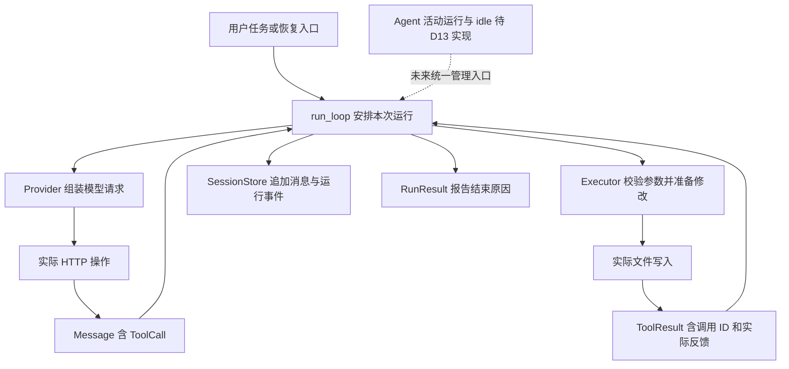

# Mini-Pi 学习对齐与 D12 整体复盘

日期：2026-10-15。源码基准：Pi `7f9e1198f2f7a8cf5ea18d5010ba081d4d60c333`。

当前应先恢复对整条行为链的理解，再继续手敲。消息配对、文件编辑、会话恢复等已学内容可以保留；D12 的取消设计需要跨模型、工具、实际资源和记录重新核对。学习单位改为一个可以解释和验证的完整行为，每个单位可以跨多个会话完成。

## 团队讨论形成的判断

三个 agent 分别审查目标对齐、理解路径和验收证据，再交换发现并交叉评审。共同判断是：局部代码和测试曾一起偏离原始行为要求，单纯继续增加异常分支不能修复这个问题。

| 关注点 | 当前问题 | 推进方式 |
| --- | --- | --- |
| 学习目标一致 | 同一个“取消”名称，在 Pi 表示信号到达实际执行层，在部分 Mini-Pi 路径只改变等待或返回状态 | 每个能力先写固定 Pi 行为、Python 对应职责和明确差异，再决定实现 |
| 学习者真正理解 | 按行插入让注意力集中在局部语法；决定收尾语义的代码却藏在助手准备的模块中 | 先用一个任务画出完整路径，再解释和手敲相关小段；辅助代码的关键取舍也要讲清 |
| 验收可信 | HTTP 测试主动释放阻塞线程后才允许返回，证明了最终收尾，未证明请求响应取消 | 从行为要求推出反例，观察真实文件、连接或 PID；多个 agent 同意不替代执行证据 |

讨论中的排期分歧是恢复入口预算是否留到 D13。最终安排在 D12 收尾：它属于已存在、已学过的入口，补齐后才能从直接运行和恢复运行两条路径说明控制生效。新的 Harness/CLI 配置仍留在 D13。

## 用一次编辑串起整体架构

任务是把临时文件中的 `value = 10` 改成 `value = 20`。先沿正常路径看谁作决定、谁操作文件、谁保存结果。

当前入口直接调用 `run_loop`；图中的 `Agent` 是待实现的运行所有者，不能把图误当成现有代码已经具备完整生命周期。正常执行时，模型只提出动作，执行器才会写文件；真实结果返回循环后进入下一轮模型请求，并按保存配置写入会话。

取消时要同时观察三个不同状态：

| 状态 | 需要知道什么 | 单看什么不够 |
| --- | --- | --- |
| 运行控制 | 运行中、取消已请求、清理中，还是已收尾 | 一个 `cancelled` 字段 |
| 实际操作 | 写入尚未开始、已经开始、已经结束，还是结果未知 | 调用方不再等待 |
| 会话记录 | 请求是否已存、结果是否已存、哪些调用缺结果 | 一条 `run_end` |

可用 `running → cancel_requested → cleaning → settled` 帮助解释时序；这是教学状态关系，不是声称 Pi 或当前 Mini-Pi 已有同名枚举。已收尾也不等于业务任务验收通过。

## 同一个编辑动作的三条轨迹

| 场景 | 应保留的行为 | 学习者要能作出的判断 |
| --- | --- | --- |
| 正常编辑 | 校验和准备完成，写入真实文件，返回配对结果，循环决定下一步 | 模型提出编辑与磁盘真正改变发生在不同位置 |
| 准备完成但尚未写入时观察到取消 | 不再启动新写入或后续调用，完成必要收尾 | 停止外层等待没有自动阻止线程里的下一句写入 |
| 写入已经开始时收到取消 | 等本次 I/O 结算，期间不能提前解除运行或写入占用；如实保留副作用结果 | 取消不能承诺回滚；允许等待在途写入收尾，但不能先报告空闲后继续改文件 |

固定 Pi 的 [edit.ts](https://github.com/earendil-works/pi/blob/7f9e1198f2f7a8cf5ea18d5010ba081d4d60c333/packages/coding-agent/src/core/tools/edit.ts#L163) 保持文件变更队列，在读完、写入前和写入后检查取消。其注释明确说明，过早响应 abort 并释放队列，会使尚未完成的文件操作继续运行。

本次真实临时文件反例已复现：在真实准备完成、实际写入前暂停线程，对循环发出取消后，循环已经返回 `cancelled` 并保存 `run_end`，文件仍为 `10`；放行线程后，原有 `write_bytes` 又把它改成 `20`。因此，当前实现存在返回之后仍发生写入的问题。

证据为 [编辑取消摘要](evidence/d12-edit-cancel-gap-7f57c031bd344aeab4b149baf934cace/summary.json)与同目录 `session.jsonl`、`fixture.txt`、`reproduce.py`。暂停门闩放大了真实竞争窗口，不能据此推断通常发生频率。核心源文件哈希前后相同，实验结束时门闩已释放，线程和任务均已收尾；实验没有请求模型服务。

`pending` 能说明这次编辑缺少结果记录，D11 门禁也能避免自动重放，但它不能替代执行层的收尾。这是 D08 编辑、D11 恢复与 D12 取消需要连起来理解的地方。

## Pi 行为到 Mini-Pi 的对照

| Pi 原始行为与定位 | Mini-Pi 对应设计 | 当前缺口或范围 | 验证方式 |
| --- | --- | --- | --- |
| [循环](https://github.com/earendil-works/pi/blob/7f9e1198f2f7a8cf5ea18d5010ba081d4d60c333/packages/agent/src/agent-loop.ts#L242)将工具结果送入下一模型请求 | [loop.py](../mini_pi/loop.py) 与统一消息对象 | 正常串行路径已有对应，保留既有证据 | 看下一请求的历史、调用 ID 和真实工具结果；移除结果追加后应失败 |
| [截断处理](https://github.com/earendil-works/pi/blob/7f9e1198f2f7a8cf5ea18d5010ba081d4d60c333/packages/agent/src/agent-loop.ts#L478)零执行并按调用 ID 返回错误反馈 | [qwen_client.py](../mini_pi/qwen_client.py) 拒绝异常结束原因 | 目前直接抛错；统一响应也未表达结束原因，反馈与继续链尚未补齐 | 截断参数即使可解析也不得执行；错误反馈进入下一请求，完整重试后才执行 |
| 模型错误或中止使循环有明确终态 | [provider.py](../mini_pi/provider.py)、[loop.py](../mini_pi/loop.py) | 普通模型异常缺少一致 `RunResult/run_end` | 模型失败不启动工具；历史、结束状态和记录一致 |
| [模型接口](https://github.com/earendil-works/pi/blob/7f9e1198f2f7a8cf5ea18d5010ba081d4d60c333/packages/ai/src/api/openai-completions.ts#L370)把取消传向 SDK 与 HTTP | [thread_worker.py](../mini_pi/thread_worker.py) 等同步工作自然结束 | D12-01 已复现；取消没有到达同步 HTTP 操作 | 本地受控慢服务观测客户端请求关闭、任务清理及无后续调用 |
| 文件编辑按 I/O 边界观察取消，并等待在途操作结算 | [edit_executor.py](../mini_pi/tools/edit_executor.py) 把整个编辑放入线程 | D12-02 已复现返回后晚写；读取和列目录的线程边界仍待核对 | 真实临时文件分别在写前、写中取消；返回后不再出现本次晚写 |
| [进程工具](https://github.com/earendil-works/pi/blob/7f9e1198f2f7a8cf5ea18d5010ba081d4d60c333/packages/coding-agent/src/core/tools/bash.ts#L99)取消时停止进程树并等待退出 | [managed_process.py](../mini_pi/tools/managed_process.py) | Windows 受控进程测试已有较强证据，保留 | 本次 PID 先存活后退出，输出保留，后续调用不启动；不只检查实现写出的标签 |
| [Agent](https://github.com/earendil-works/pi/blob/7f9e1198f2f7a8cf5ea18d5010ba081d4d60c333/packages/agent/src/agent.ts#L341)管理单一运行、取消和 idle；队列在特定边界交付 | 当前直接调用循环，尚无 `agent.py` | D04 阅读完成，Python 生命周期与队列待 D13 | 清理期间拒绝第二次 prompt；steer/followUp 在各自边界进入下一请求 |
| [SessionManager](https://github.com/earendil-works/pi/blob/7f9e1198f2f7a8cf5ea18d5010ba081d4d60c333/packages/coding-agent/src/core/session-manager.ts#L542)从完整记录投影模型上下文 | [session_store.py](../mini_pi/session_store.py) 与 D11 恢复门禁 | 线性记录已有；树分支、压缩延期。pending 门禁是 Mini-Pi 的明确设计 | 加载零执行、不重复保存旧历史；未知写入不重放；后续上下文变小也保留原记录 |
| 轮数及整次运行时限属于 Mini-Pi 新增工程要求 | [run_loop](../mini_pi/loop.py)已有配置，[resume_session](../mini_pi/session_resume.py)未透传 | D12-03 为源码确认的集成缺口 | 直接运行与 ready 恢复都受本次配置约束；非 ready 仍零调用、零追加 |

Pi 的协作式取消不保证任意操作在某个精确毫秒停止。HTTP、文件写入和进程的停止办法不同。真正要保留的是：取消到达可响应的执行层，不再启动后续操作，在途副作用完成收尾后才允许结束本次占用。Mini-Pi 的运行时间预算还需另行定义计时起点、清理时间和清理失败的报告方式。

## 验收怎样避免自证

先写“给定输入，应发生什么，什么现象算失败”，然后选择实现。现有 [HTTP 测试](../tests/test_qwen_cancel.py)要求测试主动释放阻塞线程才返回，它可以保留为线程收尾性质的测试，不能继续当作网络取消能力的证明。

| 场景 | 合格条件 | 能揭露问题的观察 |
| --- | --- | --- |
| 服务已经接收请求且保持不响应，此时取消 | 本地请求响应取消并关闭资源，停止后续解析、重试和工具调用 | 服务端连接状态与客户端资源任务；不能靠模拟函数主动返回放行 |
| 编辑准备后或写入中取消 | 按已定义写入边界停止新写或等在途写结束 | 实际文件内容、线程完成事件、记录的先后顺序；返回后仍变化即失败 |
| 固定测试进程正在运行时取消 | 本次受管进程树退出，再返回 | OS 进程句柄/PID 与日志，复用已有有效证据 |
| 从历史恢复并设置本次预算 | ready 路径和直接运行遵守同一配置；旧历史不预扣本次模型轮数 | 请求次数、记录前后内容；非 ready 不进入循环 |

模拟模型适合验证消息次序；实际资源边界需要独立外部观察。阻塞性反例应使用独立看门狗，不能只依赖可能被被测代码吞掉的同协程取消。修复后至少保留一条能区分旧错误实现与新实现的负例，不能只新增相似的成功用例。

源码核对、模拟验证和真实资源验证分别记录。进程证据不能外推到所有文件工具，线程收尾证据不能外推到 HTTP 取消；诊断脚本成功运行也不等于被诊断实现通过。

## 基于当前进度的学习方式

先完成 D12 的四个能力单元；它们是推进顺序，不要求在四次会话内完成。

| 单元 | 本次要看懂和完成什么 | 进入下一单元的依据 |
| --- | --- | --- |
| D12-R0 整体复盘 | 看本页图，走正常编辑、写前取消、写中取消；说明控制、操作和记录三种状态 | 学习者可看图、接受提示，解释谁执行、谁收到取消、何时可结束；不用背函数名 |
| D12-R1 行为契约与反例 | 明确 HTTP/文件/进程各自可承诺什么，观察现有缺口与测试失效原因 | 对当前反例能判断违背了哪条要求，再决定整改方案 |
| D12-R2 按契约整改 | 分别修 HTTP 和文件工具的取消连接，检查读取/列目录线程；每次回到同一场景复验 | 核心按分段手敲规则实现；辅助实现也展示影响行为的取舍；真实边界通过 |
| D12-R3 现有入口集成 | 恢复门禁通过后，新 run 也接入相同预算 | 直接入口与恢复入口通过；旧历史不预扣本次预算，非 ready 门禁保持有效 |

D13 按依赖拆成四个独立单元：A 模型结束原因、错误与截断反馈；B 单一活动运行与 idle；C steer/followUp 队列时点；D Harness/CLI 组装。A 先补齐循环的结束与反馈，B 管理它的生命周期，C 加入运行中的追加输入，最后 D 统一入口。D15 之后既有上下文、hook、评测和 reviewer 的顺序保留。

每个能力单元固定采用同一种节奏：助手先讲完整场景与 Pi 对应片段，展示 Mini-Pi 的位置、缺口和正常/失败轨迹；学习者在图和提示帮助下解释行为；理解一致后，助手给出完整小段代码和准确位置；执行后再回到原场景核对。需要跨多个文件的设计先画出联动，不把它切成互相孤立的行号任务。

学习记录分别填写“源码已定位、理解了哪些边界、Python 已实现什么、实际验证了什么”。当前新增的取消全链仍待共同复盘，不能由测试结果替学习者填写“已理解”。手敲、助手代写和真实执行继续分别注明。

下一次从 D12-R0 开始，只用编辑案例解释三件事：取消发生在写前和写中时分别还能保证什么；报告结束前哪些工作必须已收尾；如何用证据发现只有状态改变、实际操作仍在继续的实现。
