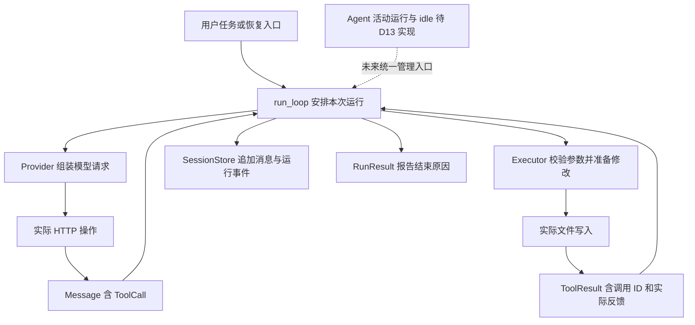

# Mini-Pi 学习对齐与 D12 整体复盘

日期：2026-10-15。源码基准：Pi `7f9e1198f2f7a8cf5ea18d5010ba081d4d60c333`。

当前 D12 的编辑与 HTTP 取消链、只读扫描及恢复入口预算已由学习者分段手敲接通，各步受控验证结果见下文和学习路线。恢复预算本步 22 项相关测试通过，D12 的技术验收与本次理解回顾已完成，2026-10-16 完成 D12，按最新要求先提交推送，再进入 D13-A；具体理解边界及证据见学习路线最新记录。继续保持跨模型、工具、实际资源和记录的整体核对。学习单位是一个可以解释和验证的完整行为，每个单位可以跨多个会话完成。

工具启动前处理取消（D12-04）已由学习者在统一等待入口加入暂停点，原 3 条失败反例已通过：取消已请求时不启动下一工具，已完成的工具结果保留。正常对照与相关回归共 49 项实际通过，无跳过，相关源文件测试前后哈希一致。助手按既有授权恢复编辑器类名拼写和缺失导入；旧内容回写来源未确定。证据见学习路线 D12-04；恢复预算和目录扫描现已分别通过本步验证，D12 保持进行中。

目录扫描取消（D12-05）已由学习者手敲 collect_names 并接入 execute，将扫描和逐项目录判断交给后台线程；原 4 条失败反例均通过，相关 19 项实际通过，无失败、错误或跳过。主流程可在扫描未结束时先返回取消/超时，晚到结果不进入历史；启动前取消零扫描、正常列表反馈均保持。路径解析仍同步，不能外推所有文件系统操作均可及时取消；恢复入口预算现已接入并通过本步验证，D12 保持进行中。

## 团队讨论形成的判断

三个 agent 分别审查目标对齐、理解路径和验收证据，再交换发现并交叉评审。共同判断是：局部代码和测试曾一起偏离原始行为要求，单纯继续增加异常分支不能修复这个问题。

| 关注点 | 当前问题 | 推进方式 |
| --- | --- | --- |
| 学习目标一致 | 同一个“取消”名称，在 Pi 表示信号到达实际执行层，在部分 Mini-Pi 路径只改变等待或返回状态 | 每个能力先写固定 Pi 行为、Python 对应职责和明确差异，再决定实现 |
| 学习者真正理解 | 按行插入让注意力集中在局部语法；决定收尾语义的代码却藏在助手准备的模块中 | 先用一个任务画出完整路径，再解释和手敲相关小段；辅助代码的关键取舍也要讲清 |
| 验收可信 | HTTP 测试主动释放阻塞线程后才允许返回，证明了最终收尾，未证明请求响应取消 | 从行为要求推出反例，观察真实文件、连接或 PID；多个 agent 同意不替代执行证据 |

讨论中的排期分歧是恢复入口预算是否留到 D13。最终安排在 D12 收尾：它属于已存在、已学过的入口，补齐后才能从直接运行和恢复运行两条路径说明控制生效。新的 Harness/CLI 配置仍留在 D13。

## 用一次编辑串起整体架构

任务是把临时文件中的 `value = 10` 改成 `value = 20`。先沿正常路径看谁作决定、谁操作文件、谁保存结果。

当前入口直接调用 `run_loop`；图中的 `Agent` 是待实现的运行所有者，不能把图误当成现有代码已经具备完整生命周期。正常执行时，模型只提出动作，执行器才会写文件；真实结果返回循环后进入下一轮模型请求，并按保存配置写入会话。

取消时要同时观察三个不同状态：

| 状态 | 需要知道什么 | 单看什么不够 |
| --- | --- | --- |
| 运行控制 | 运行中、取消已请求、清理中，还是已收尾 | 一个 `cancelled` 字段 |
| 实际操作 | 写入尚未开始、已经开始、已经结束，还是结果未知 | 调用方不再等待 |
| 会话记录 | 请求是否已存、结果是否已存、哪些调用缺结果 | 一条 `run_end` |

可用 `running → cancel_requested → cleaning → settled` 帮助解释时序；这是教学状态关系，不是声称 Pi 或当前 Mini-Pi 已有同名枚举。已收尾也不等于业务任务验收通过。

## 同一个编辑动作的三条轨迹

| 场景 | 应保留的行为 | 学习者要能作出的判断 |
| --- | --- | --- |
| 正常编辑 | 校验和准备完成，写入真实文件，返回配对结果，循环决定下一步 | 模型提出编辑与磁盘真正改变发生在不同位置 |
| 准备完成但尚未写入时观察到取消 | 不再启动新写入或后续调用，完成必要收尾 | 停止外层等待没有自动阻止线程里的下一句写入 |
| 写入已经开始时收到取消 | 等本次 I/O 结算，期间不能提前解除运行或写入占用；如实保留副作用结果 | 取消不能承诺回滚；允许等待在途写入收尾，但不能先报告空闲后继续改文件 |

固定 Pi 的 [edit.ts](https://github.com/earendil-works/pi/blob/7f9e1198f2f7a8cf5ea18d5010ba081d4d60c333/packages/coding-agent/src/core/tools/edit.ts#L163) 保持文件变更队列，在读完、写入前和写入后检查取消。其注释明确说明，过早响应 abort 并释放队列，会使尚未完成的文件操作继续运行。

整改前的真实临时文件反例已复现：在真实准备完成、实际写入前暂停线程，对循环发出取消后，循环已经返回 `cancelled` 并保存 `run_end`，文件仍为 `10`；放行线程后，原有 `write_bytes` 又把它改成 `20`。这是原实现返回之后仍发生写入的证据，保留为修复基线。

证据为 [编辑取消摘要](evidence/d12-edit-cancel-gap-7f57c031bd344aeab4b149baf934cace/summary.json)与同目录 `session.jsonl`、`fixture.txt`、`reproduce.py`。暂停门闩放大了真实竞争窗口，不能据此推断通常发生频率。核心源文件哈希前后相同，实验结束时门闩已释放，线程和任务均已收尾；实验没有请求模型服务。

`pending` 能说明这次编辑缺少结果记录，D11 门禁也能避免自动重放，但它不能替代执行层的收尾。这是 D08 编辑、D11 恢复与 D12 取消需要连起来理解的地方。

本轮修复：`execute` 创建共享 `FileCancellation`，将同一对象交给 `apply_edit`，并在等待取消时调用 `request_cancel`。`apply_edit` 在准备前检查、写入许可处检查、写后检查；等待层在传播取消前等本次工作结束。3 项整合测试与相关回归合计 54 项实际通过，证据为 [本轮测试记录](evidence/d12-edit-wiring-1329e47312594c438818427c1e546d7a/test-results.txt)。受控写前取消保留 10；受控分段写入中取消，完成本次写入后保留 20；超时同样通知并等收尾。写入获准是逻辑边界，不承诺获准后、实际系统调用前的取消一定能撤回写入；不代表已实现完整文件变更队列或硬截止时间。

## Pi 行为到 Mini-Pi 的对照

| Pi 原始行为与定位 | Mini-Pi 对应设计 | 当前缺口或范围 | 验证方式 |
| --- | --- | --- | --- |
| [循环](https://github.com/earendil-works/pi/blob/7f9e1198f2f7a8cf5ea18d5010ba081d4d60c333/packages/agent/src/agent-loop.ts#L242)将工具结果送入下一模型请求 | [loop.py](../mini_pi/loop.py) 与统一消息对象 | 正常串行路径已有对应，保留既有证据 | 看下一请求的历史、调用 ID 和真实工具结果；移除结果追加后应失败 |
| [截断处理](https://github.com/earendil-works/pi/blob/7f9e1198f2f7a8cf5ea18d5010ba081d4d60c333/packages/agent/src/agent-loop.ts#L478)零执行并按调用 ID 返回错误反馈 | [qwen_client.py](../mini_pi/qwen_client.py) 拒绝异常结束原因 | 目前直接抛错；统一响应也未表达结束原因，反馈与继续链尚未补齐 | 截断参数即使可解析也不得执行；错误反馈进入下一请求，完整重试后才执行 |
| 模型错误或中止使循环有明确终态 | [provider.py](../mini_pi/provider.py)、[loop.py](../mini_pi/loop.py) | 普通模型异常缺少一致 `RunResult/run_end` | 模型失败不启动工具；历史、结束状态和记录一致 |
| [模型接口](https://github.com/earendil-works/pi/blob/7f9e1198f2f7a8cf5ea18d5010ba081d4d60c333/packages/ai/src/api/openai-completions.ts#L370)把取消传向 SDK 与 HTTP | 磁盘 Qwen 已直接 await [async_http_transport.py](../mini_pi/async_http_transport.py)，取消请求并等待资源关闭 | D12-01 已通过磁盘代码的 40 项相关验证；初始化、系统 DNS 与硬实时停止尚不在已证范围 | 正常、等头/体取消、总时限均核对真实连接、客户端/响应、状态与记录；慢服务不放行也观察到断开 |
| 文件编辑按 I/O 边界观察取消，并等待在途操作结算 | [edit_executor.py](../mini_pi/tools/edit_executor.py) 用共享标记连接同步检查和异步通知，并等待工作收尾 | D12-02 已在受控边界修复；完整并发文件队列尚未实现 | 已实际验证写前、受控分段写中、超时及重复取消，检查文件、线程、消息与 run_end 时序 |
| [read](https://github.com/earendil-works/pi/blob/7f9e1198f2f7a8cf5ea18d5010ba081d4d60c333/packages/coding-agent/src/core/tools/read.ts#L111) 与 [ls](https://github.com/earendil-works/pi/blob/7f9e1198f2f7a8cf5ea18d5010ba081d4d60c333/packages/coding-agent/src/core/tools/ls.ts#L73) 可先结束外层等待，在途只读 I/O 可能继续 | 当前读取、列目录使用 to_thread | 已核对源码，不把只读后台工作与编辑晚写等同；更强只读收尾属于待明确的 Mini-Pi 工程要求 | 源码观察尚不是上游运行验收；若加强收尾，须独立验证资源结束及取消延迟，不能机械套用写入门禁 |
| [进程工具](https://github.com/earendil-works/pi/blob/7f9e1198f2f7a8cf5ea18d5010ba081d4d60c333/packages/coding-agent/src/core/tools/bash.ts#L99)取消时停止进程树并等待退出 | [managed_process.py](../mini_pi/tools/managed_process.py) | Windows 受控进程测试已有较强证据，保留 | 本次 PID 先存活后退出，输出保留，后续调用不启动；不只检查实现写出的标签 |
| [Agent](https://github.com/earendil-works/pi/blob/7f9e1198f2f7a8cf5ea18d5010ba081d4d60c333/packages/agent/src/agent.ts#L341)管理单一运行、取消和 idle；队列在特定边界交付 | 当前直接调用循环，尚无 `agent.py` | D04 阅读完成，Python 生命周期与队列待 D13 | 清理期间拒绝第二次 prompt；steer/followUp 在各自边界进入下一请求 |
| [SessionManager](https://github.com/earendil-works/pi/blob/7f9e1198f2f7a8cf5ea18d5010ba081d4d60c333/packages/coding-agent/src/core/session-manager.ts#L542)从完整记录投影模型上下文 | [session_store.py](../mini_pi/session_store.py) 与 D11 恢复门禁 | 线性记录已有；树分支、压缩延期。pending 门禁是 Mini-Pi 的明确设计 | 加载零执行、不重复保存旧历史；未知写入不重放；后续上下文变小也保留原记录 |
| 轮数及整次运行时限属于 Mini-Pi 新增工程要求 | [run_loop](../mini_pi/loop.py)执行预算，[resume_session](../mini_pi/session_resume.py)已透传 | D12-03 接线及相关 22 项测试通过，待整体复盘 | 直接运行与 ready 恢复都受本次配置约束；旧历史不扣本次额度，非 ready 仍零调用、零追加 |

Pi 的协作式取消不保证任意操作在某个精确毫秒停止。HTTP、文件写入、只读 I/O 和进程的边界不同：编辑保留文件变更占用直到在途操作结算，模型 HTTP 把信号传给 SDK，而只读工具可先拒绝外层 Promise，底层只读作业仍可能继续。不能把任何一种工具的行为直接外推到全部工具，也不能把观察到的原始行为当作没有缺陷的保证。Mini-Pi 的运行时间预算、是否加强只读收尾，还需明确为自己的工程要求并独立验收。

## 验收怎样避免自证

先写“给定输入，应发生什么，什么现象算失败”，然后选择实现。现有 [HTTP 测试](../tests/test_qwen_cancel.py)要求测试主动释放阻塞线程才返回，它可以保留为线程收尾性质的测试，不能继续当作网络取消能力的证明。

| 场景 | 合格条件 | 能揭露问题的观察 |
| --- | --- | --- |
| 服务已经接收请求且保持不响应，此时取消 | 本地请求响应取消并关闭资源，停止后续解析、重试和工具调用 | 服务端连接状态与客户端资源任务；不能靠模拟函数主动返回放行 |
| 编辑准备后或写入中取消 | 按已定义写入边界停止新写或等在途写结束 | 实际文件内容、线程完成事件、记录的先后顺序；返回后仍变化即失败 |
| 固定测试进程正在运行时取消 | 本次受管进程树退出，再返回 | OS 进程句柄/PID 与日志，复用已有有效证据 |
| 从历史恢复并设置本次预算 | ready 路径和直接运行遵守同一配置；旧历史不预扣本次模型轮数 | 请求次数、记录前后内容；非 ready 不进入循环 |

模拟模型适合验证消息次序；实际资源边界需要独立外部观察。阻塞性反例应使用独立看门狗，不能只依赖可能被被测代码吞掉的同协程取消。修复后至少保留一条能区分旧错误实现与新实现的负例，不能只新增相似的成功用例。

源码核对、模拟验证和真实资源验证分别记录。进程证据不能外推到所有文件工具，线程收尾证据不能外推到 HTTP 取消；诊断脚本成功运行也不等于被诊断实现通过。

## 基于当前进度的学习方式

先完成 D12 的四个能力单元；它们是推进顺序，不要求在四次会话内完成。

| 单元 | 本次要看懂和完成什么 | 进入下一单元的依据 |
| --- | --- | --- |
| D12-R0 整体复盘 | 看本页图，走正常编辑、写前取消、写中取消；说明控制、操作和记录三种状态 | 学习者可看图、接受提示，解释谁执行、谁收到取消、何时可结束；不用背函数名 |
| D12-R1 行为契约与反例 | 明确 HTTP/文件/进程各自可承诺什么，观察现有缺口与测试失效原因 | 对当前反例能判断违背了哪条要求，再决定整改方案 |
| D12-R2 按契约整改 | 编辑链已通过受控验证；接着修 HTTP 传输取消；只读取消与新增收尾要求单独辨明 | 核心按分段手敲规则实现；辅助实现也展示影响行为的取舍；真实边界通过 |
| D12-R3 现有入口集成 | 恢复门禁通过后，新 run 也接入相同预算 | 直接入口与恢复入口通过；旧历史不预扣本次预算，非 ready 门禁保持有效 |

D13 按依赖拆成四个独立单元：A 模型结束原因、错误与截断反馈；B 单一活动运行与 idle；C steer/followUp 队列时点；D Harness/CLI 组装。A 先补齐循环的结束与反馈，B 管理它的生命周期，C 加入运行中的追加输入，最后 D 统一入口。D15 之后既有上下文、hook、评测和 reviewer 的顺序保留。

每个能力单元固定采用同一种节奏：助手先讲完整场景与 Pi 对应片段，展示 Mini-Pi 的位置、缺口和正常/失败轨迹；学习者在图和提示帮助下解释行为；理解一致后，助手给出完整小段代码和准确位置；执行后再回到原场景核对。需要跨多个文件的设计先画出联动，不把它切成互相孤立的行号任务。

学习记录分别填写“源码已定位、理解了哪些边界、Python 已实现什么、实际验证了什么”。当前新增的取消全链仍待共同复盘，不能由测试结果替学习者填写“已理解”。手敲、助手代写和真实执行继续分别注明。

HTTP `_send` 已完成手敲切换；名称拼写按授权修正后，磁盘代码的 40 项相关验证通过，详见 [HTTP 磁盘验收](evidence/d12-http-wiring-recheck-d9ccb07c1b4f48f4a6d051172a340698/verification.json)。这次结果已替代准备阶段的内存候选验证作为实现证据。线程“本次工作完成”与销毁线程不同，取消本机请求也不保证远端停止生成；库初始化和系统解析等同步阶段不在硬实时保证内。用户已确认 apply_edit 检查点以及外层总时限触发取消、HTTP 函数执行取消与收尾的作用；后续仍按必要的新机制解释，不由通过的测试推定全面理解。后续只读扫描与恢复预算结果见学习路线最新记录，D12 保持进行中。

恢复入口预算（D12-03）最新验收：学习者已将两个参数传给 run_loop，恢复预算和既有两入口相关 22 项测试全部通过，无跳过。旧历史不预扣本次额度，模型与工具共用 deadline，非 ready 零执行、零追加；D12 仍待整体验收与理解复盘。证据见学习路线。

## D12 整体验收最新结论（2026-10-15）

未通过，暂不进入 D13。原有测试在当前磁盘执行 198 项，196 通过、2 条符号链接用例因 Windows 权限跳过；另补“结束前已请求取消”2 条反例均失败。最终回答结束路径写 finished、最后工具完成且预算耗尽路径写 budget_exhausted，但调用方实际收到取消异常，JSONL 与调用方状态不一致。新增 D12-06；不以已有分步通过宣称整个取消链已完成，也不把该缺陷移到下一阶段。

本轮仅新增辅助测试和维护记录，未改核心。下一单元先解释何时确认运行结束、如何处理此前已请求的取消并保留已完成结果，再分段手敲；目标是统一行为，不能在每个分支各贴一块局部补丁。完整日志与实际观察见学习路线的本次整体验收记录和 `evidence/d12-overall-audit-8fff954edd8f42c1b3475e6656b3930a/`。

D12-06 最新进展（2026-10-16）：用户授权后，助手补齐剩余模型超时、模型取消与工具超时三处接线；当前六条结束路径均调用 finish_run。73 项相关回归全部通过，无失败、错误或跳过，核心文件测试前后哈希一致。此前结束前取消的两条失败反例现均通过，D12 仍待最终整体复核与理解回顾，未提交或推送；证据见学习路线最新记录。

D12 最终技术复核（2026-10-16）：完整测试 207 项，205 通过、2 条旧 D08 符号链接用例因 Windows 权限跳过，无失败或错误；预算、总时限、取消三场景真实进程演示均通过，全部核心 Python 文件哈希保持一致。当前阶段技术验收通过既定受控范围，理解回顾待用户讨论，D12 仍进行中、未自动进入 D13；完整证据见学习路线最新记录。

D12 已完成归档（2026-10-16）：技术验收及用户本次理解回顾均已记录，当前进度 12/30，进入 D13-A。timeout 不能证明文件未改或没有重复修改；对于已经开始写入的本次编辑，它表示工作先收尾再报告超时。D13-A 先解决普通模型错误的统一结束状态，以及长度截断调用零执行、逐 ID 错误反馈和完整重试。本轮只更新记录与解释，未实现 D13 功能，未提交或推送。

最新推进顺序（2026-10-16）：D12 已完成；先核对范围并提交推送，再继续 D13-A。此前仅预告 D13 问题，尚无 D13 实现。D12 学习图和完整提示词见 README 的 D12 学习图。
